# Gasyu — Alur Sistem

Versi 0.14 · 27 Oktober 2026 · Pilot Kota Cimahi, terbuka untuk seluruh Indonesia
Perubahan 0.14: Gasyu terbuka untuk semua kota di Indonesia (migrasi 0027). Wilayah asal warga dan penyelenggara sekarang **kota/kabupaten + kecamatan** dari seluruh Indonesia, bukan kelurahan Cimahi; pilihan "Luar Cimahi" dihapus (bagian 3a). Admin membuka kota satu per satu di halaman Wilayah; peringkat dihitung per kota dan per kecamatan, hanya untuk kota yang sudah dibuka (bagian 17). Cakupan aktivitas berupa kota atau kecamatan di kota yang sudah dibuka (bagian 6). Badge Penjelajah Kelurahan menjadi Penjelajah Kecamatan.
Perubahan 0.13: pemilih kota di Jelajah (bagian 20b). Warga melihat aktivitas di kotanya sendiri secara otomatis dan bisa memilih kota lain atau Semua kota (migrasi 0026).
Perubahan 0.12 (tinjauan keamanan, migrasi 0025): anggota tim tidak bisa meninjau atau menandai misinya sendiri, dan misi manual hanya untuk peserta yang sudah check-in (bagian 9b); kode misi minimal 6 karakter dan tebakan massal dari banyak akun ditandai (bagian 9c dan 19); poin dari check-in di luar radius ditahan sampai admin memutuskan (bagian 14c); admin bisa membatalkan misi yang sudah disetujui (bagian 19); refund voucher oleh merchant hanya untuk reward nonaktif dan kode voucher aktif hanya dilihat pemiliknya (bagian 16); kode undangan grup maks. 5 percobaan salah per 15 menit (bagian 11); partner yang keluar atau dibekukan tidak bisa lagi menampilkan QR, dan misinya ikut nonaktif (bagian 10); identitas pemenang Event Global hanya untuk pemenang dan admin.
Perubahan 0.11: database Event Global sudah dibangun (bagian 22); halaman admin sudah ada: jangkauan dan mode lokasi di formulir event Gasyu, misi berskor, Kelola hadiah, serta Peringkat & pemenang (bagian 20); halaman warga juga sudah ada: tab Event Global di Jelajah, skor dan hadiah di halaman event, papan peringkat `/aktivitas/[id]/peringkat`, hasil scan berupa skor, kartu Beranda, halaman Hadiah `/hadiah` dengan klaim, dan notifikasi hadiah (bagian 22e); kartu "Hadiah yang disponsori" di dashboard merchant dan komunitas (bagian 20a) hanya menampilkan peringkat dan status, tanpa identitas pemenang; warga luar Cimahi memilih kota/kabupaten asal dari daftar (bagian 3); di Event Global peserta tidak pernah berstatus selesai, jadi tetap bisa menambah skor lewat misi sampai acara berakhir (bagian 22c).
Perubahan 0.10: keluar dari semua perangkat (bagian 3); hadiah non-poin ditulis di deskripsi (bagian 6); ganti bukti bayar dan tombol chat panitia di WhatsApp (bagian 8); voucher berlaku di outlet tertentu (bagian 16); deteksi otomatis peninjau yang menyetujui terlalu cepat (bagian 19). Semua sudah dibangun (voucher per outlet dan peninjau cepat di migrasi 0020).
Perubahan 0.9: Event Global, yaitu event buatan admin yang terbuka untuk pengguna dari kota mana pun, dengan misi, skor, papan peringkat, dan hadiah khusus event yang terpisah dari XP, level, dan poin (bagian 22); hak akses (bagian 2), validasi (bagian 6), penetapan pemenang saat settled (bagian 7), syarat selesai event online (bagian 9d), cron `process_prizes` (bagian 18), anti-curang (bagian 19), dashboard dan peta halaman (bagian 20).
Perubahan 0.8: pengingat voucher dan poin hampir kedaluwarsa (bagian 18); master misi (bagian 9f); saran warga untuk merchant dan komunitas (bagian 21); ubah profil, ganti kelurahan, hapus akun, riwayat, bantuan (bagian 3); serah terima peran pemilik/ketua (bagian 5).
Perubahan 0.7: aturan domisili peserta, yaitu hanya warga wilayah event atau semua warga (bagian 6).
Perubahan 0.6: pembuat event mengatur kapan tiap misi tampil ke warga (bagian 9e).
Perubahan 0.5: admin bisa membuat event atas nama Gasyu dan langsung menambahkan merchant/komunitas yang terlibat (bagian 10c).
Perubahan 0.4: empat entitas dengan dashboard masing-masing (bagian 1 dan 20); "bisnis/brand" diganti Merchant/UMKM; istilah "organizer" tidak dipakai lagi di aplikasi.
Perubahan 0.3: aktivitas berbayar dengan pembayaran di luar aplikasi (bagian 8) dan misi di dalam event/challenge (bagian 9).
Perubahan 0.2: keanggotaan komunitas (bagian 12), kebijakan bergabung, dan aktivitas khusus member.
Dokumen pendamping: `DESAIN-DATABASE.md` (struktur data), `CLAUDE.md` (aturan kerja), PRD.

Semua diagram ditulis dalam Mermaid, jadi bisa dibaca langsung di GitHub, VS Code (ekstensi Mermaid), atau [mermaid.live](https://mermaid.live). Nama tabel dan fungsi di diagram sama persis dengan `DESAIN-DATABASE.md`.

## Daftar isi

1. Entitas dan peta sistem
2. Peran dan hak akses
3. Login dan onboarding warga (3a. Wilayah se-Indonesia)
4. Registrasi merchant/UMKM dan komunitas
5. Undangan anggota tim
6. Membuat aktivitas
7. Siklus hidup aktivitas
8. Event berbayar
9. Misi
10. Kolaborasi: undangan, open call, dan event buatan admin
11. Grup warga
12. Keanggotaan komunitas
13. Join aktivitas (pribadi dan grup)
14. Check-in QR dan pemberian XP/poin
15. Progress dan penyelesaian challenge
16. Tukar poin dan pakai voucher
17. Leaderboard, level, dan badge
18. Proses terjadwal (cron)
19. Moderasi admin dan anti-curang
20. Dashboard dan peta halaman
21. Saran warga
22. Event Global

---

## 1. Entitas dan peta sistem

Gasyu punya empat entitas. Masing-masing punya dashboard sendiri.

| # | Entitas | Siapa | Aplikasi | Dashboard |
| --- | --- | --- | --- | --- |
| 1 | **Admin** | Pemilik aplikasi (tim Gasyu) | Web, desktop-first, di `admin.gasyu.id` | Verifikasi merchant dan komunitas, review aktivitas, moderasi, metrik kota, pengaturan aturan main |
| 2 | **Merchant/UMKM** | UMKM atau usaha apa pun yang mendaftar (kedai, kafe, toko, jasa, bengkel, dll.); dikelola pemilik, staf, kasir | Mobile PWA | Aktivitas, peserta dan pembayaran, misi, QR, kasir voucher, reward dan budget poin, outlet, kolaborasi, tim |
| 3 | **Komunitas** | Komunitas apa pun yang mendaftar: olahraga (lari, sepeda, futsal, dll.), musik, seni, hobi, sosial, lingkungan, dan lainnya; dikelola ketua dan pengurus | Mobile PWA | Aktivitas, peserta dan pembayaran, misi, QR, member, kolaborasi, tim |
| 4 | **Warga** | Semua pengguna terdaftar, dari kota mana pun di Indonesia | Mobile PWA | Level dan XP, aktivitas yang diikuti dan misinya, poin dan voucher, peringkat, grup, komunitas saya, Event Global dan hadiahnya |

**Tidak ada batasan jenis.** Merchant mencakup semua jenis usaha, dari UMKM rumahan sampai bisnis dengan beberapa cabang. Komunitas mencakup semua jenis komunitas warga. Kategori (lihat bagian 4) hanya dipakai untuk penyaringan dan pencarian, bukan syarat pendaftaran; jika kategorinya tidak ada, pilih "Lainnya".

**Satu akun, beberapa mode.** Setiap orang mendaftar sebagai warga. Akun yang sama bisa menjadi pemilik/staf merchant atau ketua/pengurus komunitas (bahkan beberapa sekaligus). Di PWA, warga melihat dashboard warga secara default dan bisa berpindah ke dashboard merchant atau komunitas lewat pemilih mode di profil. Admin tidak memakai PWA; dashboard admin hanya bisa dibuka dari web oleh akun `is_admin`.

**Istilah.** Di aplikasi dan dokumen ini, merchant dan komunitas disebut bersama sebagai **penyelenggara** bila aturannya berlaku untuk keduanya. Di database keduanya tetap satu tabel induk `organizers` (tipe `merchant` atau `community`), sehingga aktivitas, kolaborasi, checkpoint, dan misi bisa menunjuk ke keduanya dengan satu relasi. Kata "organizer" tidak tampil di aplikasi.

Gambaran besar: siapa memakai apa, dan di mana logika penting dijalankan. Semua aturan XP, poin, dan hak akses dijalankan di server (fungsi database dan server action), tidak di HP pengguna.

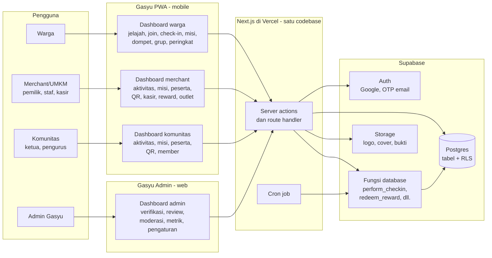

**Prinsip arsitektur**

| Prinsip | Penerapan |
| --- | --- |
| Akses dijaga database | Setiap tabel memakai Row Level Security; UI hanya menyembunyikan, database yang menolak |
| Uang permainan hanya ditulis server | XP, poin, dan skor Event Global hanya masuk lewat fungsi `security definer`, client tidak punya izin `insert` ke ledger |
| Saldo dari ledger | Saldo XP, poin, dan skor event dihitung dari `xp_ledger`, `point_ledger`, dan `activity_score_ledger`, tidak ada kolom saldo |
| Satu akun banyak peran | Akun warga bisa menjadi pemilik merchant dan pengurus komunitas sekaligus |
| Zona waktu tunggal | Semua batas harian dan bulanan memakai `Asia/Jakarta` |

---

## 2. Peran dan hak akses

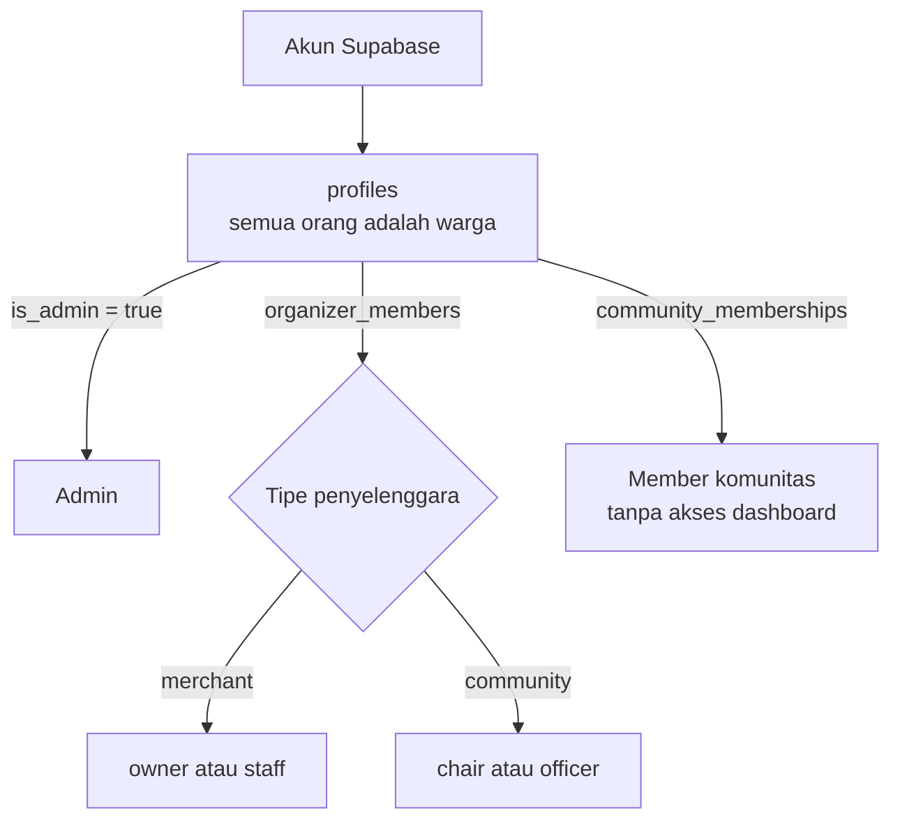

Ada dua jenis keterikatan warga dengan komunitas, dan keduanya terpisah:

- **Tim komunitas** (`organizer_members`, peran chair/officer): mengelola komunitas di dashboard komunitas.
- **Member komunitas** (`community_memberships`): warga biasa yang tergabung di komunitas. Member tidak punya akses dashboard; mereka mendapat akses ke aktivitas khusus member dan notifikasi aktivitas baru. Ketua dan pengurus otomatis tercatat sebagai member aktif.

| Kemampuan | Warga | Staf merchant | Pemilik merchant | Pengurus komunitas | Ketua komunitas | Admin |
| --- | --- | --- | --- | --- | --- | --- |
| Join aktivitas, check-in, tukar poin | Ya | Ya | Ya | Ya | Ya | Ya |
| Ikut Event Global dari kota mana pun dan klaim hadiahnya | Ya | Ya | Ya | Ya | Ya | - |
| Buat dan kelola grup | Ya | Ya | Ya | Ya | Ya | Ya |
| Gabung/keluar sebagai member komunitas | Ya | Ya | Ya | Ya | Ya | Ya |
| Ikut aktivitas khusus member | Member aktif | Member aktif | Member aktif | Ya | Ya | - |
| Kelola member (setujui, tolak, keluarkan) | - | - | - | Ya | Ya | - |
| Atur kebijakan bergabung komunitas | - | - | - | - | Ya | - |
| Buat dan edit draft aktivitas | - | Ya | Ya | Ya | Ya | - |
| Ajukan aktivitas ke admin | - | - | Ya | - | Ya | - |
| Tampilkan QR check-in dan QR misi | - | Ya | Ya | Ya | Ya | - |
| Kelola misi (tambah, ubah, nonaktifkan) | - | Ya | Ya | Ya | Ya | - |
| Pakai template master misi saat menambah misi | - | Ya | Ya | Ya | Ya | Ya |
| Kelola master misi (template) | - | - | - | - | - | Ya |
| Tinjau bukti foto misi, tandai misi manual | - | Ya | Ya | Ya | Ya | - |
| Atur harga aktivitas berbayar | - | - | Ya | - | Ya | - |
| Konfirmasi pembayaran peserta | - | Ya | Ya | Ya | Ya | - |
| Atur budget poin dan voucher | - | - | Ya | - | - | - |
| Mode kasir (pakai voucher) | - | Ya | Ya | - | - | - |
| Undang/terima partner, buka open call | - | - | Ya | - | Ya | - |
| Undang anggota tim | - | - | Ya | - | Ya | - |
| Kirim saran ke merchant/komunitas lain | Ya | Ya | Ya | Ya | Ya | Ya |
| Baca, balas, dan ubah status saran yang masuk | - | Ya | Ya | Ya | Ya | Baca saja |
| Buka dashboard merchant/komunitas miliknya | - | Ya | Ya | Ya | Ya | - |
| Buka dashboard admin (web) | - | - | - | - | - | Ya |
| Verifikasi penyelenggara, review aktivitas, tinjau flag | - | - | - | - | - | Ya |
| Buat event/challenge atas nama Gasyu | - | - | - | - | - | Ya |
| Buat Event Global, atur hadiahnya, tandai hadiah terkirim atau hangus | - | - | - | - | - | Ya |
| Tambahkan merchant/komunitas langsung ke event Gasyu | - | - | - | - | - | Ya |
| Keluar dari event Gasyu sebelum berjalan | - | - | Ya | - | Ya | - |
| Lihat status hadiah Event Global yang ia sponsori (tanpa alamat pemenang) | - | - | Ya | - | Ya | - |

Untuk event Gasyu, admin memegang semua kemampuan tim penyelenggara host: membuat draft, mengatur harga, mengelola misi, menampilkan QR checkpoint Gasyu, mengonfirmasi pembayaran, dan meninjau bukti misi. Selama pilot, **hanya admin yang bisa membuat Event Global**; hak akses dicek lewat peran admin di fungsi database, sehingga nanti bisa dibuka untuk merchant atau komunitas terverifikasi tanpa mengubah alur (bagian 22).

---

## 3. Login dan onboarding warga

Tiga cara masuk: Google, **email + kata sandi** (cara utama untuk email), dan **kode 6 angka lewat email** (cadangan, tanpa kata sandi). Tautan undangan (grup, tim, aktivitas) disimpan sebagai `next` supaya pengguna kembali ke tujuan setelah onboarding.

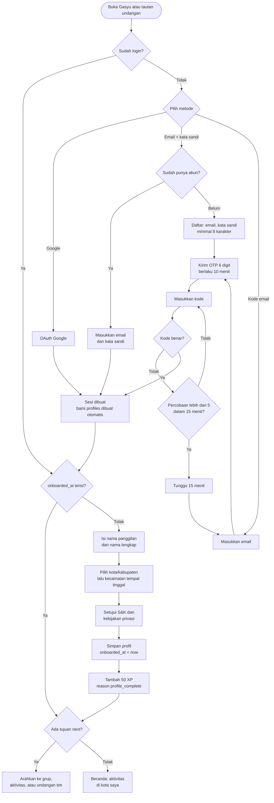

**Aturan tambahan**

- Daftar dengan kata sandi (`/masuk/daftar`) selalu mengonfirmasi email dengan kode 6 angka sebelum akun aktif. Email yang sudah terdaftar ditolak dengan ajakan masuk atau memakai Lupa kata sandi. Akun yang belum dikonfirmasi dan mencoba masuk diarahkan untuk mengirim kode konfirmasi.
- Lupa kata sandi (`/masuk/lupa`): warga masuk dengan kode email (tanpa membuat akun baru), lalu langsung dibawa ke `/profil/kata-sandi` untuk membuat kata sandi baru. Halaman yang sama dipakai untuk membuat kata sandi bagi akun lama (Google atau kode email) dan mengganti kata sandi.
- Kata sandi disimpan dan dicek oleh Supabase Auth, tidak di tabel Gasyu. Minimal 8 karakter; kata sandi yang pernah bocor ditolak (Leaked password protection). Batas percobaan masuk mengikuti rate limit Supabase Auth.
- Middleware Next.js mengalihkan semua halaman ke onboarding selama `onboarded_at` kosong.
- Nama panggilan harus unik (case-insensitive), 3–20 karakter.
- Warga mengubah nama panggilan dan nama lengkap di `/profil/ubah` (`update_my_profile`).
- Foto profil juga di `/profil/ubah`: foto dipotong persegi dan diperkecil ke 512 px di HP sebelum diunggah ke bucket publik `avatars` (folder milik warga sendiri), lalu disimpan lewat `set_my_avatar`. Foto lama dihapus otomatis. Foto tampil di profil dan beranda warga sendiri, dan di daftar tim penyelenggara tempat ia bergabung. Saat akun dihapus, foto ikut dihapus.
- Kota dan kecamatan tempat tinggal **wajib** diisi saat onboarding (`complete_onboarding`), dari 514 kota/kabupaten dan 7.285 kecamatan se-Indonesia. Aturan wilayah ada di bagian 3a.
- Kota dan kecamatan bisa diganti (termasuk pindah kota) maksimal sekali per `profile.district_change_days` hari, awal 90 (`change_home_district`, `home_district_changed_at`). Penggantian pertama setelah onboarding langsung dihitung. Akun lama yang belum punya kecamatan boleh langsung mengisinya; Beranda, Profil, dan Peringkat mengingatkan mereka.
- Tidak ada batas usia dan tidak ada persetujuan orang tua selama pilot.
- Sesi tetap aktif di HP sampai warga keluar. Selain tombol "Keluar dari akun" (perangkat ini saja), halaman profil punya **Keluar dari semua perangkat** (Supabase Auth `signOut({ scope: 'global' })`), untuk warga yang HP-nya hilang atau pernah masuk di HP orang lain.
- Hapus akun (`/profil/hapus`, `delete_my_account`, warga mengetik HAPUS): data pribadi di `profiles` dikosongkan dan `deleted_at` diisi; baris ledger tetap ada demi audit, tetapi tidak lagi terhubung ke identitas yang bisa dikenali. Pendaftaran yang belum berjalan dibatalkan, warga keluar dari grup, komunitas, dan tim, notifikasinya dihapus. Ditolak jika ia satu-satunya pemilik/ketua, masih punya pembayaran lunas/menunggu di aktivitas yang belum selesai, atau akun admin. Sesi akun terhapus selalu dikeluarkan dan email yang sama tidak bisa dipakai masuk lagi.
- Riwayat XP dan poin ada di `/riwayat` (dibaca dari `xp_ledger` dan `point_ledger`). Halaman `/bantuan` berisi pertanyaan umum dan kontak tim dari `app_settings` (`support.whatsapp`, `support.email`).

### 3a. Wilayah se-Indonesia

Gasyu dimulai di Kota Cimahi, tetapi warga, merchant, dan komunitas dari kota mana pun boleh mendaftar.

| Hal | Aturan |
| --- | --- |
| Data wilayah | 514 kota/kabupaten dan 7.285 kecamatan (kode Kemendagri) di `regions`. Wilayah asal selalu **kecamatan**; kotanya diambil dari induk kecamatan. Kelurahan Cimahi lama tetap tersimpan untuk riwayat, tetapi tidak bisa dipilih lagi |
| Pemilih wilayah | Ketik nama kota (mis. "bandung" menemukan Kota Bandung dan Kabupaten Bandung), lalu pilih kecamatan. Dipakai di onboarding, Ubah profil, daftar merchant/komunitas, tambah outlet, dan profil komunitas |
| Kota dibuka | Admin membuka kota satu per satu di halaman **Wilayah** (`set_city_active`, dicatat di `admin_actions`). Awalnya hanya Kota Cimahi yang dibuka. Halaman Wilayah menampilkan jumlah warga dan penyelenggara per kota (`v_admin_city_stats`) supaya admin tahu kota mana yang sudah ada peminatnya |
| Kota yang belum dibuka | Warga tetap bisa mendaftar, ikut aktivitas, dan mendapat XP dan poin. Kota itu belum tampil di pemilih kota Jelajah, belum bisa dipakai sebagai cakupan aktivitas, dan peringkat kota/kecamatannya belum tampil. XP tetap tercatat per kecamatan (snapshot), jadi langsung terhitung begitu kota dibuka |
| Penyelenggara di kota yang belum dibuka | Boleh mendaftar dan diverifikasi. Di halaman Verifikasi admin melihat peringatan "kota belum dibuka" dan tombol untuk membukanya |
| Akun lama | Warga lama "Luar Cimahi" tidak punya kecamatan (`home_district_id` kosong). Mereka tetap dapat XP dan poin, tetapi tidak masuk peringkat dan tidak lolos aktivitas `residents_only` sampai mengisi kota dan kecamatan |
| Pengecekan | Kolom kecamatan warga, penyelenggara, outlet, dan area komunitas hanya bisa berisi kecamatan (`is_valid_district`, trigger `check_district_ref`); cakupan aktivitas hanya wilayah di kota yang sudah dibuka (`is_open_region`) |

---

## 4. Registrasi merchant/UMKM dan komunitas

Dua formulir berbeda, satu alur verifikasi.

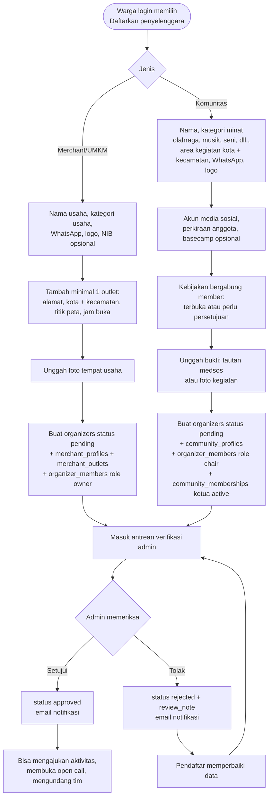

Selama `pending`, penyelenggara sudah bisa mengisi profil dan membuat draft aktivitas, tetapi tombol "Ajukan" dan "Buka open call" terkunci (dicek di fungsi database, bukan hanya UI).

---

## 5. Undangan anggota tim

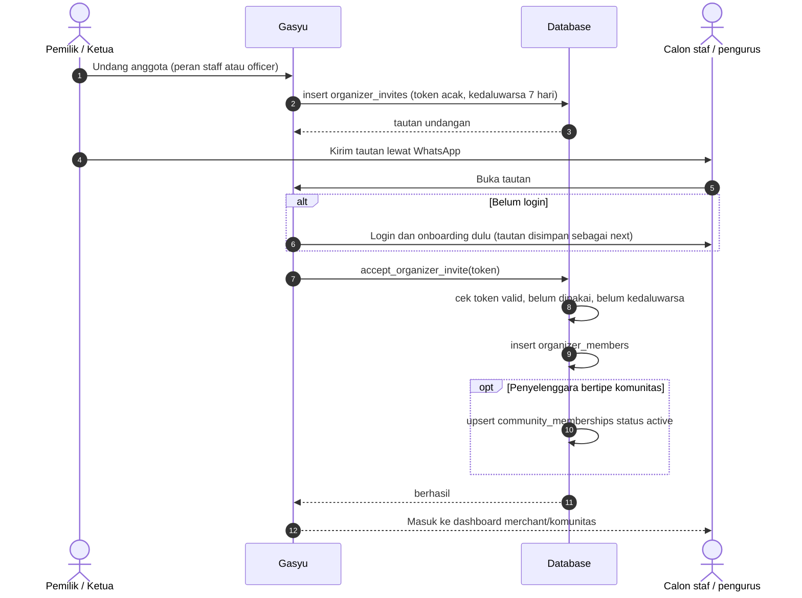

Peran yang boleh diundang mengikuti tipe: merchant hanya `staff`, komunitas hanya `officer`. Pemilik/ketua bisa mencabut anggota kapan saja; minimal harus tersisa satu pemilik/ketua. Di halaman Tim, pemilik/ketua bisa menjadikan anggota lain pemilik/ketua, lalu turun menjadi staf/pengurus (`set_team_role`); begitulah peran pemilik/ketua diserahkan. Anggota yang perannya diubah mendapat notifikasi. Pengurus komunitas yang dicabut dari tim tetap menjadi member biasa, kecuali ketua juga mengeluarkannya dari keanggotaan.

Undangan tim berbeda dengan keanggotaan komunitas (bagian 12): undangan tim memberi akses dashboard, sedangkan keanggotaan hanya menghubungkan warga dengan komunitasnya.

---

## 6. Membuat aktivitas

```mermaid
flowchart TD
    S([Penyelenggara: Buat aktivitas]) --> T{Tipe}
    T -->|Event| E1[Tanggal dan jam,<br/>lokasi tunggal]
    T -->|Challenge| C1[Rentang tanggal,<br/>target: jumlah check-in,<br/>checkpoint berbeda, atau misi]
    E1 --> G
    C1 --> C2{Cakupan target}
    C2 -->|Individu| G
    C2 -->|Grup| C3[Target kolektif grup] --> G
    G[Tujuan campaign:<br/>awareness, visit, sales, membership] --> D[Judul, deskripsi, cover,<br/>syarat usia jika ada - teks bebas]
    D --> W[Wilayah cakupan,<br/>kuota, tingkat kesulitan]
    W --> J[Mode pendaftaran:<br/>individu, grup, keduanya<br/>+ ukuran grup min-maks]
    J --> AU{Host komunitas?}
    AU -- Ya --> AU2[Audiens: publik<br/>atau khusus member]
    AU -- Tidak, merchant --> AU3[Audiens: publik]
    AU2 --> RES
    AU3 --> RES
    RES{Siapa boleh ikut?}
    RES -->|Semua warga| PAY
    RES -->|Hanya warga wilayah event| RES2[Sesuai wilayah cakupan:<br/>kota atau kecamatan] --> PAY
    PAY{Berbayar?}
    PAY -- Gratis --> CP
    PAY -- Berbayar --> PAY2[Harga per orang,<br/>instruksi bayar: rekening/QRIS/kontak,<br/>batas waktu bayar] --> CP
    CP[Checkpoint: pilih outlet<br/>atau titik peta + radius]
    CP --> MS[Misi opsional:<br/>judul, cara verifikasi, XP, wajib atau bonus]
    MS --> RW{Host merchant?}
    RW -- Ya --> PB[Poin per penyelesaian<br/>+ budget poin]
    RW -- Tidak, komunitas --> NP[Tanpa poin sendiri<br/>poin hanya dari sponsor merchant]
    PB --> COL
    NP --> COL
    COL{Kolaborasi?}
    COL -->|Tidak| SV[Simpan draft]
    COL -->|Undang partner| INV[Pilih penyelenggara + peran<br/>+ kontribusi]
    COL -->|Buka open call| OC[Isi kebutuhan, manfaat,<br/>tenggat]
    INV --> SV
    OC --> SV
    SV --> SUB{Ajukan?}
    SUB -->|Nanti| END1([Tetap draft])
    SUB -->|Ya| CHK{Validasi submit_activity}
    CHK -->|Gagal| ERR[Tampilkan kekurangan] --> SV
    CHK -->|Ada partner belum menjawab| AW[status awaiting_partners]
    CHK -->|Lengkap| RV[status in_review]
```

**Validasi `submit_activity`**

- Penyelenggara host berstatus `approved`, dan pemanggil adalah `owner` atau `chair`. Untuk event Gasyu (host `platform`), pemanggil harus admin, dan aktivitas langsung `published` tanpa antrean review (bagian 10c).
- Waktu mulai di masa depan; waktu selesai setelah mulai.
- Minimal satu checkpoint aktif.
- Jika `points_per_completion > 0`, total budget poin dari partner merchant minimal sama dengan `points_per_completion`.
- Challenge wajib punya `challenge_targets`.
- `group_min` dan `group_max` di antara 2 dan 10 jika mode grup dipakai.
- `audience = members_only` hanya boleh jika host bertipe komunitas.
- `residency_rule = residents_only` wajib punya wilayah cakupan (`scope_region_id`).
- Jika `is_paid = true`: `price_idr` minimal Rp1.000 dan `payment_instructions` terisi.
- Misi: setiap misi aktif punya cara verifikasi yang lengkap (misi QR punya checkpoint, misi kode punya kode rahasia); XP tiap misi 10–100 dan total XP misi per aktivitas maksimal 500.
- Challenge dengan target berbasis misi wajib punya minimal satu misi aktif (dan minimal satu misi wajib untuk `required_missions`).
- Event Global (`reach = global`): aturan tambahan di bagian 22b, termasuk boleh tanpa checkpoint untuk mode `online`/`hybrid`, minimal satu misi aktif, dan minimal satu hadiah.
- Open call yang terhubung ke aktivitas otomatis ditutup.

**Aturan domisili peserta (`residency_rule`).** Penyelenggara memilih siapa yang boleh mendaftar:

| Pilihan | Yang boleh ikut | Contoh |
| --- | --- | --- |
| `open` (default) | Semua warga Gasyu, dari kota mana pun | Konser, festival kuliner, fun run terbuka |
| `residents_only` | Hanya warga yang kecamatan asalnya berada di dalam wilayah cakupan event. Jika cakupannya kota, berlaku untuk seluruh warga kota itu; jika kecamatan, hanya warga kecamatan itu | Lomba antarkecamatan, program kota untuk warga Cimahi, kerja bakti RW |

- Domisili dicek dari kecamatan asal di profil saat mendaftar. Data ini diisi sendiri oleh warga (bukan verifikasi KTP), tetapi hanya bisa diganti sekali per 90 hari, sehingga sulit dipakai untuk berpindah-pindah demi ikut event.
- Warga yang pindah kecamatan setelah terdaftar tetap boleh ikut sampai selesai.
- Wilayah cakupan hanya bisa dipilih dari kota yang sudah dibuka admin (bagian 3a): seluruh kota atau satu kecamatan. Aktivitas lama yang cakupannya kelurahan dipindah ke kecamatannya.
- Pendaftaran grup: setiap anggota yang dipilih harus memenuhi aturan domisili.
- Bisa digabung dengan aturan lain: misalnya event khusus member komunitas sekaligus khusus warga Cimahi; kedua syarat harus terpenuhi.
- Event tetap terlihat oleh semua warga dengan label "Khusus warga [wilayah]", supaya warga lain tahu event itu ada.

**Hadiah non-poin.** Merchant dan komunitas boleh menjanjikan hadiah di luar poin, misalnya merchandise, sertifikat, atau medali. Untuk aktivitas regional, hadiah ini cukup ditulis di deskripsi aktivitas dan diurus sendiri oleh penyelenggara; sistem tidak mencatat atau memeriksanya. Hadiah yang dicatat sistem hanya ada di Event Global (bagian 22d).

**Aktivitas khusus member.** Tetap tampil di beranda dan halaman komunitas (dengan label "Khusus member"), supaya warga lain tahu dan tertarik bergabung, tetapi tombol join hanya aktif untuk member aktif komunitas host. Aturan XP, poin, dan check-in sama dengan aktivitas publik.

---

## 7. Siklus hidup aktivitas

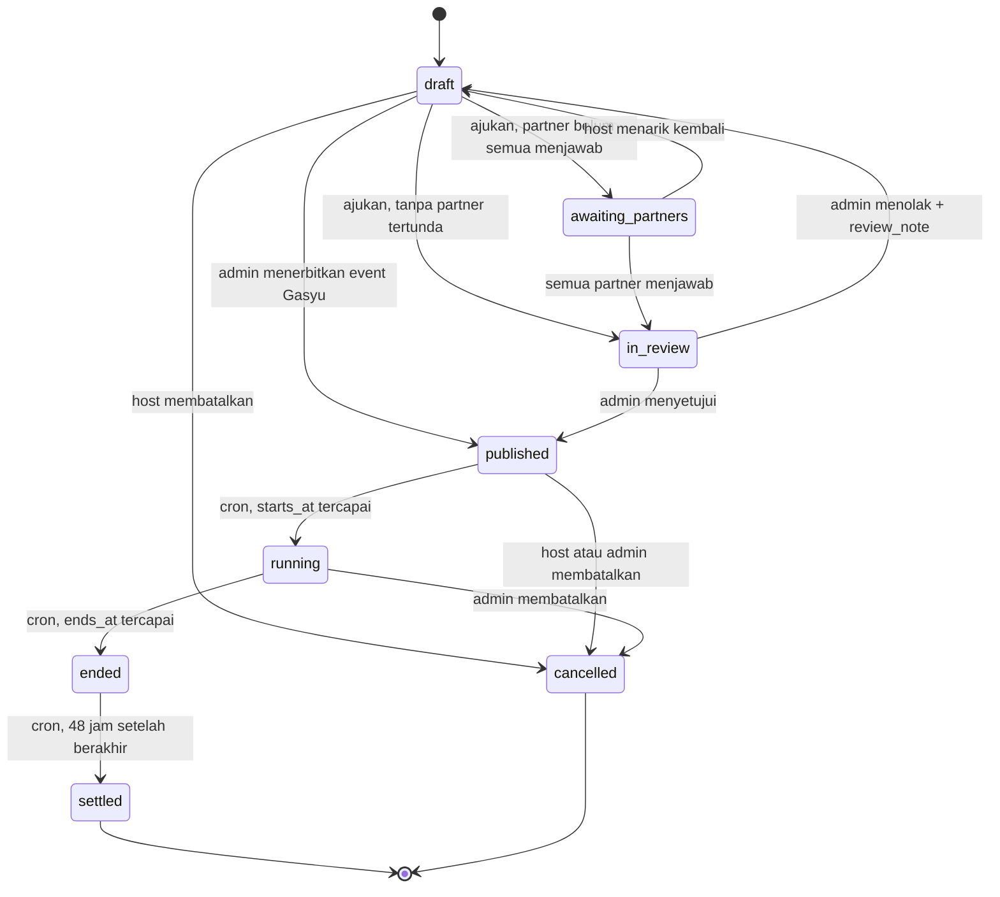

| Status | Bisa diedit | Kelola misi | Warga bisa join | Check-in dan misi |
| --- | --- | --- | --- | --- |
| draft | Semua | Semua | - | - |
| awaiting_partners | Hanya partner | Partner menambah misi di checkpoint miliknya | - | - |
| in_review | Tidak | Tidak | - | - |
| published | Hanya deskripsi dan cover | Tambah misi baru, nonaktifkan misi | Ya | - |
| running | Hanya deskripsi | Tambah misi baru, nonaktifkan misi | Ya, jika kuota masih ada | Ya |
| ended | Tidak | Tidak (tinjau bukti foto masih bisa) | - | Kirim bukti foto ditutup |
| settled | Tidak | Tidak | - | - |
| cancelled | Tidak | Tidak | - | - |

Harga dan status berbayar/gratis tidak bisa diubah setelah `published`, supaya peserta yang sudah mendaftar tidak dirugikan.

Masa 48 jam antara `ended` dan `settled` dipakai admin dan host untuk meninjau check-in yang ditandai dan bukti foto misi yang masih menunggu. Setelah `settled`, laporan akhir dikunci. Untuk Event Global, masa ini juga masa verifikasi peringkat: papan peringkat berlabel "Sementara", dan pemenang baru ditetapkan saat `settled` (bagian 22d). Event Global yang dibatalkan tidak menetapkan pemenang. Jangkauan (`reach`), mode lokasi, dan hadiah yang sudah diumumkan tidak bisa diubah setelah `published` (hadiah hanya bisa ditambah).

---

## 8. Event berbayar

Merchant dan komunitas sama-sama bisa membuat aktivitas berbayar (event maupun challenge). Selama pilot, **uang tidak lewat Gasyu**: warga membayar langsung ke penyelenggara (transfer bank, QRIS, atau tunai), dan tim penyelenggara menandai pembayaran itu lunas di dashboard. Gasyu hanya mencatat harga dan status bayar.

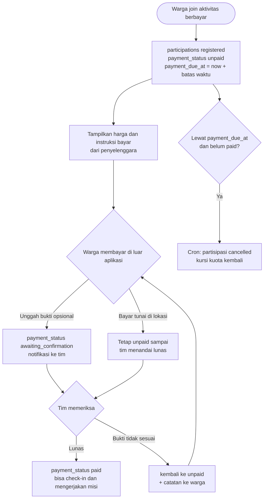

**Aturan aktivitas berbayar**

| Aturan | Keterangan |
| --- | --- |
| Siapa yang bisa | Host merchant maupun komunitas; harga diatur pemilik/ketua host |
| Harga | Satu harga per orang (`price_idr`), sama untuk pendaftar pribadi dan grup |
| Batas waktu bayar | Diatur per aktivitas (default 24 jam setelah join); jika pendaftaran dekat dengan waktu mulai, batasnya dipotong ke `starts_at` |
| Kuota | Pendaftar `unpaid` dan `awaiting_confirmation` ikut memakan kuota sampai dibatalkan |
| Bayar di lokasi | Tim bisa menandai lunas saat hari H, lalu warga langsung bisa check-in |
| Check-in dan misi | Hanya untuk `payment_status = paid` (aktivitas gratis memakai `not_required`) |
| Grup | Tiap anggota membayar dan dikonfirmasi sendiri-sendiri |
| Pembatalan oleh warga | Diizinkan sebelum check-in pertama; pengembalian dana diurus langsung dengan penyelenggara, tim menandai `refunded` jika dana dikembalikan |
| Aktivitas dibatalkan | Peserta yang sudah `paid` mendapat notifikasi; tim wajib menandai `refunded` setelah mengembalikan dana, dan admin bisa melihat yang belum |
| XP dan poin | Sama dengan aktivitas gratis; membayar tidak memberi XP |
| Bukti bayar | Disimpan di Storage privat, hanya bisa dilihat warga pemilik dan tim penyelenggara host. Selama status `awaiting_confirmation`, warga boleh mengganti bukti (bukti lama ditimpa); fungsi `submit_payment_proof` sudah mengizinkannya, tinggal tombol "Ganti bukti" di halaman status bayar |
| Kontak panitia | Halaman status bayar punya tombol "Chat panitia di WhatsApp" yang membuka nomor WhatsApp host dari profil merchant/komunitas. Untuk event Gasyu dipakai `payment.gasyu_whatsapp` di `app_settings`, atau `support.whatsapp` jika kosong. Nomor hanya tampil ke peserta terdaftar aktivitas itu |

**Di luar cakupan pilot:** payment gateway, pencairan dana, komisi Gasyu, dan faktur. Struktur `payment_status` sudah disiapkan supaya gateway bisa ditambahkan nanti tanpa mengubah alur peserta.

---

## 9. Misi

Misi adalah tugas di dalam sebuah aktivitas (event atau challenge) yang dibuat dan dikelola tim penyelenggara. Setiap misi punya satu cara verifikasi yang dipilih sesuai bentuk tantangannya, dan dianggap selesai menurut cara itu.

### 9a. Cara verifikasi misi

| Cara (`verification`) | Cocok untuk | Selesai ketika | XP masuk |
| --- | --- | --- | --- |
| `qr_scan` | "Kunjungi booth sponsor", "Mampir ke pos 3" | Warga memindai QR misi (berganti tiap 60 detik) di dalam radius | Langsung |
| `secret_code` | "Ikuti sesi talkshow sampai akhir", "Temukan kode di mural" | Warga mengetik kode yang diumumkan/disembunyikan di lokasi | Langsung |
| `photo` | "Foto bersama tim", "Foto sampah yang kamu kumpulkan" | Tim penyelenggara menyetujui foto yang diunggah | Saat disetujui |
| `manual` | "Menang lomba", "Selesaikan rute lari 5K" | Tim penyelenggara menandai peserta yang berhasil | Saat ditandai |

### 9b. Membuat dan mengelola misi

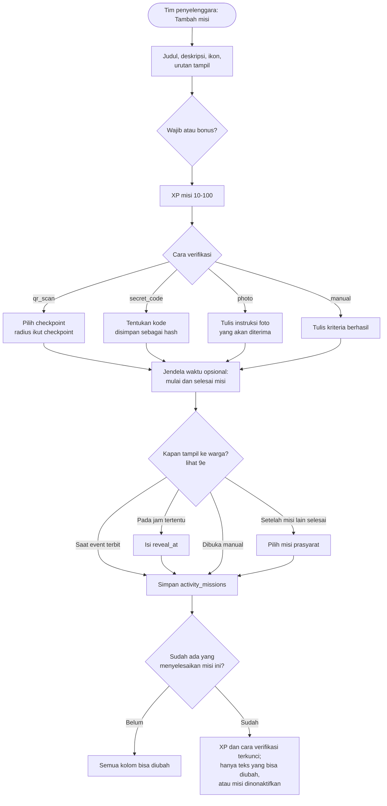

- Partner yang punya checkpoint di aktivitas boleh membuat misi `qr_scan` di checkpoint miliknya; misi itu tercatat atas nama partner tersebut untuk atribusi.
- Misi yang dinonaktifkan hilang dari daftar warga, tetapi XP yang sudah diberikan tetap.
- Setiap misi hanya bisa diselesaikan sekali per warga.
- Kode rahasia minimal 6 karakter (`mission.code_min_length`).
- Anggota tim tidak bisa menyetujui bukti foto atau menandai misi manual untuk akunnya sendiri; anggota tim lain yang melakukannya.
- Misi manual hanya bisa ditandai untuk peserta yang sudah check-in (jika aktivitas punya checkpoint). Di dashboard, peserta yang belum memenuhi syarat tampil abu-abu.
- Misi dan checkpoint milik partner yang keluar dari aktivitas atau dibekukan otomatis nonaktif, dan tidak bisa diaktifkan lagi selama partner itu tidak aktif.
- Tim penyelenggara selalu melihat semua misi di dashboard-nya, termasuk yang belum tampil ke warga, lengkap dengan label statusnya ("Tersembunyi", "Terbuka 19.00", "Terkunci, menunggu misi X").

### 9c. Warga mengerjakan misi

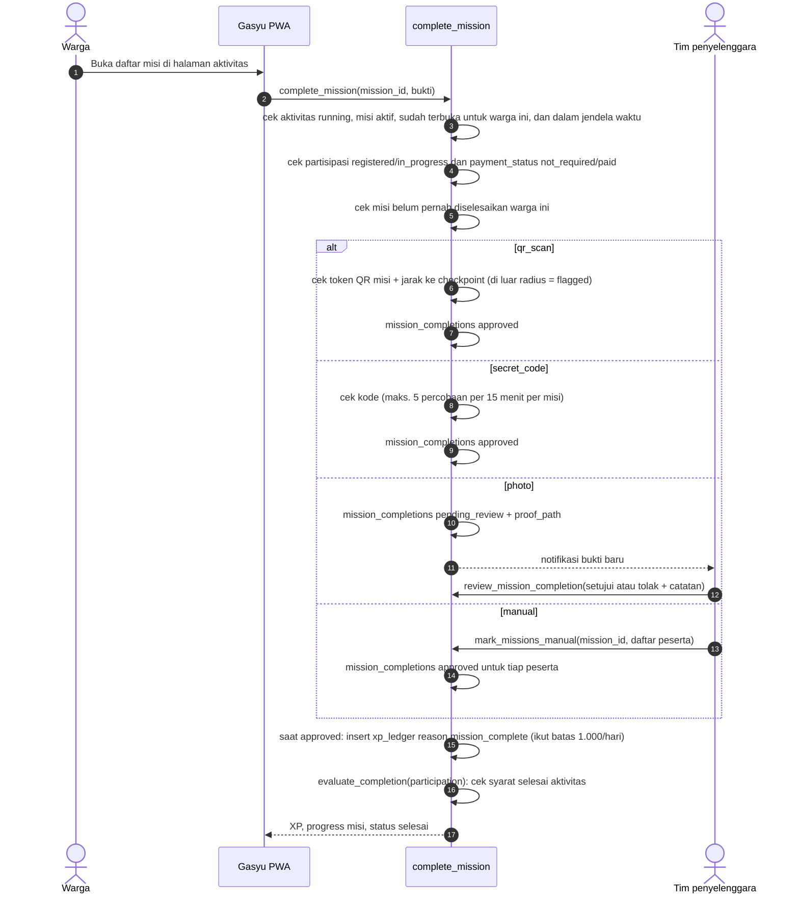

- Foto yang ditolak boleh diunggah ulang selama aktivitas masih `running`.
- Jika satu misi kode menerima lebih dari `mission.code_flag_attempts` tebakan salah (awal 50) dari semua akun dalam 15 menit, admin mendapat laporan `code_bruteforce` di Moderasi.
- Bukti foto yang masih `pending_review` saat aktivitas `settled` otomatis ditolak (warga mendapat notifikasi).
- Menyelesaikan misi `qr_scan` atau `secret_code` di hari yang belum ada check-in tidak otomatis dihitung sebagai check-in; check-in kehadiran tetap lewat QR checkpoint.

### 9d. Kapan aktivitas dianggap selesai

Fungsi `evaluate_completion` dipanggil setiap ada check-in atau misi yang disetujui.

| Jenis aktivitas | Selesai ketika |
| --- | --- |
| Event tanpa misi wajib | Warga check-in (seperti sebelumnya) |
| Event dengan misi wajib | Warga check-in **dan** semua misi wajib disetujui |
| Event Global `online`, atau `hybrid` tanpa check-in | Semua misi wajib disetujui; jika tidak ada misi wajib, saat misi pertama disetujui |
| Challenge target `total_checkins` / `distinct_checkpoints` | Target check-in tercapai (misi hanya menambah XP) |
| Challenge target `required_missions` | Semua misi wajib disetujui |
| Challenge target `missions_completed` | Jumlah misi disetujui (wajib maupun bonus) mencapai `target_count` |

Misi bonus selalu opsional: menambah XP, tetapi tidak menghalangi status selesai. Misi wajib yang **belum pernah dibuka** (misalnya mode manual yang tidak jadi dibuka panitia) tidak dihitung sebagai syarat; begitu terbuka, ia langsung menjadi syarat. Hadiah penyelesaian (XP challenge dan poin dari budget) tetap diberikan sekali, saat status menjadi `completed`. Setelah status `completed`, warga tetap boleh mengerjakan misi bonus yang masih terbuka (termasuk yang baru dibuka belakangan) sampai aktivitas berakhir; XP misi tetap diberikan sekali per misi dan status tidak berubah.

### 9e. Kapan misi tampil ke warga

Misi tidak harus langsung terlihat saat event terbit. Pembuat event mengatur cara tampil setiap misi, misalnya untuk kejutan di tengah acara, misi bertahap, atau misi yang baru dibuka setelah sesi tertentu.

| Cara tampil (`reveal_mode`) | Misi muncul ke warga | Contoh pemakaian |
| --- | --- | --- |
| `on_publish` | Saat event terbit (default) | Misi utama yang perlu diketahui sejak awal |
| `scheduled` | Otomatis pada jam `reveal_at` | "Misi malam" yang terbuka pukul 19.00 saat konser dimulai |
| `manual` | Saat tim penyelenggara menekan "Buka misi" | Misi kejutan yang diumumkan MC di panggung |
| `after_mission` | Per warga, setelah misi prasyarat miliknya disetujui | Rute bertahap: selesai pos 1 baru terbuka pos 2 |

Selain itu, setiap misi yang belum terbuka bisa diatur **ditampilkan sebagai teaser** (`show_teaser`) atau **disembunyikan sepenuhnya**:

- **Teaser**: warga melihat kartu terkunci tanpa judul dan isi, hanya keterangan kapan atau bagaimana misi terbuka ("Misi rahasia, terbuka pukul 19.00", "Selesaikan Pos 1 untuk membuka"). Jumlah XP boleh ditampilkan supaya penasaran.
- **Tersembunyi**: misi sama sekali tidak muncul sampai terbuka.

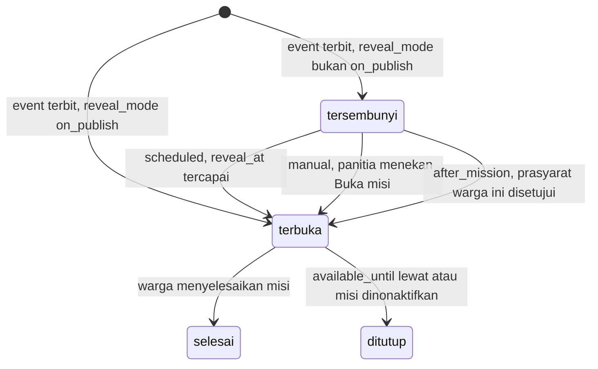

**Aturan tampil misi**

| Aturan | Keterangan |
| --- | --- |
| Terbuka tidak bisa ditutup lagi | Misi yang sudah terbuka tidak bisa disembunyikan kembali; untuk menghentikannya, nonaktifkan misi |
| Notifikasi | Saat misi `scheduled` atau `manual` terbuka, peserta terdaftar mendapat notifikasi "Misi baru terbuka"; untuk `after_mission`, notifikasi dikirim ke warga yang bersangkutan |
| Tampil vs bisa dikerjakan | Terbuka berarti terlihat. Misi tetap hanya bisa dikerjakan saat aktivitas `running` dan di dalam jendela `available_from`–`available_until` |
| Prasyarat | `after_mission` menunjuk satu misi lain di aktivitas yang sama; tidak boleh berputar. Misi wajib hanya boleh berprasyarat misi wajib, supaya warga tidak bisa melewatkan misi wajib dengan sengaja tidak membuka rantainya |
| Pengunjung yang belum daftar | Melihat misi yang sudah terbuka dan teaser, supaya tertarik ikut; tidak bisa mengerjakannya |
| QR dan kode | Memindai QR atau mengetik kode misi yang belum terbuka ditolak dengan pesan "Misi belum dibuka" |
| Event Gasyu | Admin yang menekan "Buka misi" untuk misi manual milik Gasyu; partner membuka misi miliknya sendiri |

Halaman aktivitas di PWA warga mengambil daftar misi lewat `get_activity_missions`, sehingga tiap warga hanya menerima misi yang memang sudah terbuka untuknya; misi tersembunyi tidak pernah terkirim ke HP.

---

### 9f. Master misi

Admin menyiapkan katalog template misi di `/admin/misi` supaya penyelenggara, terutama UMKM yang baru pertama membuat event, tidak mulai dari nol.

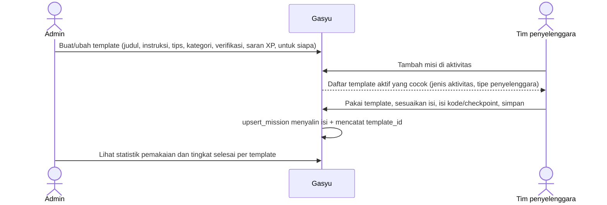

| Aturan | Isi |
| --- | --- |
| Siapa mengelola | Hanya admin: buat, ubah, aktifkan, nonaktifkan (tercatat di audit). Template tidak dihapus supaya statistik tetap utuh |
| Isi template | Judul, instruksi untuk warga, tips untuk penyelenggara, kategori (kunjungan, belanja, media sosial, olahraga, lingkungan, edukasi, komunitas, lainnya), cara verifikasi, saran XP (dalam batas `mission.xp_min`–`mission.xp_max`), wajib/bonus |
| Untuk siapa | Bisa dibatasi ke event atau challenge, dan ke merchant atau komunitas; kosong = semua. Event Gasyu melihat semua template |
| Partner (bukan host) | Hanya melihat template Scan QR, sesuai aturan misi partner |
| Disalin, bukan ditautkan | Isi template disalin ke misi dan tetap bisa diubah penyelenggara. Mengubah atau menonaktifkan template tidak mengubah misi yang sudah dibuat |
| Kode dan checkpoint | Kode rahasia dan checkpoint selalu diisi penyelenggara sendiri; template tidak menyimpannya |
| Statistik | Per template: jumlah aktivitas dan misi yang memakainya, persentase peserta yang menyelesaikan, kapan terakhir dipakai |

## 10. Kolaborasi: undangan, open call, dan event buatan admin

Kolaborasi berlaku untuk semua kombinasi: komunitas–komunitas, komunitas–merchant, merchant–merchant.

### 10a. Jalur undangan

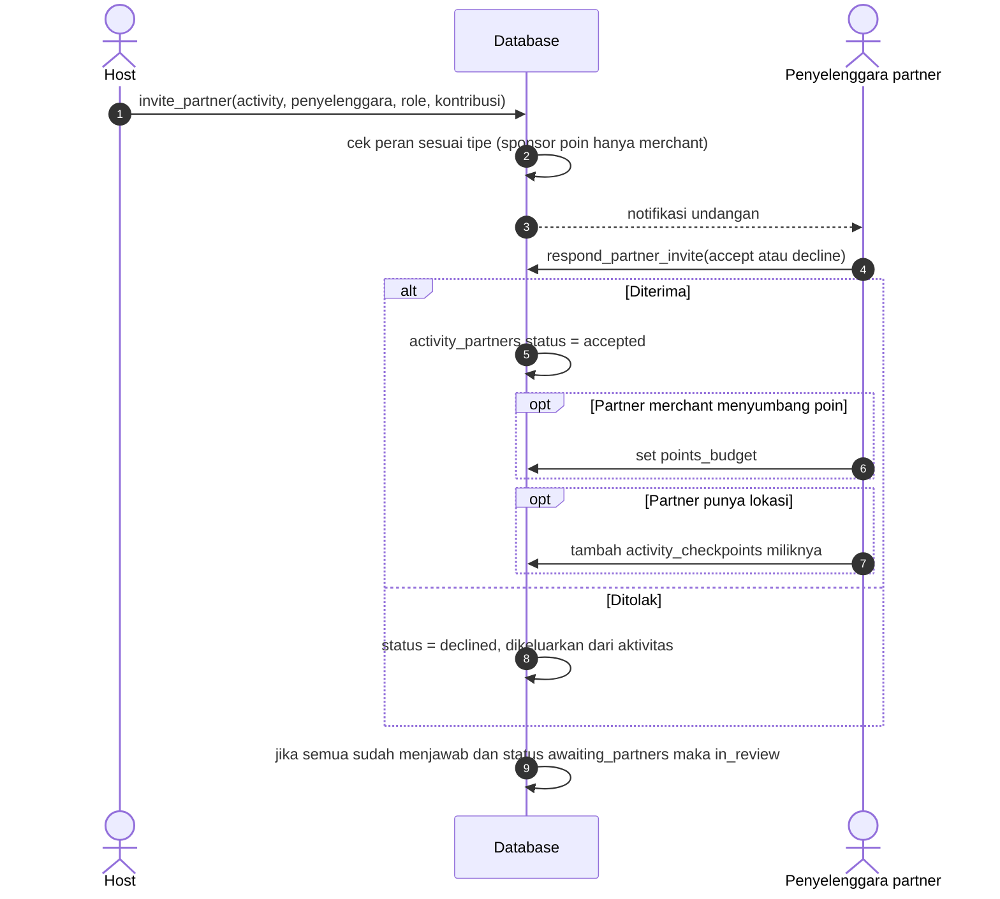

### 10b. Jalur open call

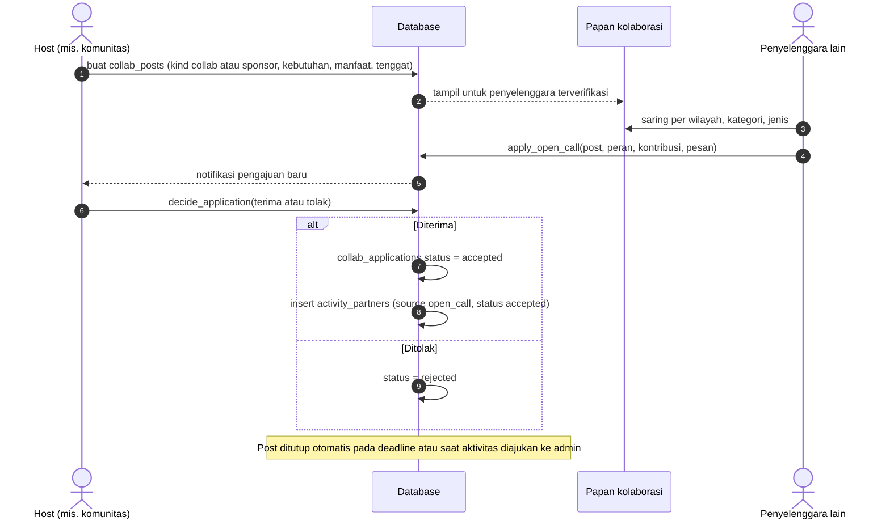

**Aturan kolaborasi**

| Aturan | Keterangan |
| --- | --- |
| Peran `sponsor` dengan poin | Hanya penyelenggara merchant (`points_budget > 0` hanya untuk merchant) |
| Sponsor non-poin | Komunitas boleh, kontribusinya dicatat sebagai teks (tenaga, perlengkapan, publikasi) |
| Atribusi | Setiap check-in mencatat `partner_organizer_id` pemilik checkpoint; setiap pemakaian voucher mencatat outlet |
| Privasi | Partner hanya melihat identitas peserta yang check-in di checkpoint miliknya; selebihnya angka agregat |
| Budget gabungan | Budget poin aktivitas = jumlah `points_budget` semua partner merchant yang `accepted`; pemakaian dicatat per partner secara proporsional |
| Tampilan warga | Halaman aktivitas menampilkan daftar "Didukung oleh" dari partner `accepted` |

### 10c. Event buatan admin

Admin bisa membuat event atau challenge atas nama **Gasyu**, misalnya festival kota, lomba antarkecamatan, atau program bersama pemerintah kota. Di dalamnya admin memilih merchant dan komunitas yang terlibat dan **langsung menambahkan mereka** tanpa menunggu persetujuan, karena kesepakatannya biasanya sudah dibuat di luar aplikasi.

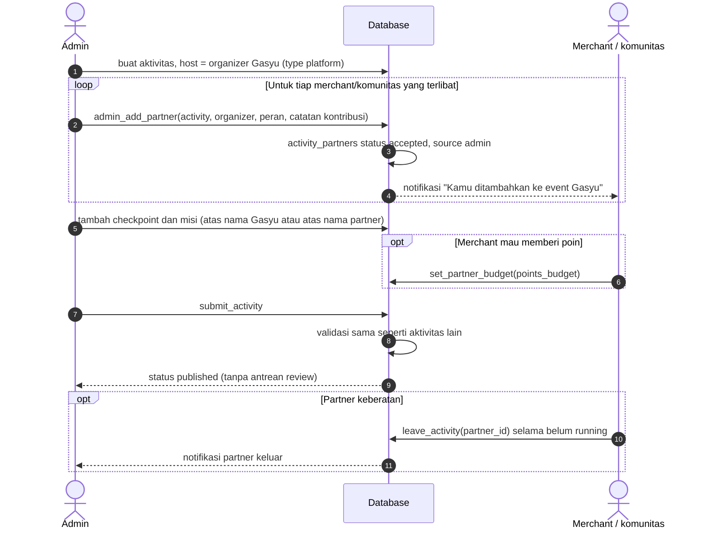

**Aturan event Gasyu**

| Aturan | Keterangan |
| --- | --- |
| Host | Satu baris `organizers` khusus bertipe `platform` bernama "Gasyu"; dikelola semua akun admin, tidak lewat `organizer_members` |
| Menambah partner | Admin menambahkan merchant atau komunitas yang `approved` langsung sebagai `accepted` (peran cohost atau sponsor); mereka mendapat notifikasi |
| Hak partner | Partner yang ditambahkan admin punya hak yang sama dengan partner biasa: melihat aktivitas di dashboard-nya, menampilkan QR checkpoint miliknya, membuat dan meninjau misi di checkpoint miliknya |
| Keluar | Partner boleh keluar selama aktivitas belum `running`; checkpoint dan misinya ikut nonaktif |
| Poin | Gasyu tidak punya budget poin sendiri. Poin hanya ada jika merchant partner mengisi budget poinnya sendiri; admin tidak bisa mengisikan budget atas nama merchant |
| Checkpoint | Admin bisa membuat checkpoint atas nama Gasyu (QR ditampilkan admin/panitia Gasyu) atau atas nama partner di outlet atau basecamp-nya (QR ditampilkan tim partner) |
| Review | Tidak lewat antrean review karena pembuatnya admin; tetap dicatat di `admin_actions` |
| Berbayar | Boleh; panitia Gasyu (admin) yang mengonfirmasi pembayaran |
| Audiens | Selalu publik (`members_only` hanya untuk host komunitas); aturan domisili `open` atau `residents_only` tetap bisa dipilih |
| Jangkauan | Regional (default) atau **Global**. Event Global hanya bisa dibuat sebagai event Gasyu selama pilot; aturannya di bagian 22 |
| Tampilan warga | Event tampil dengan label "Event Gasyu" (atau "Event Global") dan daftar "Didukung oleh" berisi partner yang terlibat |

---

## 11. Grup warga

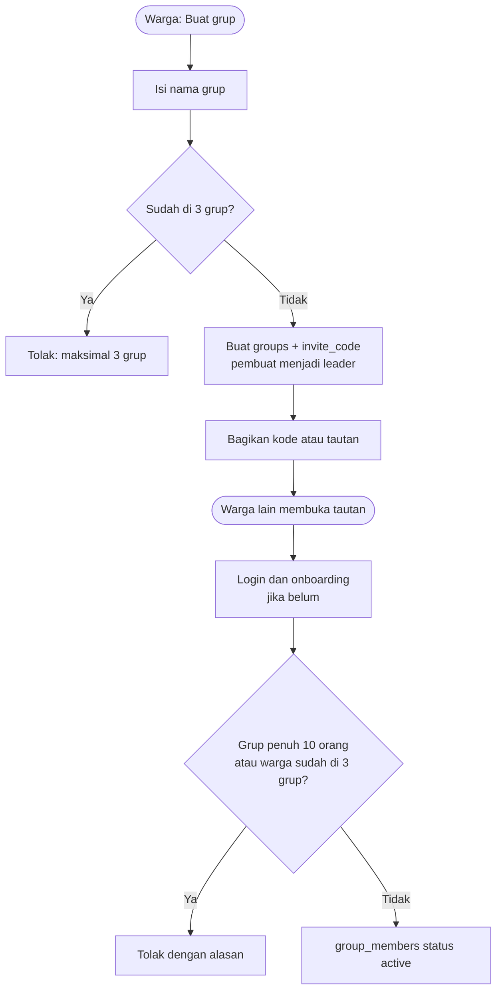

- Ketua bisa mengeluarkan anggota dan menyerahkan peran ketua. Jika ketua keluar, peran ketua otomatis pindah ke anggota paling lama.
- Grup dengan anggota aktif kurang dari 2 tetap ada, tetapi tidak bisa mendaftar ke aktivitas.
- Kode undangan grup maks. 5 kali salah per 15 menit per warga (`group.join_max_attempts`, `group.join_window_minutes`). Warga yang dikeluarkan ketua tidak bisa bergabung lagi lewat kode.

---

## 12. Keanggotaan komunitas

Khusus penyelenggara bertipe komunitas. Warga bisa menjadi member komunitas yang ia ikuti di dunia nyata, dan tim komunitas mengelola daftar member dari dashboard. Merchant tidak punya fitur ini.

### 12a. Warga bergabung

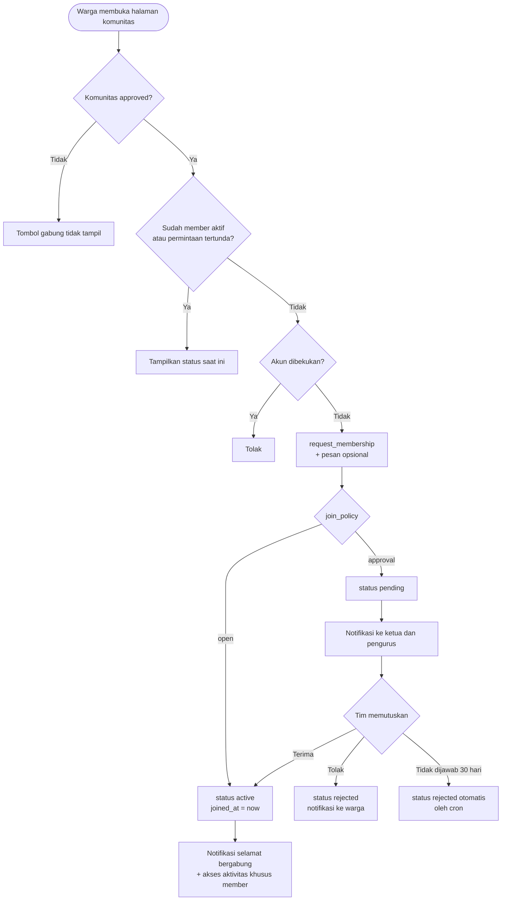

### 12b. Tim mengelola member

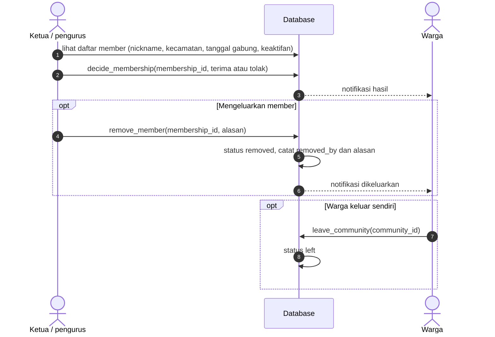

**Aturan keanggotaan**

| Aturan | Keterangan |
| --- | --- |
| Kebijakan bergabung | Ketua memilih `open` (langsung aktif) atau `approval` (perlu persetujuan); bisa diubah kapan saja, tidak berlaku mundur ke permintaan yang sudah ada |
| Jumlah komunitas | Warga boleh menjadi member di banyak komunitas, tanpa batas |
| Tim otomatis member | Ketua dan pengurus selalu member aktif; ketua tidak bisa keluar sebelum menyerahkan peran ketua |
| Bergabung ulang | Member yang `left` boleh meminta lagi kapan saja; yang `removed` atau `rejected` baru boleh meminta lagi setelah 30 hari |
| Privasi | Tim melihat nickname, kecamatan, tanggal gabung, dan jumlah check-in member di aktivitas komunitas itu; tidak pernah nama lengkap. Publik hanya melihat jumlah member aktif |
| XP | Bergabung tidak memberi XP, supaya tidak jadi celah farming |
| Komunitas dibekukan | Keanggotaan tetap tersimpan; aktivitas khusus member ikut tidak bisa diikuti |
| Grup warga | Terpisah dari keanggotaan; grup bisa berisi warga dari komunitas berbeda |

**Manfaat member**

- Bisa ikut aktivitas khusus member (`audience = members_only`).
- Notifikasi otomatis saat komunitasnya menerbitkan aktivitas baru.
- Komunitas tampil di profil warga ("Member di ...").
- Statistik member di dashboard komunitas: jumlah member aktif, member baru bulan ini, dan berapa persen member yang hadir di aktivitas 30 hari terakhir.

---

## 13. Join aktivitas (pribadi dan grup)

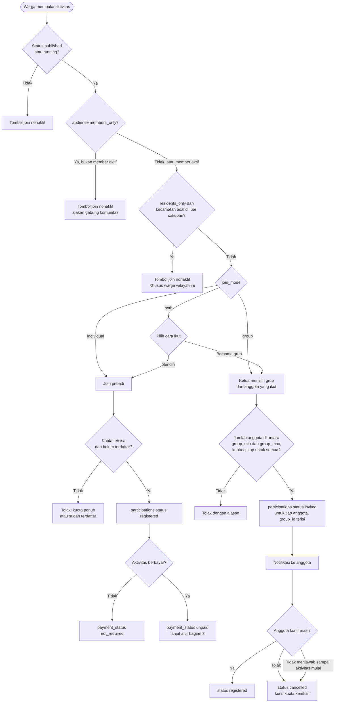

- Kuota dihitung per orang: `registered + in_progress + completed + invited`.
- Satu warga hanya punya satu partisipasi per aktivitas (pribadi atau lewat satu grup).
- Join tidak memberi XP atau skor; XP dan skor baru masuk saat check-in atau misi selesai.
- Event Global: tidak ada pemeriksaan domisili, keanggotaan, maupun grup. Siapa pun yang sudah onboarding, dari kota mana pun, langsung mendaftar sendiri (bagian 22).
- Warga bisa membatalkan sebelum check-in pertama; kursinya kembali ke kuota.
- Aktivitas berbayar lewat grup: setiap anggota yang mengonfirmasi mendapat `payment_status unpaid` dan batas waktu bayarnya sendiri.
- Untuk aktivitas khusus member, pendaftaran grup hanya bisa memilih anggota grup yang juga member aktif komunitas host.
- Member yang keluar atau dikeluarkan setelah terdaftar tetap boleh ikut aktivitas itu sampai selesai; syarat member hanya dicek saat mendaftar.

---

## 14. Check-in QR dan pemberian XP/poin

Ini alur paling kritis. Semua langkah setelah pemindaian terjadi di satu fungsi database `perform_checkin` dalam satu transaksi.

### 14a. QR dinamis

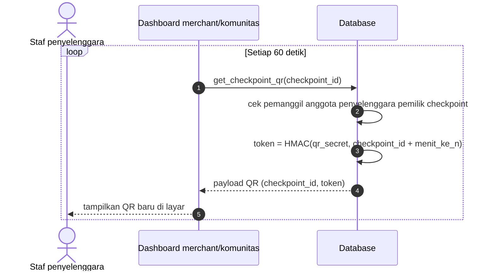

Token berlaku untuk menit berjalan dan satu menit sebelumnya (toleransi jam HP dan jaringan). Rahasia `qr_secret` tidak pernah dikirim ke client.

### 14b. Pemindaian oleh warga

```mermaid
sequenceDiagram
    autonumber
    actor W as Warga
    participant App as Gasyu PWA
    participant DB as perform_checkin
    W->>App: Pindai QR di HP staf
    App->>W: Minta izin lokasi (hanya pertama kali)
    App->>DB: perform_checkin(checkpoint_id, token, lat, lng)
    DB->>DB: 1. token cocok dengan menit ini atau menit sebelumnya
    DB->>DB: 2. aktivitas berstatus running
    DB->>DB: 3. warga punya partisipasi registered atau in_progress
    DB->>DB: 3b. payment_status not_required atau paid
    DB->>DB: 4. belum check-in di aktivitas ini hari ini (WIB)
    alt Ada pemeriksaan yang gagal
        DB-->>App: tolak + alasan
        App-->>W: pesan kesalahan
    else Lolos
        DB->>DB: 5. hitung jarak ke checkpoint
        DB->>DB: 6. insert checkins (review_status ok atau flagged jika di luar radius)
        DB->>DB: 7. hitung XP (lihat tabel di bawah) dan potong ke batas 1.000 per hari
        DB->>DB: 8. insert xp_ledger
        DB->>DB: 9. perbarui progress, lalu evaluate_completion (bagian 9d)
        opt Syarat selesai terpenuhi
            DB->>DB: 10. tandai completed
            opt Budget poin masih cukup
                DB->>DB: 11. insert point_ledger (+poin, kedaluwarsa 6 bulan)
            end
        end
        DB->>DB: 12. cek bonus grup dan badge
        DB-->>App: hasil: XP, poin, level, badge baru
        App-->>W: animasi hadiah
    end
```

### 14c. Perhitungan XP

| Komponen | Kapan | Nilai |
| --- | --- | --- |
| Dasar event | Check-in di event | 100 XP |
| Dasar challenge | Saat challenge selesai | 150 / 250 / 400 XP (easy / medium / hard) |
| Misi | Saat misi disetujui (langsung untuk QR/kode, saat ditinjau untuk foto/manual) | 10–100 XP per misi sesuai pengaturan penyelenggara; total per aktivitas maks. 500 XP; tidak kena bonus kolaborasi dan grup |
| Kunjungan pertama | Pertama kali check-in di penyelenggara itu | +50 XP |
| Kolaborasi | Aktivitas punya lebih dari satu partner accepted | +25% XP dasar |
| Bonus grup | Minimal 3 anggota grup yang sama check-in di aktivitas yang sama hari itu | +20% XP dasar untuk semua anggota yang hadir |
| Batas harian | Total XP per warga per hari (WIB) | Maksimal 1.000 XP; kelebihan dipotong |

**Bonus grup** diberikan sekali per anggota per aktivitas per hari. Saat anggota ketiga check-in, fungsi menambahkan bonus untuk ketiganya sekaligus; anggota keempat dan seterusnya langsung mendapat bonus saat check-in.

Di Event Global, check-in dan misi memberi **skor event** (bagian 22c) lewat `award_activity_score`, tanpa XP, bonus, poin, dan batas harian.

**Check-in di luar radius** tetap memberi XP atau skor (supaya warga dengan GPS kurang akurat tidak dirugikan), tetapi ditandai `flagged`. Jika admin menolaknya, fungsi `reverse_checkin` menulis baris XP dan poin bernilai negatif.

**Poin tertahan.** Poin dari check-in yang ditandai belum bisa dipakai sampai admin menyatakan check-in itu sah. Di Dompet tampil "X poin tertahan". Jika ditolak, poinnya ditarik; jika sah, poin langsung masuk saldo.

---

## 15. Progress dan penyelesaian challenge

```mermaid
flowchart TD
    C([Check-in atau misi disetujui<br/>di challenge]) --> SC{target_scope}
    SC -->|individual| I1[progress pribadi = jumlah check-in,<br/>checkpoint berbeda, atau misi disetujui<br/>sesuai target_kind]
    I1 --> I2{progress >= target_count?}
    I2 -- Tidak --> I3[status in_progress]
    I2 -- Ya --> DONE[Warga completed<br/>+ XP penyelesaian + poin jika ada budget]
    SC -->|group| G1[progress grup = jumlah<br/>dari semua anggota grup]
    G1 --> G2{progress grup >= target_count?}
    G2 -- Tidak --> G3[anggota in_progress<br/>leaderboard grup diperbarui]
    G2 -- Ya --> G4[Semua anggota yang sudah<br/>berkontribusi minimal 1 kali]
    G4 --> DONE2[completed + XP + poin<br/>untuk tiap kontributor]
    G4 --> NC[Anggota tanpa kontribusi:<br/>tidak dapat hadiah penyelesaian]
```

- Jenis target: `total_checkins` (jumlah check-in), `distinct_checkpoints` (checkpoint berbeda, cocok untuk "jelajah 5 kedai"), `required_missions` (semua misi wajib selesai), dan `missions_completed` (jumlah misi selesai mencapai target, contoh "selesaikan 4 dari 6 misi").
- Target grup berbasis misi: `missions_completed` dihitung dari jumlah misi disetujui seluruh anggota grup (misi yang sama oleh dua anggota dihitung dua). `required_missions` tidak tersedia untuk target grup.
- Satu check-in per aktivitas per hari tetap berlaku untuk challenge; misi tidak dibatasi per hari, hanya sekali per misi per warga.
- Challenge yang berakhir sebelum target tercapai: partisipasi tetap `in_progress`, lalu cron mengubahnya menjadi tidak selesai saat `settled`. XP dari check-in harian tetap dimiliki warga.

---

## 16. Tukar poin dan pakai voucher

```mermaid
sequenceDiagram
    autonumber
    actor W as Warga
    participant DB as Database
    actor K as Kasir merchant
    W->>DB: redeem_reward(reward_id)
    DB->>DB: cek reward aktif, stok > 0, masih berlaku
    DB->>DB: cek saldo poin belum kedaluwarsa >= harga
    alt Tidak memenuhi
        DB-->>W: tolak + alasan
    else Memenuhi
        DB->>DB: insert point_ledger (-harga, reason redemption)
        DB->>DB: kurangi stok reward
        DB->>DB: insert redemptions (kode unik 8 karakter, status active)
        DB-->>W: kode voucher + QR
    end
    W->>K: Tunjukkan kode di kasir
    K->>DB: use_voucher(kode, outlet_id) dari mode kasir
    DB->>DB: cek kasir anggota merchant pemilik reward
    DB->>DB: cek status active dan belum kedaluwarsa
    DB->>DB: cek outlet termasuk valid_outlet_ids (jika diisi)
    DB->>DB: status used, catat used_by dan outlet
    DB-->>K: berhasil: nama reward dan nama panggilan warga
```

- Poin dipakai dengan urutan FIFO: poin yang paling cepat kedaluwarsa dipakai lebih dulu.
- Voucher yang sudah ditukar tidak bisa dikembalikan menjadi poin. Pengecualian: jika merchant menonaktifkan reward sebelum voucher dipakai, fungsi `refund_redemption` mengembalikan poinnya. Pemilik merchant hanya bisa me-refund voucher dari reward yang sudah nonaktif; admin bisa kapan saja. Poin yang dikembalikan tetap memakai tanggal kedaluwarsa aslinya.
- Kode voucher yang masih aktif hanya dilihat warga pemiliknya. Daftar "Voucher ditukar" di dashboard merchant baru menampilkan kode setelah voucher dipakai atau berakhir.
- Merchant memilih voucher berlaku di **semua outlet** atau hanya di **outlet tertentu** (`rewards.valid_outlet_ids`). Halaman voucher warga menampilkan daftar outlet tempat voucher berlaku. Kasir yang memindai voucher di outlet yang tidak termasuk ditolak dengan pesan "Voucher ini tidak berlaku di outlet ini".
- Komunitas tidak punya mode kasir dan tidak bisa membuat `rewards`.

---

## 17. Leaderboard, level, dan badge

```mermaid
flowchart LR
    XL[(xp_ledger)] --> LV[v_user_level<br/>total XP seumur hidup<br/>ke tabel level]
    XL --> LU[v_leaderboard_users_month<br/>XP bulan berjalan<br/>per kecamatan dan se-kota]
    XL --> LK[v_leaderboard_districts_month<br/>rata-rata XP per warga aktif<br/>minimal 10 warga aktif, per kota]
    CI[(checkins)] --> AK[v_district_active_month<br/>jumlah warga aktif<br/>tab Kecamatan]
    CI --> LG[v_group_progress<br/>leaderboard grup per aktivitas]
    CI --> OR[v_organizer_reputation<br/>hadir, penyelesaian, kolaborasi]
    CI --> BD[award_badges<br/>dicek setelah check-in]
    BD --> UB[(user_badges)]
```

**Level**

| Level | Nama | XP kumulatif |
| --- | --- | --- |
| 1 | Warga Baru | 0 |
| 2 | Penjelajah | 500 |
| 3 | Penggerak | 1.500 |
| 4 | Jawara | 4.000 |
| 5 | Legenda Cimahi | 10.000 |

**Peringkat kota dan kecamatan.** Halaman Peringkat punya tiga tab: warga di kecamatan saya, warga se-kota saya, dan peringkat kecamatan di kota saya. Hanya kota yang sudah dibuka admin yang punya peringkat (bagian 3a); warga di kota lain melihat keterangan "peringkat kotamu belum dibuka". XP dihitung ke kecamatan yang tercatat di `xp_ledger.district_id` saat XP diberikan (snapshot), sehingga pindah kecamatan tidak memindahkan XP lama. Warga tanpa kecamatan (akun lama) tidak dihitung. Juara kecamatan bulan lalu di setiap kota disimpan oleh cron ke `monthly_district_winners`.

**Badge awal**

| Kode | Nama | Syarat |
| --- | --- | --- |
| first_step | Langkah Pertama | Check-in pertama |
| district_explorer | Penjelajah Kecamatan | Check-in di 3 kecamatan berbeda |
| regular | Langganan | Check-in di penyelenggara yang sama 5 kali |
| collaborator | Kolaborator | Ikut 3 aktivitas kolaborasi |
| consistent | Konsisten | Streak 4 minggu |
| one_team | Satu Tim | Ikut 3 aktivitas sebagai grup |

---

## 18. Proses terjadwal (cron)

Dijalankan dengan `pg_cron` di Supabase (atau Vercel Cron yang memanggil fungsi database). Semua job idempoten: aman dijalankan ulang.

```mermaid
flowchart TB
    subgraph T5["Setiap 5 menit"]
        J1[advance_activity_status<br/>published ke running,<br/>running ke ended]
        J2[expire_group_invitations<br/>undangan grup yang belum<br/>dikonfirmasi saat aktivitas mulai]
        J10[expire_unpaid_participations<br/>lewat batas waktu bayar]
        J12[reveal_scheduled_missions<br/>buka misi yang reveal_at-nya tercapai]
    end
    subgraph TH["Setiap jam"]
        J3[close_expired_collab_posts<br/>open call lewat tenggat]
        J4[settle_ended_activities<br/>ended lebih dari 48 jam ke settled<br/>challenge belum selesai ditutup,<br/>bukti foto misi tertunda ditolak,<br/>pemenang Event Global ditetapkan]
    end
    subgraph TD1["Setiap hari 00.05 WIB"]
        J5[expire_points<br/>tulis baris negatif untuk<br/>poin lewat 6 bulan yang belum dipakai]
        J6[expire_redemptions<br/>voucher lewat masa berlaku]
        J7[award_streak<br/>hari Senin: bonus streak mingguan]
        J9[expire_membership_requests<br/>permintaan member tertunda<br/>lebih dari 30 hari]
        J11[prune_code_attempts<br/>hapus log percobaan kode<br/>lebih dari 1 hari]
    end
    subgraph TD8["Setiap hari 08.05 WIB"]
        J13[notify_expiring<br/>ingatkan voucher dan poin<br/>yang hangus dalam 7 hari]
        J14[process_prizes<br/>pengingat klaim hadiah, hadiah hangus,<br/>hapus alamat pengiriman lama]
    end
    subgraph TM["Tanggal 1 pukul 00.10 WIB"]
        J8[snapshot_monthly_winners<br/>simpan juara kecamatan bulan lalu]
    end
```

| Job | Jadwal | Efek |
| --- | --- | --- |
| advance_activity_status | 5 menit | Mengubah status berdasarkan `starts_at` dan `ends_at` |
| expire_group_invitations | 5 menit | Partisipasi `invited` di aktivitas yang sudah mulai menjadi `cancelled` |
| reveal_scheduled_missions | 1 menit | Misi `scheduled` yang `reveal_at`-nya tercapai diisi `revealed_at` dan peserta diberi notifikasi; tampilan ke warga sudah dihitung dari jam, cron ini hanya untuk notifikasi dan pencatatan |
| expire_unpaid_participations | 5 menit | Partisipasi `unpaid` yang lewat `payment_due_at` menjadi `cancelled` + notifikasi; `awaiting_confirmation` tidak disentuh supaya bukti yang sudah dikirim tetap ditinjau |
| close_expired_collab_posts | 1 jam | `collab_posts.status = closed` setelah `deadline` |
| settle_ended_activities | 1 jam | `ended` lebih dari 48 jam menjadi `settled`; partisipasi yang belum memenuhi syarat selesai menjadi `not_completed`; `mission_completions` yang masih `pending_review` menjadi `rejected`; untuk Event Global memanggil `finalize_activity_winners` |
| expire_points | Harian | Baris `point_ledger` negatif `reason = expiry` untuk sisa poin yang kedaluwarsa |
| expire_redemptions | Harian | Voucher `active` lewat `expires_at` menjadi `expired` |
| award_streak | Senin | +50 XP untuk warga dengan minimal satu check-in di setiap minggu berturut-turut |
| expire_membership_requests | Harian | `community_memberships` berstatus `pending` lebih dari 30 hari menjadi `rejected` + notifikasi ke warga |
| prune_code_attempts | Harian | Menghapus baris `mission_code_attempts` yang lebih dari 1 hari |
| notify_expiring | Harian 08.05 WIB | Notifikasi ke warga untuk voucher aktif dan poin yang akan kedaluwarsa dalam `reminder.expiry_days` hari (awal 7). Voucher diingatkan sekali; poin paling sering sekali per jangka itu. Jam pagi dipilih supaya notifikasi tidak masuk tengah malam |
| snapshot_monthly_winners | Bulanan | Insert `monthly_village_winners` untuk bulan lalu |
| process_prizes | Harian 08.05 WIB | Mengirim `prize_claim_reminder` 3 hari sebelum `claim_deadline`; `pending_claim` yang lewat batas menjadi `forfeited` + notifikasi; mengosongkan alamat pengiriman 30 hari setelah `delivered` |

Leaderboard bulanan tidak perlu di-reset: view menyaring XP berdasarkan bulan berjalan, sehingga otomatis mulai dari nol tiap tanggal 1.

---

## 19. Moderasi admin dan anti-curang

```mermaid
flowchart TD
    subgraph Antrean["Dashboard admin (web)"]
        Q1[Penyelenggara pending]
        Q2[Aktivitas in_review]
        Q3[Check-in dan misi QR flagged]
        Q4[Laporan pola mencurigakan]
        Q5[Aktivitas dibatalkan dengan<br/>pembayaran belum refunded]
    end
    Q5 --> D5[Hubungi penyelenggara<br/>catat di admin_actions]
    Q1 --> D1{Setujui?}
    D1 -->|Ya| A1[approved]
    D1 -->|Tidak| A2[rejected + catatan]
    Q2 --> D2{Setujui?}
    D2 -->|Ya| A3[published]
    D2 -->|Tidak| A4[draft + review_note]
    Q3 --> D3{Sah?}
    D3 -->|Ya| A5[review_status approved]
    D3 -->|Tidak| A6[reverse_checkin<br/>XP dan poin dibalik]
    Q4 --> D4{Tindakan}
    D4 -->|Peringatan| A7[catat di fraud_flags]
    D4 -->|Bekukan akun| A8[profiles.suspended_at diisi<br/>tidak bisa check-in dan menukar]
    D4 -->|Bekukan penyelenggara| A9[organizers.status suspended<br/>aktivitas running dibatalkan]
```

**Lapisan anti-curang**

| Lapisan | Mencegah |
| --- | --- |
| QR berganti tiap 60 detik | Foto QR disebar ke grup chat |
| Cek radius GPS 150 m | Check-in dari rumah dengan QR curian |
| Satu check-in per aktivitas per hari | Memindai berkali-kali |
| Batas 1.000 XP per hari | Farming XP besar-besaran |
| XP/poin hanya dari fungsi server | Memanipulasi request dari HP |
| Budget poin per aktivitas | Poin tak terbatas yang membebani merchant |
| Deteksi pola (`fraud_flags`) | Banyak akun dari satu lokasi dan waktu yang sama, check-in beruntun di lokasi berjauhan dalam waktu tidak wajar |
| Kode voucher sekali pakai | Voucher dipakai ulang |
| QR misi berganti tiap 60 detik + cek radius | Foto QR misi disebar |
| Batas percobaan kode misi (5 per 15 menit) + kode minimal 6 karakter + laporan tebakan massal | Menebak kode rahasia, termasuk dari banyak akun |
| Peninjau tidak bisa menyetujui misinya sendiri; misi manual hanya untuk yang sudah check-in | Panitia memberi XP ke diri sendiri atau ke orang yang tidak hadir |
| Poin dari check-in di luar radius ditahan sampai ditinjau | Poin dari QR curian langsung ditukar voucher sebelum admin sempat menolak |
| XP misi 10–100, total maks. 500 per aktivitas | Penyelenggara membuat misi XP besar untuk mendongkrak warga tertentu |
| Misi foto dan manual dicatat siapa peninjaunya | Panitia menyetujui temannya sendiri tanpa jejak; admin bisa mengaudit |
| Skor Event Global terpisah dari XP | Event besar dengan peserta luar kota menggeser peringkat kota dan kecamatan |
| Masa verifikasi 48 jam sebelum pemenang ditetapkan | Juara dari check-in atau foto yang belum ditinjau |
| Admin meninjau pemenang sebelum hadiah dikirim; akun dibekukan tidak bisa menang | Akun ganda atau curang membawa pulang hadiah |

Bukti foto misi ditinjau oleh tim penyelenggara, bukan admin. Admin hanya turun tangan lewat laporan atau pola mencurigakan.

**Peninjau terlalu cepat (`reviewer_burst`).** Jika satu anggota tim menyetujui `fraud.reviewer_burst_count` bukti foto atau lebih (awal 50) dalam `fraud.reviewer_burst_minutes` menit (awal 10), sistem membuat satu `fraud_flags` berjenis `reviewer_burst` per jendela waktu, berisi peninjau, penyelenggara, aktivitas, dan jumlah bukti. Persetujuan tetap berlaku (tidak dibatalkan otomatis), supaya panitia yang memang meninjau cepat di acara besar tidak terganggu. Admin melihatnya di halaman Moderasi dan bisa mengabaikan, memberi peringatan, membalik misi tertentu, atau membekukan penyelenggara.

**Membatalkan misi.** Admin bisa membatalkan misi yang sudah disetujui lewat `reverse_mission_completion` (wajib alasan): status misi menjadi ditolak, XP atau skor ditarik dengan baris negatif, laporan terkait ditutup, dan warga mendapat notifikasi. Di halaman Moderasi tombol ini ada di kartu "Peninjau terlalu cepat" (daftar persetujuan dalam jendela itu) dan di daftar "Misi QR di luar radius".

---

## 20. Dashboard dan peta halaman

Satu codebase Next.js melayani dua aplikasi: **Gasyu PWA** (warga, merchant, komunitas) di `gasyu.id` dan **Gasyu Admin** (web) di `admin.gasyu.id`. Middleware memilih tata letak berdasarkan host; dashboard admin menolak akun yang bukan `is_admin`.

### 20a. Isi dashboard per entitas

**Dashboard warga** (`/beranda`, tampilan awal PWA; dimuat sekaligus lewat `get_citizen_dashboard()`)

| Bagian | Isi | Sumber data |
| --- | --- | --- |
| Kartu level | Level, XP total, XP menuju level berikutnya, streak minggu ini | `v_user_level`, `xp_ledger` |
| Aktivitasku | Aktivitas yang diikuti hari ini dan mendatang, status bayar, misi yang belum selesai | `participations`, `v_participation_missions` |
| Event Global | Event Global yang diikuti beserta skor dan posisi saya; Event Global yang sedang dibuka pendaftarannya | `v_activity_scoreboard`, `activities` |
| Hadiah perlu diklaim | Hadiah Event Global berstatus `pending_claim` beserta batas klaimnya | `activity_winners` |
| Dompet ringkas | Saldo poin, poin yang akan kedaluwarsa 30 hari lagi, voucher aktif | `v_user_points_balance`, `redemptions` |
| Peringkat | Posisi di kecamatan dan se-kota bulan ini, posisi kecamatan saya (hanya kota yang dibuka) | `get_leaderboard` |
| Rekomendasi | Aktivitas di kota saya (diutamakan kecamatan saya) dan dari komunitas yang saya ikuti | `activities`, `community_memberships` |
| Badge terbaru | Badge yang baru didapat | `user_badges` |

**Dashboard merchant** (`/merchant/[id]`)

| Bagian | Isi | Sumber data |
| --- | --- | --- |
| Ringkasan | Aktivitas berjalan, peserta, check-in hari ini, warga baru vs kembali | `v_merchant_dashboard`, `v_activity_stats` |
| Perlu tindakan | Pembayaran menunggu konfirmasi, bukti foto misi menunggu tinjauan, undangan kolaborasi, saran baru dari warga | `v_activity_payment_stats`, `v_mission_stats`, `activity_partners`, `v_organizer_suggestions` |
| Poin dan voucher | Budget poin terpakai dan sisa, voucher ditukar dan dipakai per outlet | `v_activity_budget`, `v_activity_partner_stats` |
| Misi | Tingkat penyelesaian tiap misi | `v_mission_stats` |
| Hadiah yang disponsori | Hadiah Event Global yang disediakan penyelenggara ini dan status penyerahannya (tanpa alamat pemenang) | `activity_prizes`, `activity_winners` |
| Reputasi | Skor hadir, penyelesaian, kolaborasi 90 hari | `v_organizer_reputation` |

**Dashboard komunitas** (`/komunitas/[id]`)

| Bagian | Isi | Sumber data |
| --- | --- | --- |
| Ringkasan | Aktivitas berjalan, peserta, check-in hari ini | `v_community_dashboard`, `v_activity_stats` |
| Member | Member aktif, member baru bulan ini, permintaan menunggu, persentase member yang hadir 30 hari terakhir | `v_community_member_stats` |
| Perlu tindakan | Permintaan bergabung, pembayaran menunggu konfirmasi, bukti foto misi, undangan kolaborasi, saran baru dari warga | `community_memberships`, `v_activity_payment_stats`, `v_mission_stats`, `v_organizer_suggestions` |
| Misi | Tingkat penyelesaian tiap misi | `v_mission_stats` |
| Hadiah yang disponsori | Hadiah Event Global yang disediakan penyelenggara ini dan status penyerahannya (tanpa alamat pemenang) | `activity_prizes`, `activity_winners` |
| Reputasi | Skor hadir, penyelesaian, kolaborasi 90 hari | `v_organizer_reputation` |

**Dashboard admin** (`admin.gasyu.id`)

| Bagian | Isi | Sumber data |
| --- | --- | --- |
| Metrik kota | Warga aktif mingguan, aktivitas berjalan, merchant dan komunitas aktif, poin beredar vs ditukar, kecamatan teraktif di semua kota yang dibuka | `v_admin_overview`, `leaderboard_districts` |
| Wilayah | Buka atau tutup kota; jumlah warga dan penyelenggara per kota (bagian 3a) | `set_city_active`, `v_admin_city_stats` |
| Event Gasyu | Buat dan kelola event/challenge Gasyu, tambahkan merchant/komunitas, konfirmasi pembayaran, tinjau bukti misi | `activities`, `activity_partners`, `v_activity_stats` |
| Event Global | Buat Event Global, atur hadiah per peringkat, pantau papan peringkat, statistik peserta (sebaran kota dan kecamatan asal, misi selesai) | `activities`, `activity_prizes`, `v_activity_scoreboard`, `v_global_event_stats` |
| Hadiah | Pemenang per event, status klaim, data pengiriman, tandai terkirim atau hangus | `activity_winners`, `fraud_flags` |
| Antrean | Merchant/komunitas menunggu verifikasi, aktivitas menunggu review, check-in dan misi flagged, laporan pola mencurigakan | `organizers`, `activities`, `checkins`, `mission_completions`, `fraud_flags` |
| Pembayaran | Aktivitas dibatalkan yang masih punya peserta `paid` belum `refunded` | `v_activity_payment_stats` |
| Pengguna | Cari warga, merchant, komunitas; bekukan atau aktifkan | `profiles`, `organizers` |
| Master misi | Template misi siap pakai untuk penyelenggara, statistik pemakaian | `mission_templates`, `v_mission_template_stats` |
| Pengaturan | Angka aturan main (XP, batas, radius, kedaluwarsa, skor dan klaim Event Global) | `app_settings` |
| Audit | Riwayat tindakan admin | `admin_actions` |

### 20b. Peta halaman

```mermaid
flowchart LR
    ROOT([Gasyu PWA]) --> AUTH[/masuk<br/>/onboarding/]
    ROOT --> WG[Warga]
    ROOT --> MC[Merchant]
    ROOT --> KM[Komunitas]
    ADM([Gasyu Admin - web]) --> AD[Admin]

    WG --> W1[/beranda: dashboard warga/]
    WG --> W2[/jelajah: aktivitas sekitar<br/>+ tab Event Global/]
    WG --> W3[/aktivitas/id detail, join,<br/>status bayar, daftar misi/]
    W3 --> W31[/aktivitas/id/peringkat<br/>papan peringkat dan hadiah Event Global/]
    WG --> W4[/scan: check-in dan misi QR/]
    WG --> W5[/dompet: poin, voucher/]
    WG --> W6[/grup/]
    WG --> W7[/komunitas-saya/]
    WG --> W8[/peringkat/]
    WG --> W9[/profil: level, badge, riwayat,<br/>pemilih mode/]
    WG --> W10[/m/slug dan /k/slug<br/>profil publik merchant dan komunitas/]
    WG --> W11[/daftar/merchant dan<br/>/daftar/komunitas/]
    WG --> W12[/saran: saran saya<br/>status dan balasan/]
    WG --> W13[/profil/ubah dan /profil/hapus/]
    WG --> W14[/riwayat: XP dan poin/]
    WG --> W15[/bantuan/]
    WG --> W16[/hadiah: hadiah Event Global<br/>dan klaim/]

    MC --> M1[/merchant/id: dashboard/]
    MC --> M2[/merchant/id/aktivitas/]
    M2 --> M21[/aktivitas/aid/misi<br/>kelola misi, tinjau bukti/]
    M2 --> M22[/aktivitas/aid/peserta<br/>daftar, konfirmasi bayar/]
    MC --> M3[/merchant/id/qr/]
    MC --> M4[/merchant/id/kasir/]
    MC --> M5[/merchant/id/reward/]
    MC --> M6[/merchant/id/outlet/]
    MC --> M7[/merchant/id/kolaborasi/]
    MC --> M8[/merchant/id/tim/]
    MC --> M9[/merchant/id/profil/]
    MC --> M10[/merchant/id/saran/]

    KM --> K1[/komunitas/id: dashboard/]
    KM --> K2[/komunitas/id/aktivitas/]
    K2 --> K21[/aktivitas/aid/misi/]
    K2 --> K22[/aktivitas/aid/peserta/]
    KM --> K3[/komunitas/id/qr/]
    KM --> K4[/komunitas/id/member/]
    KM --> K5[/komunitas/id/kolaborasi/]
    KM --> K6[/komunitas/id/tim/]
    KM --> K7[/komunitas/id/profil/]
    KM --> K8[/komunitas/id/saran/]

    AD --> A0[/ ringkasan metrik/]
    AD --> A1[/verifikasi: merchant dan komunitas/]
    AD --> A2[/aktivitas: review,<br/>event Gasyu, Event Global/]
    A2 --> A21[/aktivitas/aid/hadiah<br/>atur hadiah per peringkat/]
    AD --> A9[/hadiah: pemenang,<br/>klaim, pengiriman/]
    AD --> A8[/misi: master misi/]
    AD --> A3[/moderasi: flag dan laporan/]
    AD --> A4[/pembayaran/]
    AD --> A5[/pengguna/]
    AD --> A6[/pengaturan/]
    AD --> A7[/audit/]
```

- Halaman Jelajah punya tab **Event Global** yang menampilkan semua Event Global `published` atau `running` tanpa saringan wilayah. Halaman Hadiah dibuka dari Beranda, Dompet, dan notifikasi.
- **Pemilih kota di Jelajah.** Tombol kota di pojok kanan atas memuat daftar kota yang aktif di Gasyu (`regions` tingkat kota) dan pilihan **Semua kota**. Aturannya:
  - Pilihan awal adalah kota tempat tinggal warga, dari kecamatannya, jika kota itu sudah dibuka; jika belum, Semua kota.
  - Kota sebuah aktivitas diambil dari wilayah cakupannya, ditarik ke tingkat kota. Jika cakupan kosong, dipakai kecamatan penyelenggara. Aktivitas tanpa keduanya, misalnya event Gasyu tanpa cakupan, tampil di semua kota.
  - Pencarian dan filter berlaku di dalam kota terpilih. Pilihan kota tersimpan di alamat halaman (`?kota=32.77` atau `?kota=semua`), sehingga terbawa saat pindah filter dan bisa dibagikan.
  - Tab Event Global tidak memakai pemilih kota.
- Navigasi bawah PWA mengikuti mode aktif: mode warga (Beranda, Jelajah, Scan, Dompet, Profil), mode merchant (Dashboard, Aktivitas, QR, Kasir, Lainnya), mode komunitas (Dashboard, Aktivitas, QR, Member, Lainnya).
- Pemilih mode hanya menampilkan merchant dan komunitas tempat akun itu tercatat di `organizer_members`. Akun yang mengelola beberapa merchant atau komunitas memilih salah satunya.
- Staf merchant hanya melihat menu yang sesuai perannya (lihat bagian 2); misalnya kasir tetap bisa membuka QR dan Kasir, tetapi tidak Reward atau Tim.

---

## 21. Saran warga

Warga bisa memberi saran ke merchant atau komunitas: ide aktivitas, produk atau menu, pelayanan, tempat dan fasilitas, atau lainnya. Tim penyelenggara membaca, membalas, dan menandai statusnya. Saran tidak memberi XP atau poin supaya tidak memancing spam.

```mermaid
sequenceDiagram
    actor W as Warga
    participant App as Gasyu
    actor T as Tim merchant/komunitas
    W->>App: Buka /m/slug atau /k/slug, isi Kasih saran
    App->>App: submit_suggestion: cek tujuan approved, bukan tim sendiri, batas harian
    App-->>T: Notifikasi "Saran baru" + to-do di dashboard
    T->>App: Buka menu Saran warga, tulis balasan
    T->>App: Tindak lanjuti / Selesai / Arsipkan (respond_suggestion)
    App-->>W: Notifikasi jika ada balasan atau status jadi ditindaklanjuti/selesai
    W->>App: Lihat status dan balasan di /saran
```

| Aturan | Isi |
| --- | --- |
| Siapa bisa mengirim | Warga aktif (sudah onboarding, tidak dibekukan), dari kota mana pun |
| Tujuan | Merchant atau komunitas berstatus `approved`; bukan event Gasyu (organizer `platform`) |
| Tim sendiri | Anggota tim tidak bisa mengirim saran ke penyelenggaranya sendiri; formulir tidak tampil untuk mereka |
| Isi | Satu jenis saran dan teks 10 sampai 1.000 karakter |
| Batas | Maksimal `suggestion.daily_limit_per_organizer` saran (awal: 3) per warga per penyelenggara per hari WIB |
| Tanpa nama | Warga boleh memilih tanpa nama. Tim tidak melihat nickname maupun kecamatan pengirim; admin tetap bisa menelusuri jika ada penyalahgunaan |
| Privasi | Tim hanya melihat nickname dan kecamatan (tidak pernah `full_name`) lewat `v_organizer_suggestions` |
| Status | `new` (Baru) → `in_progress` (Ditindaklanjuti) → `done` (Selesai), atau `archived` (Diarsipkan). Tidak bisa kembali ke Baru |
| Siapa menanggapi | Semua anggota tim (pemilik, staf, ketua, pengurus). Balasan hanya terlihat oleh pengirimnya |
| Notifikasi | Tim: setiap saran baru. Warga: saat ada balasan baru, atau status berubah ke Ditindaklanjuti/Selesai. Mengarsipkan tanpa balasan tidak mengirim notifikasi |
| Admin | Bisa membaca semua saran untuk moderasi, tetapi tidak menanggapi atas nama penyelenggara |

---

## 22. Event Global

Event Global adalah event yang **terbuka untuk pengguna dari kota mana pun**, tidak terikat ke wilayah asal tertentu. Di dalamnya ada misi seperti event biasa, tetapi hasilnya berupa **skor event** dengan **papan peringkat khusus peserta event itu**, dan **hadiah khusus event** yang diberikan menurut peringkat. Contoh: lomba foto wisata Cimahi untuk pengunjung luar kota, tantangan online saat hari jadi kota, atau festival yang mengundang peserta dari kota sekitar.

### 22a. Perbedaan dengan event biasa

| Hal | Event regional | Event Global |
| --- | --- | --- |
| Pembuat | Merchant, komunitas, admin | **Admin saja** selama pilot (host `platform`) |
| Siapa boleh ikut | Semua warga atau hanya warga wilayah (`residency_rule`) | Semua pengguna yang sudah onboarding, dari kota mana pun, termasuk kota yang belum dibuka |
| Tampil di | Beranda dan Jelajah, disaring per kota (bagian 20b) | Tab Event Global di Jelajah dan kartu di Beranda semua pengguna, tanpa saringan wilayah |
| Lokasi | Checkpoint fisik | `onsite` (checkpoint), `online` (tanpa checkpoint), atau `hybrid` (keduanya) |
| Cara ikut | Pribadi atau grup | Pribadi saja |
| Hasil check-in dan misi | XP (+ poin dari budget merchant) | **Skor event** saja; tidak menambah XP, level, peringkat kota/kecamatan, atau poin dompet |
| Peringkat | Peringkat kota dan kecamatan bulanan | **Papan peringkat per event**, hanya berisi peserta event itu |
| Hadiah | Poin → voucher; hadiah lain ditulis di deskripsi | **Hadiah per peringkat** dicatat di sistem, dengan alur klaim dan pengiriman |
| Partner | Undangan, open call, atau ditambahkan admin | Ditambahkan admin; boleh menyediakan checkpoint, misi, dan hadiah |

### 22b. Admin membuat Event Global

```mermaid
flowchart TD
    S([Admin: Buat event Gasyu]) --> R{Jangkauan}
    R -->|Regional| REG[Alur bagian 6 dan 10c]
    R -->|Global| G1[reach = global<br/>type event, publik, domisili open,<br/>daftar pribadi, tanpa poin]
    G1 --> G2{Mode lokasi}
    G2 -->|onsite| L1[Checkpoint wajib]
    G2 -->|online| L2[Tanpa checkpoint<br/>misi foto, kode, atau manual]
    G2 -->|hybrid| L3[Checkpoint opsional]
    L1 --> G3
    L2 --> G3
    L3 --> G3
    G3[Judul, deskripsi, cover, jadwal,<br/>kuota, berbayar atau gratis] --> P1[Tambah partner opsional<br/>admin_add_partner]
    P1 --> M1[Susun misi:<br/>skor 10-1000 per misi,<br/>total maks. 5.000]
    M1 --> H1[Atur hadiah per peringkat<br/>upsert_activity_prize]
    H1 --> SUB[submit_activity]
    SUB --> V{Validasi}
    V -->|Gagal| ERR[Tampilkan kekurangan] --> M1
    V -->|Lolos| PUB[published<br/>tampil di tab Event Global]
```

**Validasi tambahan Event Global** (di `submit_activity` dan trigger tabel):

- Host bertipe `platform` dan pemanggil admin.
- `type = event`, `audience = public`, `residency_rule = open`, `join_mode = individual`, `points_per_completion = 0`.
- Minimal satu misi aktif; setiap misi punya `score_reward` 10–1.000 dan `xp_reward = 0`; total skor misi aktif maksimal 5.000.
- `onsite` wajib minimal satu checkpoint; `online` tidak boleh punya checkpoint dan misi `qr_scan`.
- Minimal satu hadiah; rentang peringkat hadiah tidak tumpang tindih dan maksimal sampai peringkat 100.
- Jangkauan, mode lokasi, dan hadiah yang sudah ada terkunci setelah `published`; admin hanya bisa **menambah** hadiah baru atau mengubah deskripsi dan gambarnya.

### 22c. Skor dan papan peringkat

**Sumber skor**

| Aksi | Skor | Keterangan |
| --- | --- | --- |
| Check-in di checkpoint | `global_event.checkin_score` (default 100) | Tetap satu kali per hari per event, cek radius dan QR sama seperti bagian 14 |
| Misi disetujui | `score_reward` misi (10–1.000) | Sekali per misi per peserta; misi foto masuk saat disetujui |
| Check-in atau misi dibatalkan admin | Baris skor negatif | Lewat `reverse_checkin` atau penolakan misi |

Skor ditulis ke `activity_score_ledger`, terpisah dari `xp_ledger` dan `point_ledger`. Tidak ada batas skor harian, karena skor sudah dibatasi oleh jumlah misi dan satu check-in per hari.

Event Global tidak punya status "selesai" seperti event regional: check-in tidak menutup partisipasi, sehingga peserta tetap bisa mengerjakan misi dan menambah skor sampai acara berakhir. Peringkat dan pemenang hanya ditentukan dari skor.

**Aturan papan peringkat**

| Aturan | Keterangan |
| --- | --- |
| Siapa yang masuk | Peserta terdaftar (bukan `cancelled`), pembayaran `not_required` atau `paid`, skor lebih dari 0, akun tidak dibekukan |
| Urutan | Skor tertinggi di atas |
| Seri | Skor sama: yang **lebih dulu mencapai skor itu** di atas, dihitung dari waktu warga mengerjakan aksinya (`occurred_at`), bukan waktu bukti disetujui. Masih sama: yang lebih dulu mendaftar |
| Tampilan | Peringkat 1–100, ditambah baris posisi saya walaupun di luar 100 besar; hanya nickname dan skor |
| Status | **Live** saat `running`; **Sementara** saat `ended` (48 jam masa verifikasi bukti dan check-in ditandai); **Final** saat `settled`, lengkap dengan hadiah tiap pemenang |
| Pengunjung | Pengguna yang belum ikut boleh melihat papan peringkat dan daftar hadiah, supaya tertarik mendaftar |

Papan peringkat diambil lewat `get_activity_leaderboard`, dan tidak muncul di halaman Peringkat kota (bagian 17).

### 22d. Penetapan pemenang dan klaim hadiah

**Hadiah per peringkat** (`activity_prizes`). Admin membuat satu baris per rentang peringkat, misalnya Juara 1, Juara 2–3, dan Peringkat 4–20.

| Isi hadiah | Pilihan |
| --- | --- |
| Jenis | Barang fisik, voucher atau tiket dari sponsor (diserahkan di luar sistem voucher Gasyu), badge eksklusif event, atau lainnya |
| Cara serah | Ambil di lokasi (wajib isi lokasi dan cara ambil), dikirim ke alamat, atau digital |
| Penyedia | Gasyu, atau partner event yang menyediakan hadiah (tampil "Hadiah dari ...") |
| Skor minimal | Peserta harus mencapai skor minimal untuk berhak, supaya hadiah tidak jatuh ke peserta yang hampir tidak ikut |

```mermaid
sequenceDiagram
    autonumber
    participant CR as Cron settle_ended_activities
    participant DB as Database
    actor W as Pemenang
    actor A as Admin
    CR->>DB: Event Global ended lebih dari 48 jam: status settled
    DB->>DB: finalize_activity_winners: peringkat final dari v_activity_scoreboard
    DB->>DB: cocokkan peringkat dengan rentang hadiah dan skor minimal
    DB->>DB: insert activity_winners (pending_claim, batas klaim 14 hari)
    opt Hadiah badge
        DB->>DB: insert user_badges, status langsung delivered
    end
    DB-->>W: notifikasi prize_won
    W->>DB: claim_prize(winner_id, data pengiriman jika dikirim)
    DB->>DB: status claimed
    DB-->>A: notifikasi prize_claimed
    A->>A: cek flag kecurangan pemenang
    alt Sah
        A->>DB: mark_prize_delivered(winner_id, resi atau catatan)
        DB-->>W: notifikasi prize_delivered
    else Terbukti curang
        A->>DB: forfeit_prize(winner_id, alasan)
        DB-->>W: notifikasi prize_forfeited
    end
    Note over DB: process_prizes harian: pengingat H-3, lewat batas klaim menjadi forfeited, alamat dihapus 30 hari setelah terkirim
```

**Aturan hadiah**

| Aturan | Keterangan |
| --- | --- |
| Satu hadiah per orang | Setiap peringkat maksimal satu pemenang dan setiap peserta maksimal satu hadiah per event |
| Peringkat tanpa peserta | Jika peserta yang memenuhi skor minimal lebih sedikit dari jumlah hadiah, sisa hadiah tidak diberikan |
| Batas klaim | 14 hari sejak pemenang ditetapkan (`global_event.claim_days`), pengingat 3 hari sebelumnya |
| Tidak diklaim | Status `forfeited`; hadiah **tidak dialihkan** ke peringkat berikutnya selama pilot |
| Data pengiriman | Nama, nomor HP, dan alamat hanya untuk hadiah yang dikirim; hanya terlihat oleh pemenang dan admin (partner penyedia hadiah tidak melihatnya); dihapus 30 hari setelah terkirim |
| Pengiriman | Diurus panitia Gasyu (admin), termasuk hadiah dari partner: partner menyerahkan hadiahnya ke panitia, lalu panitia yang mengirim |
| Event dibatalkan | Tidak ada pemenang; peserta berbayar mengikuti aturan refund bagian 8 |

### 22e. Tampilan warga

- **Jelajah → tab Event Global**: kartu event dengan label "Event Global", mode lokasi ("Online", "Di Cimahi", "Online + di lokasi"), jumlah peserta, dan hadiah utama.
- **Halaman event**: deskripsi, daftar misi beserta skornya (mengikuti aturan tampil misi bagian 9e), daftar hadiah per peringkat, dan tombol ke papan peringkat.
- **Papan peringkat** (`/aktivitas/[id]/peringkat`): 100 besar, posisi saya, label Live/Sementara/Final.
- **Beranda**: kartu skor dan posisi saya di Event Global yang diikuti, serta kartu "Hadiah perlu diklaim".
- **Hadiah** (`/hadiah`): semua hadiah Event Global milik saya, status klaim, formulir data pengiriman, dan batas klaim.
- Skor event **tidak** tampil di kartu level, XP, dompet, atau peringkat kota, supaya warga tidak bingung antara skor event dan XP.

### 22f. Batasan pilot dan pengembangan berikutnya

| Batasan sekarang | Rencana berikutnya |
| --- | --- |
| Hanya admin yang membuat Event Global | Buka untuk merchant dan komunitas terverifikasi lewat peran baru, tanpa mengubah tabel (hak dicek di fungsi database) |
| Hanya tipe event, daftar pribadi | Event Global berbentuk challenge dan papan peringkat grup |
| Akun ganda dicegah lewat deteksi pola dan tinjauan admin sebelum hadiah dikirim | Verifikasi nomor HP sebelum klaim hadiah |
| Kode rahasia sama untuk semua peserta (bisa bocor di event online) | Kode per peserta atau kode berganti per waktu; untuk hadiah bernilai besar, pakai misi foto atau manual |
| Hadiah hangus tidak dialihkan | Fungsi admin untuk mengalihkan hadiah ke peringkat berikutnya |
| Asal peserta luar kota tidak tercatat | Semua peserta punya kota dan kecamatan asal (bagian 3a), sehingga sebaran peserta bisa dilaporkan ke pemkot |
