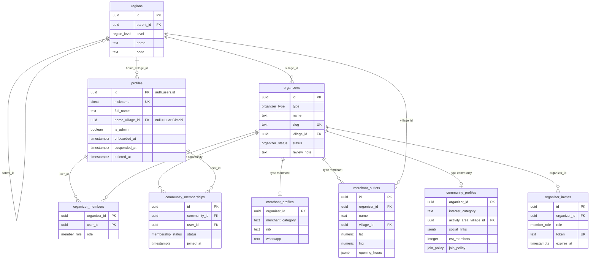
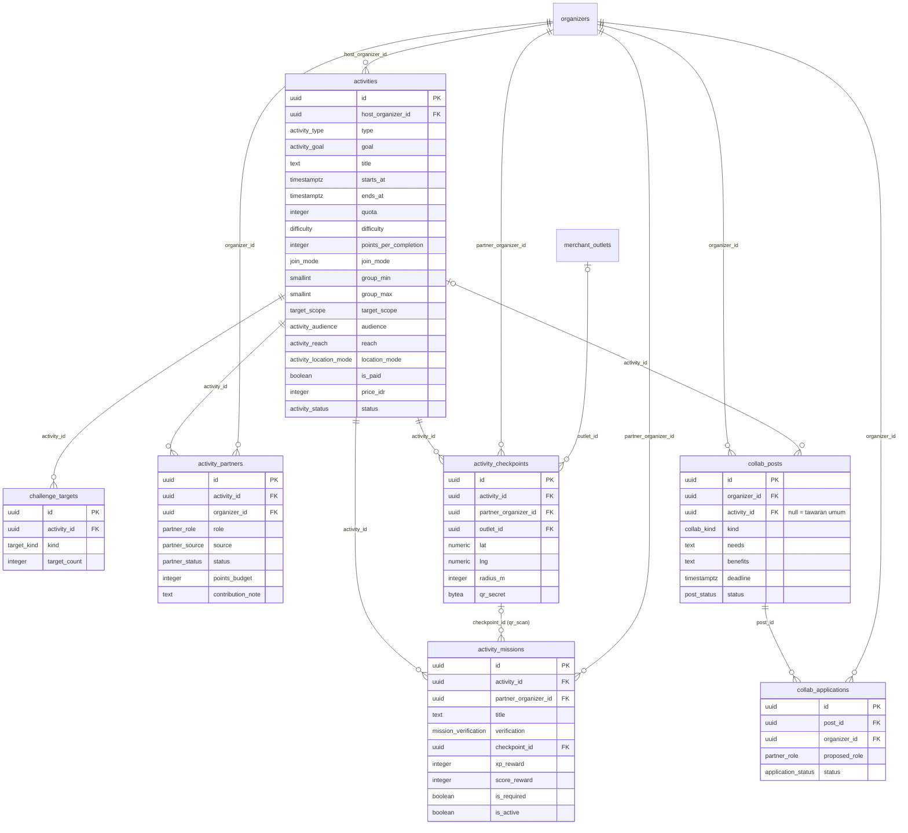
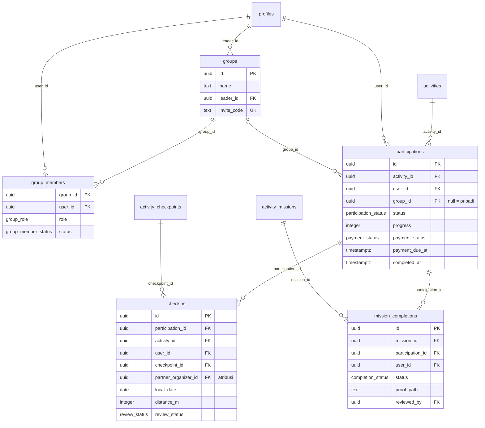
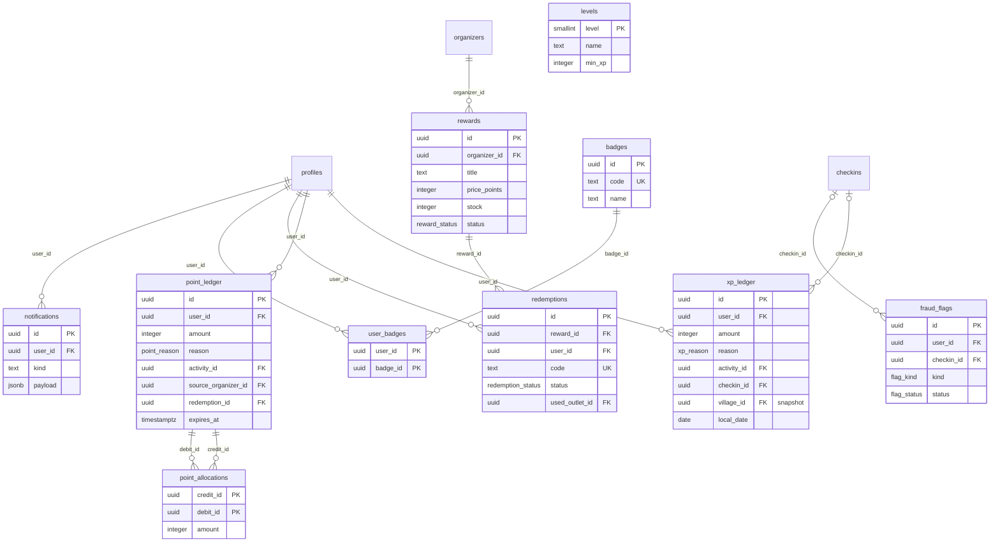
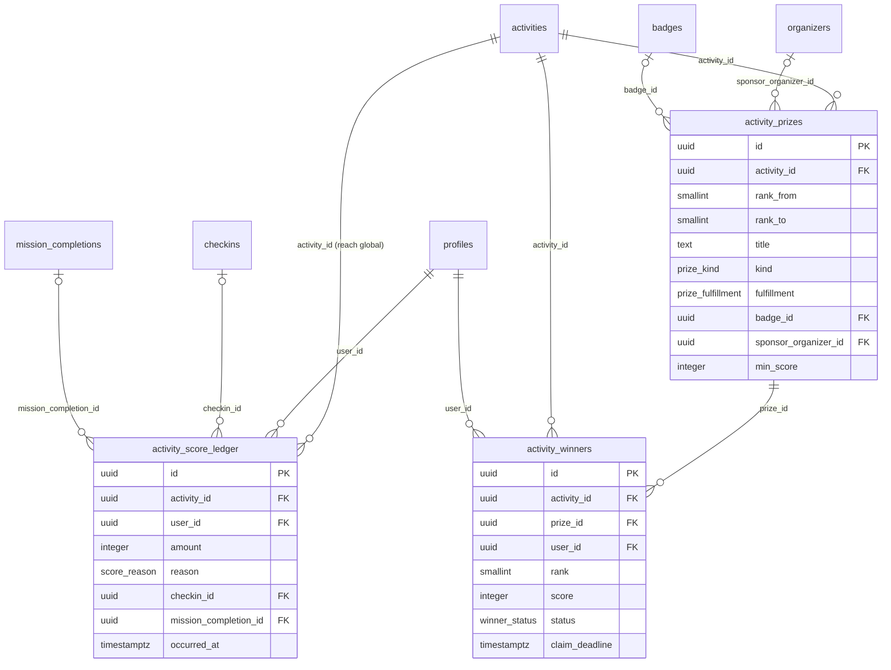

# Gasyu — Desain Database

Versi 0.13 · 19 Oktober 2026 · Supabase (Postgres 15+)
Perubahan 0.13: migrasi `0026_activity_city` (sudah diterapkan). Fungsi `region_city(region_id)` mencari kota dari wilayah tingkat apa pun. `v_activity_cards` menambah `city_id` dan `city_name`: kota dari `scope_region_id`, atau dari `organizers.village_id` jika cakupan kosong; NULL berarti berlaku untuk semua kota. Dipakai pemilih kota di Jelajah.
Perubahan 0.12: migrasi `0025_security_hardening` dari tinjauan keamanan (sudah diterapkan). View tidak lagi bisa ditulis atau dibaca `anon`; partner tidak bisa membaca `checkins.lat/lng`; `partner_is_active` + trigger `partner_inactive` di checkpoint dan misi; `activity_winners` dan `redemptions` hanya untuk pemilik dan admin (sponsor lewat `get_sponsored_prizes`, kode voucher aktif disembunyikan di `v_reward_redemptions`); poin dari check-in `flagged` ditahan (`point_credit_held`, `points_held`, kolom `v_user_points_balance.held`); `reverse_checkin` membalik XP per kelurahan asal; `refund_redemption` untuk pemilik hanya jika reward nonaktif; `review_mission_completion`/`mark_missions_manual` menolak diri sendiri dan peserta yang belum check-in (`manual_mark_eligible`, kolom `v_mission_manual_candidates.eligible`); kode misi minimal 6 karakter dan `flag_kind` `code_bruteforce`; `group_join_attempts` dan batas percobaan `join_group` (kode salah mengembalikan null); `reverse_mission_completion` (admin); constraint URL gambar `https://`; streak dan leaderboard kelurahan hanya menghitung aktivitas `regional`; kunci `app_settings` `mission.code_min_length`, `mission.code_flag_attempts`, `group.join_max_attempts`, `group.join_window_minutes`.
Perubahan 0.11: Event Global dibangun di migrasi `0022_global_events` (sudah diterapkan); tabel `cities` (514 kota/kabupaten, kode Kemendagri) dan `profiles.home_city_code` + `set_home_city` untuk kota asal warga luar Cimahi; di Event Global partisipasi tidak pernah berstatus `completed` (peringkat dari skor, peserta tetap bisa mengerjakan misi sampai acara berakhir); trigger `xp_ledger_reject_global`/`point_ledger_reject_global` menjamin aktivitas global tidak pernah menulis XP atau poin dari jalur mana pun; `set_activity_reach` (admin, saat draft) untuk memilih jangkauan dan mode lokasi. Migrasi `0023_bonus_missions_after_completion`: warga yang partisipasinya sudah `completed` tetap bisa mengerjakan misi bonus (`complete_mission`, `mark_missions_manual`, `get_activity_missions`), dan notifikasi misi baru dibuka juga sampai ke mereka. Migrasi `0024_activity_cards_reach`: `v_activity_cards` membawa `reach` dan `location_mode` untuk halaman admin Event Global (tahap 2) dan tab Event Global di Jelajah (tahap 3).
Perubahan 0.10: `rewards.valid_outlet_ids` dan cek outlet di `use_voucher`; `flag_kind` `reviewer_burst`, `fraud_flags.organizer_id`, deteksi di `review_mission_completion`; kunci `app_settings` `fraud.reviewer_burst_count`, `fraud.reviewer_burst_minutes`, `payment.gasyu_whatsapp`; migrasi `0020_outlet_vouchers_reviewer_flag` (sudah diterapkan; semula direncanakan 0021, ditukar dengan Event Global karena dikerjakan lebih dulu; Event Global kini 0022 setelah perbaikan review 0021).
Perubahan 0.9: Event Global, yaitu event buatan admin yang terbuka untuk pengguna dari kota mana pun, dengan skor, peringkat, dan hadiah khusus event: kolom `activities.reach` dan `activities.location_mode`, `activity_missions.score_reward`, tabel `activity_score_ledger`, `activity_prizes`, `activity_winners`, enum `activity_reach`, `activity_location_mode`, `score_reason`, `prize_kind`, `prize_fulfillment`, `winner_status`, view `v_activity_scoreboard` dan `v_global_event_stats`, fungsi `award_activity_score`, `get_activity_leaderboard`, `upsert_activity_prize`, `remove_activity_prize`, `finalize_activity_winners`, `claim_prize`, `mark_prize_delivered`, `forfeit_prize`, cron `process_prizes`, kunci `app_settings` `global_event.*`, migrasi `0022_global_events` (belum dibuat).
Perubahan 0.8: pengingat voucher dan poin hampir kedaluwarsa (`notify_expiring`, notifikasi `points_expiring`, `reminder.expiry_days`); master misi (`mission_templates`, `activity_missions.template_id`, `v_mission_template_stats`); fungsi akun warga (`update_my_profile`, `change_home_village`, `delete_my_account`), `set_team_role`; saran warga (`suggestions`, enum `suggestion_category` dan `suggestion_status`, view `v_organizer_suggestions`, fungsi `submit_suggestion` dan `respond_suggestion`).
Perubahan 0.7: kolom `activities.residency_rule` (enum `residency_rule`) dan helper `is_resident_of`.
Perubahan 0.6: pengaturan tampil misi (`reveal_mode`, `reveal_at`, `prerequisite_mission_id`, `show_teaser`, `revealed_at`), fungsi `reveal_mission` dan `get_activity_missions`.
Perubahan 0.5: event buatan admin (tipe organizer `platform`, sumber partner `admin`, fungsi `admin_add_partner`, `leave_activity`, `set_partner_budget`).
Perubahan 0.4: tipe organizer `business` diganti `merchant` (tabel `merchant_profiles`, `merchant_outlets`), view dashboard per entitas.
Perubahan 0.3: aktivitas berbayar (kolom harga di `activities`, status bayar di `participations`) dan misi (`activity_missions`, `mission_completions`).
Perubahan 0.2: keanggotaan komunitas (`community_memberships`), kebijakan bergabung, dan aktivitas khusus member.
Dokumen pendamping: `ALUR-SISTEM.md` (alur), `CLAUDE.md` (aturan kerja), PRD.

Nama tabel, kolom, dan enum ditulis dalam bahasa Inggris sesuai `CLAUDE.md`. Diagram ERD memakai Mermaid.

## Daftar isi

1. Ringkasan dan konvensi
2. ERD per domain
3. Enum
4. Kamus tabel
5. View
6. Fungsi database (RPC)
7. Matriks Row Level Security
8. Indeks dan constraint penting
9. Urutan migrasi per irisan build
10. Catatan desain

---

## 1. Ringkasan dan konvensi

**Empat entitas, satu skema.** Admin, Merchant/UMKM, Komunitas, dan Warga (lihat `ALUR-SISTEM.md` bagian 1). Setiap orang punya baris `profiles` (warga). Merchant dan komunitas disimpan di tabel induk `organizers` dengan `type` `merchant` atau `community`; tim pengelolanya di `organizer_members`. Admin adalah `profiles.is_admin = true`. Kata "organizer" hanya dipakai di nama tabel dan kolom; di aplikasi disebut merchant, komunitas, atau penyelenggara.

**38 tabel dalam 7 domain:**

| Domain | Tabel |
| --- | --- |
| Identitas & wilayah | `regions`, `profiles` |
| Organizer | `organizers`, `merchant_profiles`, `merchant_outlets`, `community_profiles`, `organizer_members`, `organizer_invites`, `community_memberships` |
| Aktivitas & kolaborasi | `activities`, `challenge_targets`, `activity_partners`, `activity_checkpoints`, `activity_missions`, `collab_posts`, `collab_applications` |
| Warga & partisipasi | `groups`, `group_members`, `participations`, `checkins`, `mission_completions` |
| Ekonomi gamifikasi | `xp_ledger`, `point_ledger`, `point_allocations`, `rewards`, `redemptions`, `levels`, `badges`, `user_badges`, `monthly_village_winners` |
| Event Global | `activity_score_ledger`, `activity_prizes`, `activity_winners` |
| Operasional | `fraud_flags`, `notifications`, `admin_actions`, `app_settings`, `mission_code_attempts` |

**Konvensi**

| Hal | Aturan |
| --- | --- |
| Primary key | `uuid` dengan `default gen_random_uuid()`, kecuali tabel penghubung (PK gabungan) dan `profiles.id` = `auth.users.id` |
| Waktu | `timestamptz`, disimpan UTC; tampilan dan batas harian/bulanan memakai `Asia/Jakarta` |
| Tanggal lokal | Kolom `local_date date` dihitung `(now() at time zone 'Asia/Jakarta')::date` untuk aturan harian |
| Koordinat | `lat numeric(9,6)`, `lng numeric(9,6)`; jarak dihitung dengan rumus haversine di fungsi (PostGIS tidak wajib di MVP) |
| Audit kolom | `created_at timestamptz default now()` di semua tabel; `updated_at` + trigger di tabel yang bisa diedit |
| Penghapusan | Soft delete hanya untuk `profiles` (`deleted_at`); data lain tidak dihapus jika sudah dipakai ledger. Pengecualian: log `mission_code_attempts` dibersihkan otomatis |
| Ledger | `xp_ledger`, `point_ledger`, dan `activity_score_ledger` hanya `insert`; koreksi ditulis sebagai baris negatif |
| Uang nyata | Tidak ada transaksi uang di aplikasi. Harga aktivitas berbayar disimpan sebagai informasi (`price_idr`, rupiah bulat) dan status bayar dikonfirmasi manual oleh tim organizer; dana sponsor dicatat sebagai teks di `contribution_note` |
| File privat | Bukti bayar dan bukti foto misi disimpan di bucket Storage privat (`payment-proofs`, `mission-proofs`); hanya warga pemilik dan tim organizer host yang bisa membaca lewat signed URL |

---

## 2. ERD per domain

ERD dipecah per domain supaya terbaca. Kolom yang ditampilkan adalah kolom kunci; daftar lengkap ada di bagian 4.

### 2a. Identitas, wilayah, dan organizer

### 2b. Aktivitas dan kolaborasi

### 2c. Warga, grup, partisipasi, dan check-in

### 2d. Ekonomi gamifikasi dan operasional

### 2e. Event Global

---

## 3. Enum

| Enum | Nilai |
| --- | --- |
| `region_level` | city, district, village |
| `organizer_type` | merchant (UMKM atau usaha apa pun), community (komunitas apa pun), platform (satu baris "Gasyu" untuk event buatan admin) |
| `organizer_status` | pending, approved, rejected, suspended |
| `member_role` | owner, staff (merchant) · chair, officer (komunitas) |
| `join_policy` | open, approval |
| `membership_status` | pending, active, rejected, left, removed |
| `activity_audience` | public, members_only |
| `residency_rule` | open, residents_only |
| `activity_reach` | regional (default, tampil per wilayah), global (Event Global: terbuka untuk pengguna dari kota mana pun, skor dan hadiah khusus event) |
| `activity_location_mode` | onsite (wajib checkpoint), online (tanpa checkpoint), hybrid (checkpoint opsional); selain onsite hanya untuk `reach = global` |
| `activity_type` | event, challenge |
| `activity_goal` | awareness, visit, sales, membership |
| `activity_status` | draft, awaiting_partners, in_review, published, running, ended, settled, cancelled |
| `difficulty` | easy, medium, hard |
| `join_mode` | individual, group, both |
| `target_scope` | individual, group |
| `target_kind` | total_checkins, distinct_checkpoints, required_missions, missions_completed |
| `mission_verification` | qr_scan, secret_code, photo, manual |
| `mission_reveal` | on_publish, scheduled, manual, after_mission |
| `completion_status` | pending_review, approved, rejected |
| `payment_status` | not_required, unpaid, awaiting_confirmation, paid, refunded |
| `partner_role` | host, cohost, sponsor |
| `partner_source` | creator, invite, open_call, admin |
| `partner_status` | invited, accepted, declined, removed |
| `collab_kind` | collab, sponsor |
| `post_status` | open, closed |
| `application_status` | pending, accepted, rejected, withdrawn |
| `group_role` | leader, member |
| `group_member_status` | active, left, removed |
| `participation_status` | invited, registered, in_progress, completed, not_completed, cancelled |
| `review_status` | ok, flagged, approved, rejected |
| `xp_reason` | profile_complete, event_checkin, challenge_complete, mission_complete, first_visit_bonus, collab_bonus, group_bonus, streak, reversal, adjustment |
| `point_reason` | activity_reward, redemption, refund, expiry, reversal, adjustment |
| `score_reason` | checkin, mission_complete, reversal, adjustment |
| `prize_kind` | physical (barang), voucher (voucher atau tiket dari sponsor, diserahkan di luar sistem `rewards`), badge (badge eksklusif event), other |
| `prize_fulfillment` | pickup (ambil di lokasi), shipping (dikirim ke alamat pemenang), digital (diberikan di aplikasi atau lewat pesan) |
| `winner_status` | pending_claim, claimed, delivered, forfeited |
| `reward_status` | active, inactive |
| `redemption_status` | active, used, expired, refunded |
| `flag_kind` | out_of_radius, impossible_travel, shared_device, burst_accounts, reviewer_burst (satu peninjau menyetujui terlalu banyak bukti dalam waktu singkat), manual |
| `flag_status` | open, dismissed, actioned |
| `suggestion_category` | activity, product, service, place, other |
| `suggestion_status` | new, in_progress, done, archived |
| `mission_category` | visit, purchase, social, sport, environment, learning, community, other |

---

## 4. Kamus tabel

Kolom `created_at timestamptz not null default now()` ada di semua tabel dan tidak diulang. "Edit" berarti tabel juga punya `updated_at`.

### Identitas & wilayah

**regions** — hierarki kota, kecamatan, kelurahan.

| Kolom | Tipe | Aturan |
| --- | --- | --- |
| id | uuid | PK |
| parent_id | uuid | FK `regions`, null untuk kota |
| level | region_level | not null |
| name | text | not null |
| code | text | kode Kemendagri, opsional |
| is_active | boolean | default true; kota yang belum dibuka = false |

Unik: `(parent_id, name)`. Seed: `seed-wilayah-cimahi.sql` (1 kota, 3 kecamatan, 15 kelurahan).

**cities** — daftar referensi 514 kota/kabupaten Indonesia (kode Kemendagri, sumber paket `idn-area-data` lisensi MIT): `code text` PK (contoh `32.73`), `province_code`, `province_name`, `name`. Hanya dibaca (semua pengguna). Dipakai untuk kota asal warga luar Cimahi, terpisah dari `regions` yang menyaring aktivitas.

**profiles** — satu baris per akun, dibuat trigger saat `auth.users` insert. Edit.

| Kolom | Tipe | Aturan |
| --- | --- | --- |
| id | uuid | PK, FK `auth.users(id)` on delete cascade |
| nickname | citext | unik, 3–20 karakter, tampil publik |
| full_name | text | privat |
| avatar_url | text | Storage |
| home_village_id | uuid | FK `regions` level village; null = Luar Cimahi |
| home_village_changed_at | timestamptz | ganti kelurahan maksimal sekali per 90 hari |
| home_city_code | text | FK `cities`; kota/kabupaten asal, hanya untuk warga luar Cimahi (`home_village_id` null, dicek constraint); opsional; diisi lewat `set_home_city`, dikosongkan saat pindah ke kelurahan Cimahi atau hapus akun |
| is_admin | boolean | default false; hanya bisa diubah lewat SQL oleh pemilik platform |
| terms_accepted_at | timestamptz | wajib saat onboarding |
| onboarded_at | timestamptz | null = belum onboarding |
| suspended_at | timestamptz | diisi admin; akun beku |
| deleted_at | timestamptz | soft delete, nama dan avatar dikosongkan |

### Organizer

**organizers** — induk bersama merchant dan komunitas. Edit.

| Kolom | Tipe | Aturan |
| --- | --- | --- |
| id | uuid | PK |
| type | organizer_type | not null, tidak bisa diubah setelah dibuat |
| name | text | not null |
| slug | text | unik, untuk URL |
| logo_url | text | Storage |
| description | text | |
| village_id | uuid | FK `regions`; kelurahan utama (outlet pertama atau area kegiatan) |
| status | organizer_status | default pending |
| review_note | text | alasan penolakan |
| verified_by | uuid | FK `profiles` admin |
| verified_at | timestamptz | |
| created_by | uuid | FK `profiles` |

**merchant_profiles** — data khusus merchant. 1:1 dengan `organizers` bertipe merchant. Edit.

| Kolom | Tipe | Aturan |
| --- | --- | --- |
| organizer_id | uuid | PK, FK `organizers` |
| merchant_category | text | kuliner, kopi, retail, fesyen, jasa, otomotif, kerajinan, lainnya; semua jenis UMKM/usaha boleh mendaftar |
| nib | text | opsional |
| whatsapp | text | not null |
| proof_url | text | foto tempat usaha |

**merchant_outlets** — cabang/outlet merchant. Edit.

| Kolom | Tipe | Aturan |
| --- | --- | --- |
| id | uuid | PK |
| organizer_id | uuid | FK `organizers` (harus type merchant) |
| name | text | contoh "Cabang Baros" |
| address | text | not null |
| village_id | uuid | FK `regions` |
| lat, lng | numeric(9,6) | not null |
| opening_hours | jsonb | `{"mon":["08:00","21:00"], ...}` |
| is_active | boolean | default true |

**community_profiles** — data khusus komunitas. 1:1. Edit.

| Kolom | Tipe | Aturan |
| --- | --- | --- |
| organizer_id | uuid | PK, FK `organizers` |
| interest_category | text | olahraga, musik, seni, hobi, sosial, lingkungan, edukasi, keagamaan, lainnya; semua jenis komunitas boleh mendaftar |
| activity_area_village_id | uuid | FK `regions` |
| social_links | jsonb | `{"instagram":"...","tiktok":"..."}` |
| est_members | integer | perkiraan saat mendaftar; jumlah nyata dari `v_community_member_stats` |
| join_policy | join_policy | default approval; ketua bisa mengubah |
| basecamp_address | text | opsional |
| basecamp_lat, basecamp_lng | numeric(9,6) | opsional |
| whatsapp | text | not null |
| proof_url | text | tautan medsos atau foto kegiatan |

**organizer_members** — anggota tim.

| Kolom | Tipe | Aturan |
| --- | --- | --- |
| organizer_id | uuid | PK, FK |
| user_id | uuid | PK, FK `profiles` |
| role | member_role | owner/staff untuk merchant, chair/officer untuk komunitas (dicek trigger) |
| invited_by | uuid | FK `profiles` |

Trigger: setiap organizer wajib punya minimal satu owner (merchant) atau chair (komunitas).

**organizer_invites** — tautan undangan tim.

| Kolom | Tipe | Aturan |
| --- | --- | --- |
| id | uuid | PK |
| organizer_id | uuid | FK |
| role | member_role | hanya staff atau officer |
| token | text | unik, 32 karakter acak |
| expires_at | timestamptz | default now() + 7 hari |
| created_by | uuid | FK |
| accepted_by | uuid | FK, null sampai dipakai |
| accepted_at | timestamptz | |

**community_memberships** — warga yang menjadi member komunitas. Terpisah dari `organizer_members` (tim pengelola). Edit.

| Kolom | Tipe | Aturan |
| --- | --- | --- |
| id | uuid | PK |
| community_id | uuid | FK `organizers`; harus type community (dicek trigger) |
| user_id | uuid | FK `profiles` |
| status | membership_status | pending atau active saat dibuat, tergantung `join_policy` |
| message | text | pesan opsional dari warga saat meminta bergabung, maks. 200 karakter |
| joined_at | timestamptz | diisi saat status menjadi active |
| decided_by | uuid | FK `profiles`; ketua/pengurus yang menerima atau menolak, null jika otomatis |
| decided_at | timestamptz | |
| ended_at | timestamptz | diisi saat status left atau removed |
| removed_by | uuid | FK `profiles` |
| removed_reason | text | |

Unik parsial: satu baris `pending` atau `active` per `(community_id, user_id)`; baris lama `left`, `removed`, atau `rejected` tetap tersimpan sebagai riwayat.

Trigger: chair dan officer di `organizer_members` selalu punya baris `active`; ketua tidak bisa `left` selama masih chair. Permintaan baru ditolak jika baris terakhir warga berstatus `removed` atau `rejected` kurang dari 30 hari lalu.

### Aktivitas & kolaborasi

**activities** — event dan challenge. Edit.

| Kolom | Tipe | Aturan |
| --- | --- | --- |
| id | uuid | PK |
| host_organizer_id | uuid | FK `organizers` |
| type | activity_type | not null |
| goal | activity_goal | not null |
| title | text | not null |
| description | text | termasuk syarat usia jika ada (teks bebas) |
| cover_url | text | |
| scope_region_id | uuid | FK `regions` (kota, kecamatan, atau kelurahan); dipakai untuk penyaringan beranda dan, jika `residents_only`, sebagai syarat domisili. Untuk Event Global boleh null atau diisi lokasi acara (hanya informasi, tidak menyaring) |
| starts_at, ends_at | timestamptz | `ends_at > starts_at` |
| quota | integer | null = tanpa batas |
| difficulty | difficulty | wajib untuk challenge |
| xp_base | integer | dihitung otomatis: event 100; challenge 150/250/400; 0 untuk Event Global |
| points_per_completion | integer | default 0; wajib 0 untuk Event Global |
| join_mode | join_mode | default individual; wajib individual untuk Event Global |
| group_min, group_max | smallint | 2–10, wajib jika join_mode bukan individual |
| target_scope | target_scope | default individual; group hanya untuk challenge |
| residency_rule | residency_rule | default open; `residents_only` = hanya warga yang `home_village_id`-nya berada di dalam `scope_region_id`; wajib open untuk Event Global |
| audience | activity_audience | default public; members_only hanya jika host bertipe community (dicek trigger) |
| reach | activity_reach | default regional; `global` hanya untuk host `platform` (admin) dan `type = event` (dicek trigger); tidak bisa diubah setelah published |
| location_mode | activity_location_mode | default onsite; online dan hybrid hanya untuk `reach = global`; tidak bisa diubah setelah published |
| is_paid | boolean | default false; tidak bisa diubah setelah published |
| price_idr | integer | wajib ≥ 1000 jika `is_paid`, null jika gratis; tidak bisa diubah setelah published |
| payment_instructions | text | wajib jika `is_paid`: rekening, QRIS, atau kontak panitia |
| payment_window_hours | integer | default 24; batas waktu bayar setelah join, dipotong ke `starts_at` |
| status | activity_status | default draft |
| review_note | text | |
| reviewed_by | uuid | FK admin |
| submitted_at, published_at | timestamptz | |
| created_by | uuid | FK |

Budget poin tidak disimpan di sini; budget = jumlah `activity_partners.points_budget` yang `accepted`.

**challenge_targets**

| Kolom | Tipe | Aturan |
| --- | --- | --- |
| id | uuid | PK |
| activity_id | uuid | FK, unik (MVP: satu target per challenge) |
| kind | target_kind | not null; `required_missions` hanya untuk `target_scope = individual` |
| target_count | integer | > 0; diabaikan untuk `required_missions` (diisi 1) |

**activity_partners** — organizer yang terlibat, termasuk host. Edit.

| Kolom | Tipe | Aturan |
| --- | --- | --- |
| id | uuid | PK |
| activity_id | uuid | FK |
| organizer_id | uuid | FK |
| role | partner_role | host (tepat satu per aktivitas), cohost, sponsor |
| source | partner_source | creator untuk host, invite, open_call, admin (ditambahkan langsung oleh admin ke event Gasyu) |
| status | partner_status | host otomatis accepted |
| points_budget | integer | default 0; > 0 hanya jika organizer bertipe merchant dan aktivitas `reach = regional` |
| contribution_note | text | kontribusi non-poin: dana (di luar aplikasi), tenaga, perlengkapan |
| benefits_note | text | yang didapat partner |
| invited_by | uuid | FK |
| responded_at | timestamptz | |

Unik: `(activity_id, organizer_id)`. Unik parsial: satu baris `role = host` per aktivitas. Trigger: `source = admin` hanya untuk aktivitas dengan host bertipe `platform`; organizer `platform` tidak bisa menjadi partner selain host.

**activity_checkpoints** — titik check-in. Edit.

| Kolom | Tipe | Aturan |
| --- | --- | --- |
| id | uuid | PK |
| activity_id | uuid | FK |
| partner_organizer_id | uuid | FK `organizers`; harus partner accepted di aktivitas ini |
| outlet_id | uuid | FK `merchant_outlets`, opsional |
| name | text | contoh "Kedai Kopi X Baros" |
| lat, lng | numeric(9,6) | diambil dari outlet atau titik peta |
| radius_m | integer | default 150 |
| qr_secret | bytea | 32 byte acak; kolom tidak bisa dibaca client |
| is_active | boolean | default true |

**mission_templates** — master misi yang dikelola admin: `id`, `title`, `description`, `organizer_tips`, `category mission_category`, `verification`, `xp_reward` (saran, dalam batas `mission.xp_min`–`xp_max`), `is_required`, `activity_type` (null = semua), `organizer_type` (merchant/community, null = semua), `is_active`, `sort_order`, `created_by`. Ditulis hanya lewat fungsi admin.

**activity_missions** — misi di dalam aktivitas (event atau challenge). Edit. Sejak 0018 ada `template_id` (asal master misi, null jika dibuat dari nol).

| Kolom | Tipe | Aturan |
| --- | --- | --- |
| id | uuid | PK |
| activity_id | uuid | FK `activities` |
| partner_organizer_id | uuid | FK `organizers`; pembuat misi, harus host atau partner accepted (atribusi) |
| title | text | 3–80 karakter |
| description | text | instruksi untuk warga, termasuk kriteria foto atau kriteria berhasil |
| icon | text | nama ikon, opsional |
| sort_order | smallint | urutan tampil |
| verification | mission_verification | not null; `qr_scan` tidak boleh untuk aktivitas `location_mode = online` |
| checkpoint_id | uuid | FK `activity_checkpoints`; wajib jika `qr_scan`, dan checkpoint harus milik `partner_organizer_id` |
| qr_secret | bytea | 32 byte acak untuk `qr_scan`; tidak bisa dibaca client |
| code_hash | text | hash kode rahasia untuk `secret_code` (bcrypt, tidak peka huruf besar/kecil); tidak bisa dibaca client |
| xp_reward | integer | 10–100 untuk aktivitas `regional`; wajib 0 untuk Event Global (trigger) |
| score_reward | integer | default 0; wajib 10–1000 untuk Event Global, wajib 0 untuk aktivitas `regional` (trigger) |
| is_required | boolean | default true; false = misi bonus |
| available_from, available_until | timestamptz | jendela waktu opsional di dalam `starts_at`–`ends_at` |
| is_active | boolean | default true |
| reveal_mode | mission_reveal | default on_publish |
| reveal_at | timestamptz | wajib jika `scheduled` |
| prerequisite_mission_id | uuid | FK `activity_missions` di aktivitas yang sama; wajib jika `after_mission` |
| show_teaser | boolean | default true; false = tidak muncul sama sekali sebelum terbuka |
| revealed_at | timestamptz | diisi saat misi terbuka untuk semua (on_publish saat terbit, scheduled oleh cron, manual oleh `reveal_mission`); null untuk `after_mission` karena terbukanya per warga |
| locked_at | timestamptz | diisi saat completion pertama disetujui; setelah itu `verification`, `xp_reward`, `score_reward`, `is_required`, `checkpoint_id` tidak bisa diubah (trigger) |
| created_by | uuid | FK `profiles` |

Trigger: total `xp_reward` misi aktif per aktivitas maksimal 500 (`app_settings.mission.max_total_xp`); total `score_reward` misi aktif per Event Global maksimal 5.000 (`app_settings.global_event.max_total_score`).

**collab_posts** — open call dan tawaran umum. Edit.

| Kolom | Tipe | Aturan |
| --- | --- | --- |
| id | uuid | PK |
| organizer_id | uuid | FK pembuat |
| activity_id | uuid | FK, null = tawaran umum ("siap jadi sponsor event olahraga") |
| kind | collab_kind | collab atau sponsor |
| needs | text | yang dibutuhkan |
| benefits | text | yang didapat partner |
| category | text | untuk penyaringan |
| region_id | uuid | FK `regions` |
| deadline | timestamptz | opsional |
| status | post_status | default open |

**collab_applications** — pengajuan ke open call. Edit.

| Kolom | Tipe | Aturan |
| --- | --- | --- |
| id | uuid | PK |
| post_id | uuid | FK |
| organizer_id | uuid | FK pengaju; tidak boleh sama dengan pembuat post |
| proposed_role | partner_role | cohost atau sponsor |
| proposed_points_budget | integer | default 0, hanya merchant |
| contribution | text | |
| message | text | |
| status | application_status | default pending |
| decided_by | uuid | FK |
| decided_at | timestamptz | |

Unik: `(post_id, organizer_id)`.

### Warga & partisipasi

**groups** — grup tetap warga. Edit.

| Kolom | Tipe | Aturan |
| --- | --- | --- |
| id | uuid | PK |
| name | text | 3–30 karakter |
| leader_id | uuid | FK `profiles` |
| invite_code | text | unik, 6 karakter, bisa dibuat ulang |

**group_members**

| Kolom | Tipe | Aturan |
| --- | --- | --- |
| group_id | uuid | PK, FK |
| user_id | uuid | PK, FK |
| role | group_role | tepat satu leader aktif per grup |
| status | group_member_status | default active |
| joined_at | timestamptz | |

Trigger: maksimal 10 anggota aktif per grup; maksimal 3 grup aktif per warga.

**participations** — keikutsertaan warga di aktivitas. Edit.

| Kolom | Tipe | Aturan |
| --- | --- | --- |
| id | uuid | PK |
| activity_id | uuid | FK |
| user_id | uuid | FK |
| group_id | uuid | FK, null = pribadi; selalu null untuk Event Global |
| status | participation_status | invited (menunggu konfirmasi grup), registered, in_progress, completed, not_completed, cancelled |
| progress | integer | default 0; untuk challenge individu (check-in atau misi, sesuai `target_kind`) |
| registered_by | uuid | FK; ketua grup atau diri sendiri |
| payment_status | payment_status | `not_required` untuk aktivitas gratis; `unpaid` saat mendaftar ke aktivitas berbayar |
| payment_due_at | timestamptz | `now() + payment_window_hours`, maksimal `starts_at`; null jika gratis |
| payment_proof_path | text | path bukti bayar di bucket `payment-proofs`, opsional |
| payment_note | text | catatan dari tim (mis. alasan bukti ditolak) |
| payment_confirmed_by | uuid | FK `profiles` tim organizer |
| payment_confirmed_at | timestamptz | |
| refunded_at | timestamptz | diisi saat tim menandai `refunded` |
| completed_at | timestamptz | |

Unik: `(activity_id, user_id)`.

**mission_completions** — penyelesaian misi oleh warga. Hanya ditulis lewat fungsi.

| Kolom | Tipe | Aturan |
| --- | --- | --- |
| id | uuid | PK |
| mission_id | uuid | FK `activity_missions` |
| participation_id | uuid | FK |
| activity_id | uuid | FK (denormalisasi) |
| user_id | uuid | FK (denormalisasi) |
| group_id | uuid | FK, salinan dari partisipasi (untuk target grup) |
| status | completion_status | `approved` langsung untuk qr_scan/secret_code/manual; `pending_review` untuk photo |
| proof_path | text | path foto di bucket `mission-proofs`; wajib untuk photo |
| lat, lng | numeric(9,6) | lokasi warga untuk qr_scan |
| distance_m | integer | jarak ke checkpoint untuk qr_scan |
| is_flagged | boolean | default false; true jika qr_scan di luar radius |
| submitted_at | timestamptz | default now() |
| reviewed_by | uuid | FK tim organizer (photo/manual) |
| reviewed_at | timestamptz | |
| review_note | text | alasan penolakan |
| local_date | date | tanggal WIB saat disetujui, untuk batas XP harian |

Unik parsial: satu baris `pending_review` atau `approved` per `(mission_id, user_id)`; baris `rejected` tetap disimpan sehingga foto bisa diunggah ulang.

**mission_code_attempts** — log percobaan kode rahasia yang salah, untuk batas 5 percobaan per 15 menit per misi per warga. Hanya insert lewat `complete_mission`.

| Kolom | Tipe | Aturan |
| --- | --- | --- |
| id | bigint | PK identity |
| mission_id | uuid | FK `activity_missions` |
| user_id | uuid | FK |
| attempted_at | timestamptz | default now() |

Baris lebih dari 1 hari dihapus oleh cron `prune_code_attempts` (satu-satunya tabel yang boleh dihapus, karena bukan data ledger).

**checkins** — setiap pemindaian yang diterima. Hanya insert lewat `perform_checkin`.

| Kolom | Tipe | Aturan |
| --- | --- | --- |
| id | uuid | PK |
| participation_id | uuid | FK |
| activity_id | uuid | FK (denormalisasi untuk indeks dan unik) |
| user_id | uuid | FK (denormalisasi) |
| group_id | uuid | FK, salinan dari partisipasi |
| checkpoint_id | uuid | FK |
| partner_organizer_id | uuid | FK, atribusi dari checkpoint |
| checked_in_at | timestamptz | default now() |
| local_date | date | tanggal WIB |
| lat, lng | numeric(9,6) | lokasi warga |
| distance_m | integer | jarak ke checkpoint |
| review_status | review_status | ok atau flagged; admin mengubah ke approved/rejected |
| reviewed_by | uuid | FK admin |

Unik: `(activity_id, user_id, local_date)`.

### Ekonomi gamifikasi

**xp_ledger** — semua perubahan XP. Hanya insert. Event Global tidak menulis ke tabel ini.

| Kolom | Tipe | Aturan |
| --- | --- | --- |
| id | uuid | PK |
| user_id | uuid | FK |
| amount | integer | boleh negatif untuk reversal |
| reason | xp_reason | not null |
| activity_id | uuid | FK, opsional |
| checkin_id | uuid | FK, opsional |
| mission_completion_id | uuid | FK `mission_completions`, untuk reason `mission_complete` |
| village_id | uuid | snapshot `profiles.home_village_id` saat XP diberikan |
| local_date | date | tanggal WIB, untuk batas 1.000/hari |
| note | text | |

**point_ledger** — semua perubahan poin. Hanya insert. Event Global tidak menulis ke tabel ini.

| Kolom | Tipe | Aturan |
| --- | --- | --- |
| id | uuid | PK |
| user_id | uuid | FK |
| amount | integer | + untuk kredit, − untuk debit |
| reason | point_reason | not null |
| activity_id | uuid | FK, untuk activity_reward |
| source_organizer_id | uuid | FK, partner merchant yang budgetnya terpakai |
| redemption_id | uuid | FK, untuk redemption dan refund |
| expires_at | timestamptz | wajib untuk kredit: +6 bulan |

**point_allocations** — memetakan debit ke kredit (FIFO), supaya sisa tiap kredit bisa dihitung untuk kedaluwarsa.

| Kolom | Tipe | Aturan |
| --- | --- | --- |
| credit_id | uuid | PK, FK `point_ledger` (amount > 0) |
| debit_id | uuid | PK, FK `point_ledger` (amount < 0) |
| amount | integer | > 0 |

**rewards** — voucher dari merchant. Edit.

| Kolom | Tipe | Aturan |
| --- | --- | --- |
| id | uuid | PK |
| organizer_id | uuid | FK, harus type merchant |
| title | text | "Gratis 1 es kopi susu" |
| description | text | syarat pemakaian |
| image_url | text | |
| price_points | integer | > 0 |
| stock | integer | ≥ 0 |
| valid_days | integer | masa berlaku voucher setelah ditukar, default 30 |
| available_until | timestamptz | batas akhir penukaran |
| valid_outlet_ids | uuid[] | null = berlaku di semua outlet merchant; jika diisi, hanya outlet aktif milik merchant yang sama (dicek trigger) |
| status | reward_status | default active |

**redemptions** — voucher milik warga. Edit (status).

| Kolom | Tipe | Aturan |
| --- | --- | --- |
| id | uuid | PK |
| reward_id | uuid | FK |
| user_id | uuid | FK |
| code | text | unik, 8 karakter tanpa huruf ambigu (O/0, I/1) |
| price_points | integer | salinan harga saat ditukar |
| status | redemption_status | default active |
| expires_at | timestamptz | now() + valid_days |
| used_at | timestamptz | |
| used_by | uuid | FK staf/kasir |
| used_outlet_id | uuid | FK `merchant_outlets` |

**levels** — tabel referensi (seed).

| level | name | min_xp |
| --- | --- | --- |
| 1 | Warga Baru | 0 |
| 2 | Penjelajah | 500 |
| 3 | Penggerak | 1500 |
| 4 | Jawara | 4000 |
| 5 | Legenda Cimahi | 10000 |

**badges** — definisi badge (seed): `id`, `code` unik, `name`, `description`, `icon_url`, `rule jsonb` (contoh `{"type":"distinct_villages","count":5}`). Badge awal ada di `ALUR-SISTEM.md` bagian 17. Badge eksklusif Event Global dibuat admin dengan `rule = {"type":"activity_prize"}`, sehingga tidak pernah diberikan otomatis oleh `award_badges`.

**user_badges**: `user_id` + `badge_id` (PK gabungan), `awarded_at`, `activity_id` opsional.

**monthly_village_winners**: `month date` (tanggal 1), `village_id`, `rank smallint`, `avg_xp numeric`, `active_citizens integer`. PK `(month, rank)`.

### Event Global

**activity_score_ledger** — semua perubahan skor di Event Global. Hanya insert (trigger `prevent_ledger_change`). Skor terpisah dari XP dan poin: tidak menambah level, peringkat kota/kelurahan, atau saldo dompet.

| Kolom | Tipe | Aturan |
| --- | --- | --- |
| id | uuid | PK |
| activity_id | uuid | FK `activities`; harus `reach = global` (trigger) |
| user_id | uuid | FK `profiles` |
| amount | integer | boleh negatif untuk reversal; tidak boleh 0 |
| reason | score_reason | not null |
| checkin_id | uuid | FK `checkins`, untuk reason `checkin` |
| mission_completion_id | uuid | FK `mission_completions`, untuk reason `mission_complete` |
| occurred_at | timestamptz | waktu warga melakukan aksinya (`checkins.checked_in_at` atau `mission_completions.submitted_at`), bukan waktu disetujui; dipakai untuk aturan seri |
| note | text | |

**activity_prizes** — hadiah per rentang peringkat di Event Global. Edit.

| Kolom | Tipe | Aturan |
| --- | --- | --- |
| id | uuid | PK |
| activity_id | uuid | FK `activities`; harus `reach = global` (trigger) |
| rank_from, rank_to | smallint | `1 ≤ rank_from ≤ rank_to ≤ global_event.max_prize_rank` (100); rentang tidak boleh tumpang tindih dalam satu aktivitas (trigger) |
| title | text | contoh "Juara 1: Sepeda lipat" |
| description | text | syarat dan detail hadiah |
| image_url | text | Storage |
| kind | prize_kind | not null |
| fulfillment | prize_fulfillment | not null; `badge` selalu `digital` |
| badge_id | uuid | FK `badges`; wajib jika `kind = badge` |
| sponsor_organizer_id | uuid | FK `organizers`; partner accepted di aktivitas ini yang menyediakan hadiah, null = disediakan Gasyu |
| pickup_note | text | lokasi dan cara ambil; wajib jika `fulfillment = pickup` |
| min_score | integer | default 1; skor minimal untuk berhak atas hadiah ini |
| created_by | uuid | FK `profiles` admin |

Setelah aktivitas `published`, baris hadiah hanya bisa ditambah; kolom selain `description` dan `image_url` terkunci dan baris tidak bisa dihapus (trigger), supaya hadiah yang sudah diumumkan tidak dikurangi.

**activity_winners** — pemenang yang ditetapkan saat Event Global `settled`. Edit (status dan data klaim).

| Kolom | Tipe | Aturan |
| --- | --- | --- |
| id | uuid | PK |
| activity_id | uuid | FK `activities` |
| prize_id | uuid | FK `activity_prizes` |
| user_id | uuid | FK `profiles` |
| rank | smallint | peringkat akhir |
| score | integer | salinan skor akhir |
| status | winner_status | default pending_claim; hadiah badge langsung `delivered` |
| claim_deadline | timestamptz | waktu settled + `global_event.claim_days` (14 hari) |
| claimed_at | timestamptz | |
| ship_name, ship_phone, ship_address | text | hanya untuk `fulfillment = shipping`; privat; dikosongkan `global_event.shipping_retention_days` (30) hari setelah `delivered` |
| delivered_at | timestamptz | |
| delivered_by | uuid | FK `profiles` admin |
| forfeited_reason | text | diisi saat `forfeited` (lewat batas klaim, akun dibekukan, atau keputusan admin) |
| note | text | nomor resi atau catatan serah terima |

Unik: `(activity_id, rank)` dan `(activity_id, user_id)`.

### Operasional

**fraud_flags**: `id`, `user_id` (warga yang dicurigai, atau peninjau untuk `reviewer_burst`), `organizer_id` opsional (penyelenggara terkait, wajib untuk `reviewer_burst`), `checkin_id` opsional, `mission_completion_id` opsional, `kind flag_kind`, `detail jsonb`, `status flag_status` default open, `reviewed_by`, `reviewed_at`.

**notifications**: `id`, `user_id`, `kind text` (partner_invite, application_received, group_registration, activity_approved, organizer_verified, badge_awarded, voucher_expiring, points_expiring, partner_added_by_admin, partner_left, membership_requested, membership_approved, membership_rejected, membership_removed, community_new_activity, payment_proof_submitted, payment_confirmed, payment_rejected, payment_expired, payment_refund_due, mission_proof_submitted, mission_approved, mission_rejected, mission_revealed, suggestion_received, suggestion_answered, team_role_changed, prize_won, prize_claim_reminder, prize_claimed, prize_delivered, prize_forfeited), `payload jsonb`, `read_at`.

**suggestions** — saran warga untuk merchant/komunitas: `id`, `organizer_id` (merchant/komunitas approved), `user_id` pengirim, `category suggestion_category`, `body text` (10–1.000 karakter), `is_anonymous boolean`, `status suggestion_status` default new, `reply text` opsional, `replied_at`, `replied_by`, `status_changed_at`, `created_at`, `updated_at`. Ditulis hanya lewat fungsi. Tim membaca lewat `v_organizer_suggestions`.

**admin_actions** — jejak audit tindakan admin: `id`, `admin_id`, `action text`, `target_table text`, `target_id uuid`, `note text`.

**app_settings** — angka aturan yang bisa dikalibrasi tanpa deploy ulang: `key text` PK, `value jsonb`.

| key | value awal |
| --- | --- |
| xp.event_checkin | 100 |
| xp.challenge | `{"easy":150,"medium":250,"hard":400}` |
| xp.first_visit_bonus | 50 |
| xp.collab_bonus_pct | 25 |
| xp.group_bonus_pct | 20 |
| xp.group_bonus_min_members | 3 |
| xp.profile_complete | 50 |
| xp.streak_weekly | 50 |
| xp.daily_cap | 1000 |
| points.expiry_months | 6 |
| checkin.radius_m_default | 150 |
| checkin.qr_rotate_seconds | 60 |
| leaderboard.min_active_citizens | 10 |
| group.min_size / group.max_size | 2 / 10 |
| group.max_groups_per_user | 3 |
| membership.request_expiry_days | 30 |
| membership.rejoin_cooldown_days | 30 |
| mission.xp_min / mission.xp_max | 10 / 100 |
| mission.max_total_xp | 500 |
| mission.code_max_attempts / mission.code_window_minutes | 5 / 15 |
| payment.min_price_idr | 1000 |
| payment.default_window_hours | 24 |
| suggestion.daily_limit_per_organizer | 3 |
| profile.village_change_days | 90 |
| reminder.expiry_days | 7 (pengingat voucher dan poin hampir kedaluwarsa) |
| global_event.checkin_score | 100 |
| global_event.score_min / global_event.score_max | 10 / 1000 (skor per misi) |
| global_event.max_total_score | 5000 (total skor misi aktif per event) |
| global_event.max_prize_rank | 100 |
| global_event.claim_days | 14 |
| global_event.claim_reminder_days | 3 |
| global_event.shipping_retention_days | 30 |
| support.whatsapp / support.email | `""` (diisi admin di Pengaturan) |
| payment.gasyu_whatsapp | `""` (nomor panitia event Gasyu untuk tombol chat di halaman bayar; jika kosong dipakai `support.whatsapp`) |
| fraud.reviewer_burst_count / fraud.reviewer_burst_minutes | 50 / 10 |

---

## 5. View

| View | Isi | Dipakai di |
| --- | --- | --- |
| `v_user_xp_total` | `user_id`, `total_xp` (sum seluruh `xp_ledger`) | profil |
| `v_user_level` | `user_id`, `total_xp`, `level`, `level_name`, `next_min_xp` | profil, header |
| `v_user_points_balance` | `user_id`, `balance` (sisa kredit belum kedaluwarsa dikurangi alokasi) | dompet |
| `v_activity_budget` | `activity_id`, `organizer_id`, `budget`, `used`, `remaining` per partner merchant | dashboard, `perform_checkin` |
| `v_activity_stats` | per aktivitas: pendaftar pribadi/grup, hadir, selesai, check-in per hari, warga baru vs kembali | dashboard organizer |
| `v_activity_partner_stats` | per aktivitas per partner: check-in, voucher ditukar dan dipakai | dashboard kolaborasi |
| `v_leaderboard_users_month` | `user_id`, `nickname`, `village_id`, `xp_month`, rank kota dan rank kelurahan | peringkat |
| `v_village_active_month` | `village_id`, `active_citizens` (warga dengan ≥1 check-in bulan ini) | tab Kelurahan Teraktif |
| `v_leaderboard_villages_month` | `village_id`, `avg_xp`, `active_citizens`, `rank` (hanya `active_citizens >= 10`) | peringkat kelurahan |
| `v_group_progress` | `activity_id`, `group_id`, `progress`, `contributors`, `rank` (check-in atau misi sesuai `target_kind`) | challenge grup |
| `v_participation_missions` | `participation_id`, `mission_id`, `is_revealed` (untuk warga ini), status penyelesaian terakhir warga per misi, `required_done`, `required_total` (hanya misi wajib yang sudah terbuka) | daftar misi di halaman aktivitas, `evaluate_completion` |
| `v_mission_stats` | per misi: diselesaikan, menunggu tinjauan, ditolak, tingkat penyelesaian | dashboard organizer, halaman kelola misi |
| `v_activity_payment_stats` | per aktivitas berbayar: jumlah `unpaid`, `awaiting_confirmation`, `paid`, `refunded`, dan perkiraan nilai (jumlah × `price_idr`, hanya informasi) | dashboard organizer, admin (pembatalan belum refund) |
| `v_community_member_stats` | `community_id`, `active_members`, `pending_requests`, `new_members_month`, `attending_members_30d` (member aktif yang check-in di aktivitas komunitas itu 30 hari terakhir) | dashboard komunitas, halaman profil komunitas (hanya `active_members` yang publik) |
| `v_mission_template_stats` | per template: jumlah misi, aktivitas, penyelesaian disetujui, slot peserta, terakhir dipakai; admin saja | halaman Master misi |
| `v_organizer_suggestions` | saran untuk satu organizer; `user_id`, `nickname`, `village_name` kosong jika anonim; nickname penanggap; disaring `is_team_member()` atau admin | halaman Saran warga, to-do dashboard |
| `v_organizer_reputation` | (tanpa organizer `platform`) `organizer_id`, skor dari hadir, tingkat penyelesaian, jumlah kolaborasi (90 hari terakhir) | papan kolaborasi, peringkat organizer |
| `v_merchant_dashboard` | per merchant: aktivitas berjalan, peserta, check-in hari ini, warga baru vs kembali, pembayaran menunggu, bukti misi menunggu, budget poin terpakai/sisa, voucher dipakai per outlet | dashboard merchant |
| `v_community_dashboard` | per komunitas: aktivitas berjalan, peserta, check-in hari ini, pembayaran menunggu, bukti misi menunggu, permintaan member menunggu | dashboard komunitas |
| `v_admin_overview` | warga aktif mingguan, aktivitas berjalan, organizer aktif, poin beredar vs ditukar, flag terbuka, Event Global berjalan, hadiah belum diklaim dan belum dikirim | dashboard admin |
| `v_activity_scoreboard` | per Event Global: `activity_id`, `user_id`, `nickname`, `score` (sum `activity_score_ledger`), `last_scored_at` (`max(occurred_at)`), `registered_at`, `rank` (urut skor turun, lalu `last_scored_at` naik, lalu `registered_at` naik); hanya partisipasi registered/in_progress/completed, bayar `not_required`/`paid`, skor > 0, akun tidak dibekukan | `get_activity_leaderboard`, `finalize_activity_winners` |
| `v_global_event_stats` | per Event Global: pendaftar, peserta aktif (skor > 0), peserta warga Cimahi vs Luar Cimahi, sebaran per kelurahan, misi selesai, skor rata-rata, hadiah per status (`pending_claim`, `claimed`, `delivered`, `forfeited`) | dashboard admin, laporan ke pemkot |

View yang memuat data warga lain hanya mengekspos `nickname` dan agregat, tidak pernah `full_name`. View dibuat dengan `security_invoker = true` supaya RLS tabel dasar tetap berlaku; view leaderboard yang harus melihat semua warga dibuat lewat fungsi `security definer` yang hanya mengembalikan kolom publik.

---

## 6. Fungsi database (RPC)

Semua fungsi yang mengubah XP, poin, status, atau hak akses berjenis `security definer`, memeriksa `auth.uid()` di dalamnya, dan dipanggil dari server action.

| Fungsi | Pemanggil | Efek utama |
| --- | --- | --- |
| `complete_onboarding(nickname, full_name, village_id)` | warga | isi profil, `onboarded_at`, +50 XP |
| `update_my_profile(nickname, full_name)` | warga | ubah nama panggilan (unik) dan nama lengkap |
| `change_home_village(village_id)` | warga | cek `profile.village_change_days`, perbarui kelurahan (null = Luar Cimahi) |
| `delete_my_account(confirm)` | warga | soft delete: batalkan pendaftaran belum berjalan, keluar grup/komunitas/tim, hapus notifikasi, kosongkan data pribadi, isi `deleted_at`; tolak jika satu-satunya pemilik/ketua, ada pembayaran aktif, atau admin |
| `set_my_avatar(url)` | warga | simpan URL foto di folder avatars miliknya; null = hapus foto |
| `set_team_role(organizer_id, user_id, role)` | owner/chair | ubah peran anggota tim (serah terima pemilik/ketua); minimal satu pemilik/ketua tersisa; notifikasi `team_role_changed` |
| `register_organizer(type, data jsonb)` | warga | buat organizer + profil tipe + outlet + member owner/chair; komunitas: + `community_memberships` ketua active |
| `create_organizer_invite(organizer_id, role)` | owner/chair | token undangan |
| `accept_organizer_invite(token)` | warga | jadi anggota tim; komunitas: + keanggotaan active |
| `request_membership(community_id, message)` | warga | `open` → active, `approval` → pending + notifikasi ke tim; cek cooldown 30 hari |
| `decide_membership(membership_id, accept)` | chair/officer | active atau rejected + notifikasi ke warga |
| `remove_member(membership_id, reason)` | chair/officer | removed; officer tidak bisa mengeluarkan chair atau officer lain |
| `leave_community(community_id)` | warga | left; ditolak jika pemanggil masih chair |
| `set_join_policy(community_id, policy)` | chair | ubah `community_profiles.join_policy` |
| `review_organizer(organizer_id, approve, note)` | admin | approved/rejected + `admin_actions` |
| `submit_suggestion(organizer_id, category, body, is_anonymous)` | warga | cek tujuan approved dan bukan tim sendiri, batas harian; simpan + notifikasi ke tim |
| `respond_suggestion(suggestion_id, status, reply)` | tim organizer | ubah status (tidak ke `new`) dan/atau balasan; notifikasi ke pengirim jika ada balasan baru atau status jadi in_progress/done |
| `submit_activity(activity_id)` | owner/chair host | validasi (termasuk harga dan misi), `awaiting_partners` atau `in_review`, tutup open call; aturan Event Global (bagian 22b `ALUR-SISTEM.md`) |
| `review_activity(activity_id, approve, note)` | admin (tidak dipakai untuk host `platform`, yang langsung published lewat `submit_activity`) | published atau kembali ke draft; saat published, kirim `community_new_activity` ke member aktif komunitas host |
| `cancel_activity(activity_id, reason)` | host/admin | cancelled + notifikasi peserta; peserta `paid` mendapat `payment_refund_due`; Event Global yang dibatalkan tidak menetapkan pemenang |
| `upsert_mission(activity_id, mission jsonb)` | tim host atau partner accepted | buat/ubah `activity_missions`; membuat `qr_secret`, meng-hash kode; menolak ubah kolom terkunci dan total XP > 500; menerima `template_id` (harus template aktif) saat membuat misi baru; Event Global: `score_reward` 10–1000, `xp_reward = 0`, total skor maks. 5.000 |
| `upsert_mission_template(template_id, data jsonb)` | admin | buat/ubah master misi + `admin_actions` |
| `set_mission_template_active(template_id, active)` | admin | aktif/nonaktifkan master misi + `admin_actions` |
| `set_mission_active(mission_id, active)` | tim pembuat misi atau host | nonaktifkan/aktifkan misi |
| `reveal_mission(mission_id)` | tim pembuat misi atau host (admin untuk event Gasyu) | buka misi `manual`: isi `revealed_at`, notifikasi `mission_revealed` ke peserta terdaftar; tidak bisa dibatalkan |
| `get_activity_missions(activity_id)` | warga atau pengunjung | daftar misi sesuai sudut pandang pemanggil: misi terbuka lengkap, misi belum terbuka sebagai teaser (tanpa judul dan isi) jika `show_teaser`, sisanya disembunyikan |
| `get_mission_qr(mission_id)` | tim pembuat misi | token QR misi menit berjalan |
| `complete_mission(mission_id, token, code, proof_path, lat, lng)` | warga | tolak jika misi belum terbuka untuk pemanggil; verifikasi sesuai `verification`; approved atau pending_review; XP + `evaluate_completion` saat approved; saat approved di Event Global: skor lewat `award_activity_score`, bukan XP |
| `review_mission_completion(completion_id, approve, note)` | tim host atau pembuat misi | approve → XP + `evaluate_completion`; reject → catatan + notifikasi; Event Global: skor, bukan XP; jika peninjau yang sama menyetujui ≥ `fraud.reviewer_burst_count` bukti dalam `fraud.reviewer_burst_minutes` menit, buat satu `fraud_flags` `reviewer_burst` per jendela (persetujuan tetap berlaku) |
| `mark_missions_manual(mission_id, user_ids uuid[])` | tim host atau pembuat misi | approved untuk tiap peserta yang memenuhi syarat partisipasi dan bayar; Event Global: skor, bukan XP |
| `evaluate_completion(participation_id)` | internal | cek syarat selesai (bagian 9d `ALUR-SISTEM.md`), tandai completed, XP challenge, poin dari budget; Event Global: hanya status, tanpa XP dan poin |
| `submit_payment_proof(participation_id, proof_path)` | warga | `awaiting_confirmation` + notifikasi ke tim; boleh dipanggil ulang selama masih `awaiting_confirmation` untuk mengganti bukti (sudah begitu di `0011`) |
| `confirm_payment(participation_id, paid, note)` | tim host | paid, atau kembali ke unpaid dengan catatan |
| `mark_refunded(participation_id, note)` | tim host | refunded, catat `refunded_at`; hanya untuk partisipasi yang dibatalkan atau aktivitas dibatalkan |
| `invite_partner(activity_id, organizer_id, role, budget, note)` | owner/chair host | baris `activity_partners` invited |
| `admin_add_partner(activity_id, organizer_id, role, note)` | admin | hanya untuk host `platform`; partner `approved` langsung `accepted`, source admin, notifikasi `partner_added_by_admin`, catat `admin_actions` |
| `set_partner_budget(partner_id, budget)` | owner merchant partner | isi atau ubah `points_budget` selama aktivitas belum `running`; tidak bisa diisi admin; ditolak untuk Event Global |
| `leave_activity(partner_id)` | owner/chair partner | status removed selama belum `running`; checkpoint dan misinya dinonaktifkan; notifikasi ke host; ditolak jika partner menyediakan hadiah Event Global yang sudah published |
| `respond_partner_invite(partner_id, accept, budget)` | owner/chair partner | accepted/declined, maju ke in_review jika semua menjawab |
| `apply_open_call(post_id, role, budget, contribution, message)` | owner/chair | `collab_applications` pending |
| `decide_application(application_id, accept)` | owner/chair pembuat post | accepted → `activity_partners` source open_call |
| `create_group(name)` / `join_group(invite_code)` / `leave_group(group_id)` | warga | kelola grup dengan batas 10 anggota dan 3 grup |
| `join_activity(activity_id)` | warga | partisipasi pribadi, cek kuota; `members_only` → wajib member aktif komunitas host; `residents_only` → wajib `is_resident_of(user, scope_region_id)`; berbayar → `unpaid` + `payment_due_at`; Event Global tidak memeriksa domisili maupun keanggotaan |
| `register_group(activity_id, group_id, member_ids uuid[])` | ketua grup | partisipasi `invited` untuk tiap anggota; `members_only` → setiap anggota yang dipilih wajib member aktif; `residents_only` → setiap anggota wajib warga wilayah cakupan; ditolak untuk Event Global |
| `confirm_group_registration(participation_id, accept)` | anggota | registered atau cancelled |
| `cancel_participation(participation_id)` | warga | cancelled jika belum check-in dan belum ada misi disetujui; jika sudah `paid`, tim mendapat `payment_refund_due` |
| `get_checkpoint_qr(checkpoint_id)` | anggota tim partner | token QR menit berjalan |
| `perform_checkin(checkpoint_id, token, lat, lng)` | warga | seluruh alur check-in (wajib `payment_status` not_required/paid), XP, progress, `evaluate_completion`, bonus grup, badge; Event Global: `global_event.checkin_score` skor lewat `award_activity_score`, tanpa XP, bonus, dan poin |
| `reverse_checkin(checkin_id, note)` | admin | baris XP/poin negatif, `review_status = rejected`; Event Global: baris skor negatif |
| `redeem_reward(reward_id)` | warga | debit poin FIFO, kurangi stok, buat voucher |
| `use_voucher(code, outlet_id)` | owner/staff merchant | cek outlet milik merchant dan termasuk `valid_outlet_ids` (jika diisi), error `outlet_not_valid`; status used |
| `refund_redemption(redemption_id)` | owner merchant/admin | poin kembali, status refunded |
| `get_citizen_dashboard()` | warga | satu panggilan untuk beranda warga: level, aktivitasku + misi tertunda, saldo poin, poin akan kedaluwarsa, voucher aktif, posisi peringkat, badge terbaru; posisi di Event Global yang diikuti, hadiah yang perlu diklaim |
| `is_resident_of(user_id, region_id)` | internal | true jika kelurahan asal warga sama dengan `region_id` atau berada di bawahnya (kecamatan/kota) menurut `regions.parent_id`; warga "Luar Cimahi" selalu false |
| `get_leaderboard(scope, region_id, month)` | publik (login) | baris peringkat dengan nickname saja; tidak memuat skor Event Global |
| `award_badges(user_id)` | internal, dipanggil `perform_checkin` dan cron | cek aturan `badges.rule`, insert `user_badges` + notifikasi; badge `activity_prize` dilewati |
| `award_activity_score(user_id, activity_id, amount, reason, checkin_id, mission_completion_id, occurred_at, note)` | internal | satu-satunya jalan menulis skor positif; memastikan aktivitas `reach = global` dan `running` (atau `ended` untuk misi foto yang disetujui di masa tinjau); tanpa batas harian |
| `get_activity_leaderboard(activity_id, limit)` | publik (login) | baris dari `v_activity_scoreboard` (rank, nickname, skor) sampai `limit` (default 100) + baris pemanggil sendiri; status `live` (running), `provisional` (ended), atau `final` (settled, beserta hadiah tiap pemenang) |
| `upsert_activity_prize(activity_id, prize jsonb)` | admin | buat/ubah `activity_prizes`; cek rentang tidak tumpang tindih; setelah published hanya menambah baris baru atau mengubah `description` dan `image_url`; catat `admin_actions` |
| `remove_activity_prize(prize_id)` | admin | hapus hadiah selama aktivitas masih `draft` |
| `finalize_activity_winners(activity_id)` | internal, dipanggil `settle_ended_activities` | ambil peringkat final dari `v_activity_scoreboard`, cocokkan dengan rentang `activity_prizes` dan `min_score`, insert `activity_winners` dengan `claim_deadline`; hadiah badge → `user_badges` + status `delivered`; notifikasi `prize_won`; idempoten |
| `claim_prize(winner_id, shipping jsonb)` | warga pemenang | `pending_claim` → `claimed` sebelum `claim_deadline`; `shipping` wajib berisi nama, nomor HP, dan alamat; `pickup` dan `digital` cukup konfirmasi; notifikasi `prize_claimed` ke admin |
| `mark_prize_delivered(winner_id, note)` | admin | `claimed` → `delivered`, catat `delivered_at`, `delivered_by`, resi di `note`; notifikasi `prize_delivered` |
| `forfeit_prize(winner_id, reason)` | admin | `pending_claim` atau `claimed` → `forfeited` (misalnya hasil tinjauan curang); catat `admin_actions`; notifikasi `prize_forfeited`; hadiah tidak dialihkan ke peringkat berikutnya |

**Fungsi cron** (dipanggil `pg_cron`, tidak bisa dipanggil client): `advance_activity_status`, `expire_group_invitations`, `close_expired_collab_posts`, `settle_ended_activities`, `expire_points`, `expire_redemptions`, `award_streak`, `snapshot_monthly_winners`, `expire_membership_requests`, `expire_unpaid_participations`, `prune_code_attempts`, `reveal_scheduled_missions` (tiap menit), `notify_expiring` (08.05 WIB: notifikasi `voucher_expiring` sekali per voucher aktif dan `points_expiring` sekali per jangka untuk poin yang hangus dalam `reminder.expiry_days` hari). `process_prizes` (08.05 WIB: `prize_claim_reminder` H-3 sebelum `claim_deadline`, `pending_claim` lewat batas menjadi `forfeited`, kosongkan `ship_*` 30 hari setelah `delivered`). `settle_ended_activities` juga menolak `mission_completions` yang masih `pending_review`, lalu memanggil `finalize_activity_winners` untuk Event Global. `award_xp` menolak `activity_id` yang `reach = global`.

**Penguncian.** `perform_checkin`, `evaluate_completion`, dan `redeem_reward` memakai `select ... for update` pada baris anggaran (partner) dan reward, supaya dua permintaan bersamaan tidak membuat budget atau stok minus. `finalize_activity_winners` mengunci baris aktivitas supaya pemenang tidak ditetapkan dua kali.

---

## 7. Matriks Row Level Security

Keterangan: **R** baca, **I** insert, **U** update, **D** delete, **fn** hanya lewat fungsi, **-** tidak ada akses. "Tim" = anggota `organizer_members` organizer terkait. Admin membaca semua tabel lewat policy `is_admin()`, dan bertindak sebagai tim untuk organizer `platform` (policy tim memeriksa `is_admin()` bila `type = platform`).

| Tabel | Warga (diri sendiri) | Warga lain | Tim organizer | Admin |
| --- | --- | --- | --- | --- |
| regions | R | R | R | R, I, U |
| profiles | R, U (kolom aman) | - (publik lewat view/fungsi) | R nickname peserta aktivitasnya; komunitas: R nickname dan kelurahan member-nya | R, U |
| organizers | R yang approved | R yang approved | R, U miliknya | R, U |
| merchant_profiles, community_profiles | R yang approved | R yang approved | R, U miliknya | R, U |
| merchant_outlets | R yang approved | R | R, I, U miliknya | R |
| organizer_members | R miliknya | - | R timnya; I/U/D fn | R |
| organizer_invites | fn | - | R timnya; I fn | R |
| community_memberships | R miliknya; I/U fn | - (jumlah lewat view) | R member komunitasnya (tanpa nama lengkap); U fn | R |
| activities | R published/running/ended | R sama | R semua miliknya dan yang ia partner; I, U draft | R, U fn; I, U untuk host `platform` |
| challenge_targets | R jika aktivitas terlihat | R | I, U saat draft | R |
| activity_partners | R accepted dari aktivitas terlihat | R | R aktivitas terkait; I/U fn | R |
| activity_checkpoints | R tanpa `qr_secret` | R | R, I, U miliknya (tanpa `qr_secret`) | R |
| mission_templates | R yang aktif | R yang aktif | R yang aktif | R semua; I/U fn |
| activity_missions | - (lewat `get_activity_missions`, karena status terbuka berbeda per warga) | - (sama) | R aktivitas terkait, termasuk yang belum terbuka; I/U fn | R |
| mission_completions | R miliknya; I fn | - | R di aktivitas host-nya dan misi buatannya; U fn | R |
| mission_code_attempts | - | - | - | R |
| collab_posts | - | - | R semua open (organizer approved); I, U miliknya | R |
| collab_applications | - | - | R yang ia ajukan atau yang masuk ke post-nya; I/U fn | R |
| groups | R grup yang ia ikuti | R nama grup lewat leaderboard | - | R |
| group_members | R grup yang ia ikuti | - | - | R |
| participations | R miliknya; I/U fn | - | R di aktivitasnya (lihat catatan privasi) | R |
| checkins | R miliknya; I fn | - | R di checkpoint miliknya; agregat lewat view | R, U fn |
| xp_ledger | R miliknya; I fn | - | - | R |
| point_ledger, point_allocations | R miliknya; I fn | - | - | R |
| rewards | R yang active | R | R, I, U miliknya (merchant) | R |
| redemptions | R miliknya; I fn | - | R untuk reward miliknya; U fn | R |
| levels, badges | R | R | R | R, I, U |
| user_badges | R | R (publik di profil) | - | R |
| monthly_village_winners | R | R | R | R |
| activity_score_ledger | R miliknya; I fn | - (peringkat lewat `get_activity_leaderboard`) | - | R |
| activity_prizes | R jika aktivitas terlihat | R | R jika aktivitas terlihat | R; I/U/D fn |
| activity_winners | R miliknya, termasuk `ship_*`; U fn | - (daftar pemenang lewat `get_activity_leaderboard`: nickname dan hadiah) | Partner sponsor: R baris hadiah yang ia sponsori tanpa kolom `ship_*` | R, U fn |
| fraud_flags, admin_actions | - | - | - | R, U |
| notifications | R, U (read_at) miliknya | - | - | R |
| suggestions | R miliknya; I fn | - | R lewat `v_organizer_suggestions` (tanpa identitas jika anonim); U fn | R |
| app_settings | R | R | R | R, U |

**Catatan privasi antar-partner.** Policy `participations` dan `checkins` untuk tim organizer hanya mengizinkan baris yang `checkins.partner_organizer_id` = organizer mereka. Host melihat semua peserta yang mendaftar, tetapi partner lain hanya melihat peserta yang pernah check-in di checkpoint mereka. Angka total untuk semua partner disajikan lewat `v_activity_stats` yang hanya berisi agregat.

**Kolom yang tidak boleh diubah warga di `profiles`:** `is_admin`, `suspended_at`, `onboarded_at`, `home_village_changed_at`. Diterapkan dengan `revoke update` per kolom, lalu `grant update (nickname, full_name)`. Sejak 0017, `avatar_url` hanya bisa diubah lewat `set_my_avatar`, yang memastikan URL menunjuk ke folder `avatars/<user_id>/` miliknya.

**Foto profil.** Bucket publik `avatars` (maks. 2 MB, gambar). Warga hanya bisa menulis, mengganti, dan menghapus file di folder `avatars/<user_id>/`.

**`qr_secret`** (di `activity_checkpoints` dan `activity_missions`) dan **`code_hash`** di-`revoke select` dari role `authenticated` dan `anon`; hanya fungsi `security definer` yang membacanya.

**Data pembayaran.** Kolom `payment_*` di `participations` hanya terlihat oleh warga pemilik dan tim organizer **host** (bukan partner lain). Bucket `payment-proofs` dan `mission-proofs` memakai policy Storage dengan aturan yang sama: path diawali `activity_id/user_id/`, dibaca lewat signed URL berumur pendek.

**Alamat pengiriman hadiah.** Kolom `ship_name`, `ship_phone`, `ship_address` di `activity_winners` hanya terlihat oleh pemenang dan admin, termasuk tidak oleh partner sponsor hadiah. Diterapkan dengan `revoke select` per kolom untuk role `authenticated`, lalu dibaca lewat fungsi.

---

## 8. Indeks dan constraint penting

| Tabel | Indeks / constraint | Alasan |
| --- | --- | --- |
| regions | unique `(parent_id, name)` | mencegah duplikat kelurahan |
| profiles | unique `lower(nickname)` | nama panggilan unik |
| organizers | `(status)`, `(type, village_id)` | antrean admin, penyaringan |
| merchant_outlets | `(organizer_id)`, `(village_id)` | daftar outlet |
| community_memberships | unique `(community_id, user_id) where status in ('pending','active')`; `(community_id, status)`; `(user_id) where status = 'active'` | satu keanggotaan berjalan, daftar member, komunitas saya |
| activities | `(status, starts_at)`, `(scope_region_id, status)`, `(host_organizer_id)`, `(reach, status) where reach = 'global'` | beranda warga, cron, tab Event Global |
| activity_partners | unique `(activity_id, organizer_id)`; unique `(activity_id) where role = 'host'` | satu host |
| activity_checkpoints | `(activity_id)` | |
| activity_missions | `(activity_id, sort_order) where is_active` | daftar misi |
| mission_completions | unique `(mission_id, user_id) where status in ('pending_review','approved')`; `(activity_id, status)`; `(participation_id)`; `(status) where status = 'pending_review'` | sekali per misi, antrean tinjau, progress |
| mission_code_attempts | `(mission_id, user_id, attempted_at)` | batas percobaan |
| collab_posts | `(status, kind, region_id)` | papan kolaborasi |
| collab_applications | unique `(post_id, organizer_id)` | satu pengajuan |
| group_members | `(user_id) where status = 'active'` | cek batas 3 grup |
| participations | unique `(activity_id, user_id)`; `(activity_id, status)`; `(group_id)`; `(payment_due_at) where payment_status = 'unpaid'`; `(activity_id) where payment_status = 'awaiting_confirmation'` | kuota, dashboard, cron bayar, antrean konfirmasi |
| checkins | unique `(activity_id, user_id, local_date)`; `(partner_organizer_id, checked_in_at)`; `(review_status) where review_status = 'flagged'` | satu check-in per hari, atribusi, antrean flag |
| xp_ledger | `(user_id, local_date)`; `(village_id, created_at)` | batas harian, leaderboard |
| point_ledger | `(user_id, expires_at) where amount > 0` | saldo dan kedaluwarsa |
| redemptions | unique `(code)`; `(user_id, status)` | pemakaian kasir, dompet |
| activity_score_ledger | `(activity_id, user_id)`; `(user_id)`; unique `(mission_completion_id) where reason = 'mission_complete'`; unique `(checkin_id) where reason = 'checkin'` | papan peringkat event, skor tidak tercatat dua kali |
| activity_prizes | `(activity_id, rank_from)` | pencocokan peringkat |
| activity_winners | unique `(activity_id, rank)`; unique `(activity_id, user_id)`; `(status, claim_deadline) where status = 'pending_claim'`; `(delivered_at) where ship_address is not null` | satu hadiah per peringkat dan per orang, cron klaim dan pembersihan alamat |
| notifications | `(user_id) where read_at is null` | lencana notifikasi |

**Check constraint**

- `activities`: `ends_at > starts_at`; `points_per_completion >= 0`; `group_min between 2 and 10`; `group_max between group_min and 10`; `target_scope = 'individual' or type = 'challenge'`; `audience = 'members_only'` hanya untuk host komunitas (trigger); `residency_rule = 'open' or scope_region_id is not null`; `is_paid = false or (price_idr >= 1000 and payment_instructions is not null)`; `is_paid` dan `price_idr` hanya bisa diubah owner/chair host dan terkunci setelah published (trigger); `reach = 'regional' or (type = 'event' and audience = 'public' and residency_rule = 'open' and join_mode = 'individual' and points_per_completion = 0)`; `location_mode = 'onsite' or reach = 'global'`; `reach = 'global'` hanya untuk host `platform`, dan `reach` serta `location_mode` terkunci setelah published (trigger).
- `activity_missions`: `xp_reward` 10–100 dan `score_reward = 0` untuk aktivitas `regional`, `xp_reward = 0` dan `score_reward` 10–1000 untuk Event Global (trigger, karena butuh tabel aktivitas); `verification <> 'qr_scan' or checkpoint_id is not null`; `verification <> 'secret_code' or code_hash is not null`; `available_until > available_from` jika keduanya terisi; `reveal_mode <> 'scheduled' or reveal_at is not null`; `reveal_mode <> 'after_mission' or prerequisite_mission_id is not null`; `prerequisite_mission_id <> id`. Trigger: prasyarat harus di aktivitas yang sama, tidak membentuk lingkaran, dan misi wajib hanya boleh berprasyarat misi wajib; `revealed_at` tidak bisa dikosongkan lagi setelah terisi.
- `mission_completions`: `verification = 'photo'` mensyaratkan `proof_path` (trigger, karena butuh tabel misi).
- `activity_partners`: `points_budget >= 0`; budget > 0 hanya untuk organizer merchant (dicek trigger, karena butuh tabel lain).
- `rewards`: `price_points > 0`, `stock >= 0`; organizer harus merchant (trigger); setiap id di `valid_outlet_ids` harus outlet milik merchant yang sama (trigger).
- `point_ledger`: `amount <> 0`; `expires_at is not null` jika `amount > 0`.
- `activity_score_ledger`: `amount <> 0`; aktivitas harus `reach = global` (trigger).
- `activity_prizes`: `rank_from >= 1`; `rank_to >= rank_from`; `min_score >= 1`; `kind <> 'badge' or (badge_id is not null and fulfillment = 'digital')`; `fulfillment <> 'pickup' or pickup_note is not null`; rentang tidak tumpang tindih dan `sponsor_organizer_id` harus partner accepted (trigger).
- `activity_winners`: `status <> 'claimed' or claimed_at is not null`; `status <> 'delivered' or delivered_at is not null`.

---

## 9. Urutan migrasi per irisan build

| Irisan | File migrasi | Isi |
| --- | --- | --- |
| 1 Fondasi | `0001_foundation.sql` | enum dasar, `regions` + seed Cimahi, `profiles` + trigger auth, `app_settings`, `levels`, `xp_ledger`, `complete_onboarding`, helper `is_admin()` |
| 2 Organizer | `0002_organizers.sql` | `organizers`, `merchant_profiles`, `merchant_outlets`, `community_profiles`, `organizer_members`, `organizer_invites`, `community_memberships`, `admin_actions`, fungsi registrasi, review, dan keanggotaan, `v_community_member_stats`, cron `expire_membership_requests` |
| 3 Event | `0003_activities.sql` | `activities`, `activity_partners` (host saja dulu), `activity_checkpoints`, `participations`, `notifications`, submit/review/join (termasuk cek `audience` dan `residency_rule`), `is_resident_of`, cron status |
| 4 Check-in | `0004_checkins.sql` | `checkins`, `fraud_flags`, `get_checkpoint_qr`, `perform_checkin` (event), `v_user_level` |
| 5 Challenge & grup | `0005_challenges_groups.sql` | `challenge_targets`, `groups`, `group_members`, register/confirm grup, progress dan bonus grup di `perform_checkin`, `v_group_progress` |
| 6 Poin & reward | `0006_points_rewards.sql` | `point_ledger`, `point_allocations`, `rewards`, `redemptions`, redeem/use/refund, cron kedaluwarsa, `v_activity_budget` |
| 7 Kolaborasi | `0007_collaboration.sql` | nilai enum `platform` dan `admin` + seed organizer "Gasyu", invite/respond partner, `admin_add_partner`, `set_partner_budget`, `leave_activity`, `collab_posts`, `collab_applications`, atribusi, policy privasi partner |
| 8 Dashboard | `0008_dashboards.sql` | `v_activity_stats`, `v_activity_partner_stats`, `v_merchant_dashboard`, `v_community_dashboard`, `get_citizen_dashboard`, `v_admin_overview`, `reverse_checkin` |
| 9 Leaderboard & badge | `0009_leaderboards_badges.sql` | `badges` + seed, `user_badges`, view leaderboard, `monthly_village_winners`, `award_streak`, `get_leaderboard` |
| 10 Misi | `0010_missions.sql` | enum misi, `target_kind` baru, `activity_missions`, `mission_completions`, `mission_code_attempts`, bucket `mission-proofs`, fungsi misi, `evaluate_completion` (menggantikan logika selesai di `perform_checkin`), `v_participation_missions`, `v_mission_stats`, kolom dan fungsi tampil misi (`reveal_mission`, `get_activity_missions`), cron `prune_code_attempts` dan `reveal_scheduled_missions` |
| 11 Aktivitas berbayar | `0011_paid_activities.sql` | kolom bayar di `activities` dan `participations`, enum `payment_status`, bucket `payment-proofs`, fungsi bayar, cek bayar di `perform_checkin` dan `complete_mission`, `v_activity_payment_stats`, cron `expire_unpaid_participations` |

| Pengerasan | `0012_hardening.sql` | cabut hak `anon`/`public` dari fungsi security definer, kunci `search_path` |
| Ganti nama | `0013_rename_gasyu.sql` | organizer platform dan teks badge menjadi Gasyu |
| Saran warga | `0014_suggestions.sql` | enum saran, `suggestions`, `v_organizer_suggestions`, `submit_suggestion`, `respond_suggestion`, `app_settings` batas harian |
| Akun warga | `0015_citizen_account.sql` | `update_my_profile`, `change_home_village`, `delete_my_account`, pengaturan `profile.village_change_days` dan kontak bantuan |
| Peran tim | `0016_team_roles.sql` | `set_team_role` untuk serah terima pemilik/ketua |
| Foto profil | `0017_avatars.sql` | bucket `avatars` + policy, `set_my_avatar`, cabut update langsung `avatar_url`; perbaikan nickname pengganti di `delete_my_account` |
| Master misi | `0018_mission_templates.sql` | enum `mission_category`, `mission_templates` + 12 template awal, `activity_missions.template_id`, fungsi admin, `v_mission_template_stats`, `upsert_mission` menerima template |
| Pengingat kedaluwarsa | `0019_expiry_reminders.sql` | `notify_expiring` + cron 08.05 WIB, `reminder.expiry_days`, indeks voucher aktif per `expires_at` |
| Voucher per outlet + peninjau cepat | `0020_outlet_vouchers_reviewer_flag.sql` | `rewards.valid_outlet_ids` + trigger (outlet milik merchant yang sama dan aktif, dicek saat daftar berubah), `upsert_reward` menerima daftar outlet, cek di `use_voucher` (`outlet_not_valid`); nilai enum `reviewer_burst`, `fraud_flags.organizer_id` + indeks `(organizer_id) where organizer_id is not null` (nilai enum baru tidak bisa dipakai di indeks pada transaksi yang sama), `check_reviewer_burst` dipanggil `review_mission_completion`, `v_moderation_flags` menampilkan penyelenggara; kunci `fraud.reviewer_burst_*` dan `payment.gasyu_whatsapp`. Uji: voucher ditolak di outlet lain; flag dibuat sekali per jendela; persetujuan tetap berlaku |
| Perbaikan review | `0021_review_fixes.sql` | `lookup_voucher` mengembalikan `valid_outlet_ids` (kasir tahu sebelum memakai); `v_moderation_flags` hanya membaca `detail.activity_id` berbentuk uuid; policy Storage `payment_proofs_delete_replaced` (pemilik boleh menghapus bukti bayar lama yang tidak lagi tercatat di partisipasi) |
| Event Global | `0022_global_events.sql` | enum `activity_reach`, `activity_location_mode`, `score_reason`, `prize_kind`, `prize_fulfillment`, `winner_status`; kolom `activities.reach`, `activities.location_mode`, `activity_missions.score_reward`; tabel `activity_score_ledger`, `activity_prizes`, `activity_winners`; `award_activity_score`, `get_activity_leaderboard`, fungsi hadiah dan klaim, `finalize_activity_winners`; cabang `reach` di `perform_checkin`, `complete_mission`, `review_mission_completion`, `mark_missions_manual`, `evaluate_completion`, `reverse_checkin`, `submit_activity`, `join_activity`, `register_group`, `settle_ended_activities`, dan penolakan di `award_xp`; `v_activity_scoreboard`, `v_global_event_stats`; cron `process_prizes`; kunci `app_settings` `global_event.*`. Uji wajib: misi Event Global tidak pernah menulis `xp_ledger` atau `point_ledger`; urutan seri benar; rentang hadiah tumpang tindih ditolak; partner sponsor tidak bisa membaca `ship_*` |
| Misi bonus setelah selesai | `0023_bonus_missions_after_completion.sql` | `complete_mission`, `mark_missions_manual`, dan `get_activity_missions` menerima partisipasi `completed` (ALUR bagian 9d); `reveal_mission` dan `reveal_scheduled_missions` juga memberi tahu peserta yang sudah selesai, payload notifikasi membawa `score`. Uji: misi bonus setelah selesai memberi XP sekali, status tetap `completed`, peserta batal tetap ditolak |
| Kartu aktivitas + jangkauan | `0024_activity_cards_reach.sql` | `v_activity_cards` menambah kolom `reach` dan `location_mode` di akhir (view tetap `security_invoker`). Uji: kartu Event Global membawa jangkauan dan mode lokasi; draft tetap tidak terlihat warga |
| Perbaikan keamanan | `0025_security_hardening.sql` | Hasil tinjauan keamanan: hak tulis view dicabut, GPS check-in disembunyikan dari partner, partner tidak aktif tidak bisa memakai QR/misi, data pemenang dan kode voucher hanya untuk pemilik, poin check-in `flagged` ditahan, larangan meninjau diri sendiri, kode misi min. 6 + laporan `code_bruteforce`, batas percobaan kode grup, `reverse_mission_completion`, constraint URL gambar, Event Global tidak masuk streak/leaderboard kelurahan. Uji: `0025_security_hardening_test.sql` |
| Kota aktivitas | `0026_activity_city.sql` | `region_city()` dan kolom `city_id`/`city_name` di akhir `v_activity_cards` (view tetap `security_invoker`) untuk pemilih kota di Jelajah. Uji: kota dari cakupan kelurahan/kecamatan, dari kelurahan penyelenggara, kota kedua di luar Cimahi, event Gasyu tanpa cakupan tidak terikat kota |
Setiap migrasi membawa RLS policy untuk tabel barunya dan file uji SQL sederhana (`supabase/tests/`) untuk aturan yang tidak boleh dilanggar. Semua uji dijalankan dari database kosong dengan `supabase/tests/run.sh` (juga otomatis di GitHub Actions).

---

## 10. Catatan desain

- **Kenapa satu induk `organizers` + tabel profil terpisah.** Merchant dan komunitas berbeda di data dan hak, tetapi aktivitas, partner, open call, dan checkpoint harus bisa menunjuk ke keduanya dengan satu foreign key. Pola induk + detail menghindari relasi polimorfik yang rapuh.
- **Kenapa `community_memberships` terpisah dari `organizer_members`.** Tim pengelola (puluhan orang paling banyak) punya hak konsol, sedangkan member (bisa ratusan) hanya warga yang terhubung ke komunitas. Memisahkan keduanya membuat policy RLS konsol tetap sempit, dan mengeluarkan member tidak pernah menyentuh hak akses tim. Riwayat keanggotaan disimpan per baris (bukan ditimpa) supaya cooldown 30 hari dan statistik member baru bisa dihitung.
- **Kenapa Gasyu dicatat sebagai organizer `platform`.** Event buatan admin butuh host yang sama dengan event lain supaya checkpoint, misi, atribusi, dan statistik memakai jalur yang sama. Satu baris `platform` yang dikelola akun admin lebih sederhana daripada membuat `host_organizer_id` boleh kosong di semua fungsi. Gasyu sengaja tidak punya budget poin, karena poin selalu harus ditopang voucher nyata dari merchant.
- **Kenapa budget poin di `activity_partners`.** Satu aktivitas bisa dibiayai beberapa merchant (host dan sponsor). Menyimpan budget per partner membuat laporan "poin siapa yang terpakai" langsung tersedia, dan komunitas sebagai host otomatis tidak punya budget.
- **Kenapa misi tabel sendiri, bukan perluasan checkpoint.** Checkpoint adalah tempat; misi adalah tugas. Satu checkpoint bisa punya beberapa misi (scan di booth lalu foto di booth yang sama), dan misi foto/manual/kode tidak butuh tempat sama sekali. Misi `qr_scan` tetap menunjuk ke checkpoint supaya radius dan atribusi partner ikut terpakai, tetapi punya `qr_secret` sendiri sehingga QR check-in dan QR misi tidak saling tertukar.
- **Kenapa syarat selesai dipusatkan di `evaluate_completion`.** Sekarang ada tiga jalan menuju selesai (check-in, misi langsung, misi yang ditinjau belakangan). Satu fungsi yang dipanggil dari ketiganya mencegah hadiah penyelesaian diberikan dua kali atau terlewat, dan dikunci dengan `for update` pada baris partisipasi.
- **Kenapa XP misi dikunci setelah ada yang menyelesaikan.** Mengubah XP atau cara verifikasi di tengah jalan membuat peserta yang sudah selesai dan yang belum diperlakukan berbeda; organizer yang ingin mengubah cukup menonaktifkan misi lama dan membuat misi baru.
- **Kenapa pembayaran hanya status, tanpa transaksi.** Pilot belum memakai payment gateway, jadi Gasyu tidak memegang uang dan tidak menanggung kewajiban refund. `payment_status` dirancang supaya nanti gateway cukup menulis status yang sama (`paid` dari webhook), tanpa mengubah alur check-in, misi, atau kuota.
- **Pemakaian budget gabungan.** Saat poin diberikan, `evaluate_completion` memotong dari partner yang checkpoint atau misinya menuntaskan syarat selesai; jika budget partner itu habis, dipotong dari partner merchant lain secara berurutan (host lebih dulu). `point_ledger.source_organizer_id` mencatat sumbernya.
- **Kenapa `village_id` disalin ke `xp_ledger`.** Supaya leaderboard kelurahan tidak berubah ketika warga pindah kelurahan, dan supaya kueri leaderboard tidak perlu join ke `profiles`.
- **Kenapa `point_allocations`.** Kedaluwarsa per 6 bulan butuh tahu sisa setiap kredit. Mencatat alokasi debit ke kredit (FIFO) membuat sisa tiap kredit bisa dihitung tepat, tanpa kolom saldo yang bisa tidak sinkron.
- **Kenapa Event Global memakai ledger skor sendiri.** Peserta Event Global bisa datang dari kota mana pun. Jika skornya masuk `xp_ledger`, peringkat kota dan kelurahan Cimahi ikut terdorong oleh event yang bukan program wilayah, dan batas 1.000 XP per hari ikut membatasi kompetisi event. Ledger terpisah membuat papan peringkat event mulai dari nol, berakhir bersama event, dan bisa dibalik (reversal) tanpa menyentuh level warga. Event Global tetap memakai tabel `activities`, `participations`, `checkins`, dan `mission_completions` yang sama, sehingga QR, misi, pembayaran, dan moderasi tidak perlu dibuat ulang.
- **Kenapa aturan seri memakai `occurred_at`.** Bukti foto bisa disetujui berjam-jam setelah dikirim. Jika seri ditentukan dari waktu disetujui, kecepatan panitia meninjau ikut menentukan juara. `occurred_at` menyimpan kapan warga benar-benar mengerjakan misinya.
- **Kenapa hadiah tidak dialihkan otomatis saat hangus.** Mengalihkan hadiah ke peringkat berikutnya berarti menggeser seluruh daftar pemenang setelah diumumkan. Untuk pilot, hadiah yang hangus dibiarkan hangus dan tercatat; pengalihan bisa ditambahkan nanti sebagai fungsi admin tersendiri.
- **Skala pilot.** Ribuan warga dan puluhan organizer jauh di bawah batas Postgres; view biasa cukup. Jika leaderboard melambat, ubah view leaderboard menjadi materialized view yang di-refresh tiap 5 menit. Hal yang sama berlaku untuk `v_activity_scoreboard` jika satu Event Global diikuti puluhan ribu peserta.
- **Multi-kota.** Cukup tambah baris `regions` untuk kota baru dengan `is_active = false`, lalu aktifkan. Tidak ada kolom yang terikat ke Cimahi.
